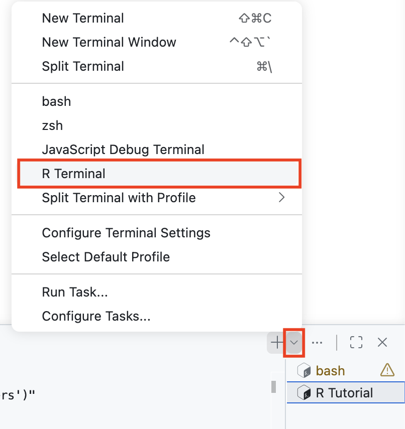
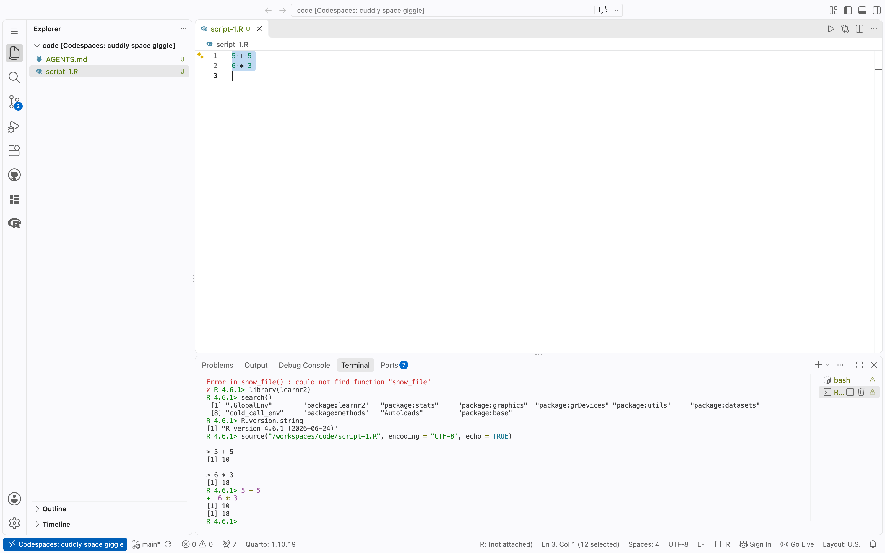
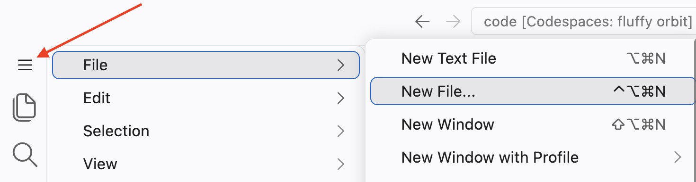
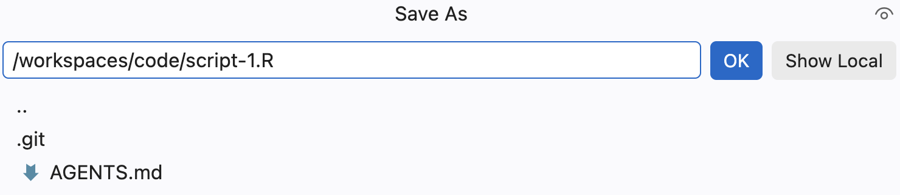
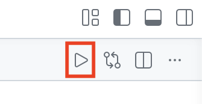
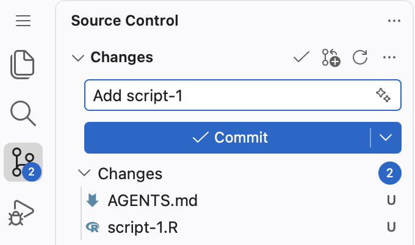



```{r}
#| label: setup
#| include: false
library(tidyverse)
```

## Information

```{r}
#| label: information-1
#| echo: false
learnr2::student_info()
```

## Introduction

This tutorial teaches you how to use [**Codespaces**](https://github.com/features/codespaces) with [**R**](https://www.r-project.org/about.html) scripts. It assumes that you have completed the Orientation and Workflow tutorials.

This tutorial includes some information from [*R for Data Science (2e)*](https://r4ds.hadley.nz/) by Hadley Wickham, Mine Çetinkaya-Rundel, and Garrett Grolemund.

###

You should be doing this tutorial in a repo called `code`. Recall from the Workflow tutorial: a repo is a folder that Git watches, with a copy kept on GitHub. If the Explorer header already says CODE, you are all set. If it says CODESPACE-STARTER (its file list looks empty), the next two exercises will get you connected.

### Exercise 1

Open a new bash Terminal. Run `pwd`. CP/CR.

```{r}
#| label: introduction-1
#| echo: false
learnr2::question(
  "Open a new bash Terminal. Run pwd. CP/CR.",
  type = "reflection",
  show_text = FALSE
)
```

###

You will see one of two answers. Either you are already in your repo:

```{.output}
code $ pwd
/workspaces/code
code $
```

or you are still in the course's folder:

```{.output}
codespace-starter $ pwd
/workspaces/codespace-starter
codespace-starter $
```

###

If your result ends in `code`, **do not run the connect-repo command in the next exercise**. Just do its last step. If it ends in `codespace-starter`, the next exercise connects you.

### Exercise 2

**Skip this paragraph --- do not run this command --- if `pwd` showed `/workspaces/code`.** Otherwise, run:

```bash
connect-repo code
```

If a sign-in message appears, follow it as you did in the Workflow tutorial: press Enter at the `Authenticate Git with your GitHub credentials?` prompt, copy the one-time code, press Enter again, and paste the code into the GitHub tab that opens. (If you signed in during the Workflow tutorial, you probably will not be asked.) The command finishes with a line like `✅  Connected: /workspaces/code  →  https://github.com/your-username/code`, and the prompt becomes `code $`.

Then one of two things happens. Usually the VS Code window switches to the new folder by itself: VS Code asks "Do you trust the authors of the files in this folder?" --- click **Trust Folder & Continue** --- your old terminals disappear from the Panel, and a fresh bash terminal opens already at `code $`. (The `✅  Connected:` line vanishes with the old terminal.) If the window does not switch and the Explorer still shows `codespace-starter`, use `File -> Open Folder...`, type `/workspaces/code`, press **OK**, and then click **Trust Folder & Continue**. Either way, this tutorial keeps running in your browser tab. If it ever stops responding, reload the tab. If that does not help, restart it the same way you started it: click **R Tutorials** in the Activity Bar, find this tutorial under **vscode.tutorials**, and click the arrow to launch it. All of your saved answers will still be there.

**Everyone**: open a new bash Terminal (or use the fresh one that appeared after the switch) and run `pwd`. CP/CR.

```{r}
#| label: introduction-2
#| echo: false
learnr2::question(
  "Everyone: open a new bash Terminal (or use the fresh one that appeared after the switch) and run pwd. CP/CR.",
  type = "reflection",
  show_text = FALSE
)
```

###

```{.output}
code $ pwd
/workspaces/code
code $
```

Stop and fix the open folder if your result still ends in `codespace-starter`. All work in this tutorial belongs in `/workspaces/code`.

###

Your repo lives in two places: this folder and `github.com`. `connect-repo` created (or found) both. The `codespace-starter` folder still sits beside yours at `/workspaces/codespace-starter` --- it belongs to the course.

###

The terminal that started this tutorial is "busy" running it. Its tab, on the right side of the Panel, is labeled **R Tutorial**. (If `connect-repo` switched your window, that tab is gone from the Panel, but the tutorial keeps running. Either way, you cannot type R commands there.)

To run R commands while the tutorial is open, open a second R Terminal. Click the small down arrow in the top right of the Panel, next to the `+` button. From the drop-down menu, select **R Terminal**.

{width=90%}

You can switch between terminals by clicking their tabs on the right side of the Panel, such as **bash** or **R Tutorial**, to bring a different terminal into view. (The tab for the R Terminal you just opened is labeled **R Interactive**.)

## Packages

Most R functions live in packages. A package must be loaded before its functions can be used.

### Exercise 1

At the R Terminal, type `show_file()`. CP/CR.

```{r}
#| label: packages-1
#| echo: false
learnr2::question(
  "At the R Terminal, type show_file(). CP/CR.",
  type = "reflection",
  show_text = FALSE
)
```

###

```{.output}
R 4.6.1> show_file()
Error in show_file() : could not find function "show_file"
```

###

From now on, the output shown directly after a question is our answer to it.

The error occurs because we have not yet loaded the **learnr2** package, where `show_file()` lives. If we had specified the package as part of the function call, as with `learnr2::show_file()`, R would have found the function.

### Exercise 2

Load the **learnr2** package into your R Terminal using the `library()` function.

Run `search()` in the R Terminal to see the libraries that you have currently loaded.

CP/CR.

```{r}
#| label: packages-2
#| echo: false
learnr2::question(
  "Run search() in the R Terminal to see the libraries that you have currently loaded. CP/CR.",
  type = "reflection",
  show_text = FALSE
)
```

###

```{.output}
R 4.6.1> library(learnr2)
R 4.6.1> search()
 [1] ".GlobalEnv"        "package:learnr2"   "package:stats"    
 [4] "package:graphics"  "package:grDevices" "package:utils"    
 [7] "package:datasets"  "cold_call_env"     "package:methods"  
[10] "Autoloads"         "package:base"     
R 4.6.1> 
```

The string "package:learnr2" should be in the output. The rest of your list may differ from ours, here and in later questions.

### Exercise 3

At the R Terminal, run:

```r
show_file(file.path(R.home(), "COPYING"), end = 7)
```

```{r}
#| label: packages-3
#| echo: false
learnr2::question(
  "At the R Terminal, run show_file(file.path(R.home(), \"COPYING\"), end = 7). CP/CR.",
  type = "reflection",
  show_text = FALSE
)
```

###

```{.output}
                    GNU GENERAL PUBLIC LICENSE
                       Version 2, June 1991

 Copyright (C) 1989, 1991 Free Software Foundation, Inc.
                       51 Franklin St, Fifth Floor, Boston, MA  02110-1301  USA
 Everyone is permitted to copy and distribute verbatim copies
 of this license document, but changing it is not allowed.
```

###

This command would have failed if we had not loaded the **learnr2** package already.

### Exercise 4

To restart R, close the current R Terminal: hover over the **R Interactive** tab on the right side of the Panel and click its trash icon. Then, open a new R Terminal.

{width=90%}

Run the `show_file()` command from the previous exercise again. (Press the up arrow in the R Terminal to bring back a command you ran earlier.) CP/CR.

```{r}
#| label: packages-4
#| echo: false
learnr2::question(
  "Run the show_file() command from the previous exercise again. (Press the up arrow in the R Terminal to bring back a command you ran earlier.) CP/CR.",
  type = "reflection",
  show_text = FALSE
)
```

###

```{.output}
R 4.6.1> show_file(file.path(R.home(), "COPYING"), end = 7)
Error in show_file(file.path(R.home(), "COPYING"), end = 7) :
  could not find function "show_file"
```

###

The command that worked a minute ago now fails. Restarting R gives you a "clean slate," with nothing but the default packages loaded.

### Exercise 5

In the R Terminal, run `library(learnr2)` again. CP/CR.

```{r}
#| label: packages-5
#| echo: false
learnr2::question(
  "In the R Terminal, run library(learnr2) again. CP/CR.",
  type = "reflection",
  show_text = FALSE
)
```

###

```{.output}
R 4.6.1> library(learnr2)
R 4.6.1>
```

Loading some packages prints a bunch of messages to the R Terminal. But most packages, like **learnr2**, print nothing.

### Exercise 6

Load the **tidyverse** package into your R Terminal using the `library()` function.

CP/CR.

```{r}
#| label: packages-6
#| echo: false
learnr2::question(
  "Load the tidyverse package into your R Terminal using the library() function. CP/CR.",
  type = "reflection",
  show_text = FALSE
)
```

###

```{.output}
R 4.6.1> library(tidyverse)
── Attaching core tidyverse packages ──────────────────────── tidyverse 2.0.0 ──
✔ dplyr     1.2.1     ✔ readr     2.2.0
✔ forcats   1.0.1     ✔ stringr   1.6.0
✔ ggplot2   4.0.3     ✔ tibble    3.3.1
✔ lubridate 1.9.5     ✔ tidyr     1.3.2
✔ purrr     1.2.2     
── Conflicts ────────────────────────────────────────── tidyverse_conflicts() ──
✖ dplyr::filter() masks stats::filter()
✖ dplyr::lag()    masks stats::lag()
ℹ Use the conflicted package (<http://conflicted.r-lib.org/>) to force all conflicts to become errors
R 4.6.1> 
```

The Conflicts section names functions that exist in more than one package. The last-loaded package wins, so `filter()` now means `dplyr::filter()`.

## Script 1

It is difficult to type more than a few lines of code into the R Terminal at once. One solution is to use [R scripts](https://r4ds.hadley.nz/workflow-scripts.html#scripts), files that contain a permanent copy of our code.

### Exercise 1

Create a new R script, as you learned in the Workflow tutorial: `File -> New File ...` from the Application Menu (see red arrow).

{width=90%}

Select `R Document`. 

Type two lines into the file: `5 + 5` on the first, `6 * 3` on the second. Save it as `script-1.R`, inside the `code` repo. 


{width=90%}

The file name must end in `.R` or `.r`.

The folder VS Code suggests in the save dialog is not always the right one. Check that it is `/workspaces/code`.

###

In the bash Terminal, run:

```bash
cat script-1.R
```

CP/CR.

```{r}
#| label: script-1-1
#| echo: false
learnr2::question(
  "Create a new R script, as you learned in the Workflow tutorial: File -> New File ... from the Application Menu, then select R Document. Type two lines into the file: 5 + 5 on the first, 6 * 3 on the second. Save it as script-1.R, inside the code repo. The file name must end in .R or .r. The folder VS Code suggests in the save dialog is not always the right one; check that it is /workspaces/code. In the bash Terminal, run cat script-1.R. CP/CR.",
  type = "reflection",
  show_text = FALSE
)
```

###

```{.output}
code $ cat script-1.R
5 + 5
6 * 3
code $
```

###

If your output instead ends like this:

```{.output}
6 * 3code $
```

with the prompt glued onto your last line of code, your file is missing a final newline. End every text file with a blank line.

### Exercise 2

Press the **Run Source** button in the top-right corner of the Editor. (We will often shorten "press the Run Source button" to "source the script.")

{width=90%}

CP/CR.

```{r}
#| label: script-1-2
#| echo: false
learnr2::question(
  "Press the Run Source button in the top-right corner of the Editor. (We will often shorten \"press the Run Source button\" to \"source the script.\") CP/CR.",
  type = "reflection",
  show_text = FALSE
)
```

###

```{.output}
R 4.6.1> source("/workspaces/code/script-1.R", encoding = "UTF-8", echo = TRUE)

> 5 + 5
[1] 10

> 6 * 3
[1] 18
R 4.6.1>
```

###

Sourcing sends every line of the file to the R Terminal. Without the `echo = TRUE` argument, the code runs silently and you see only the results. With `echo = TRUE`, you see both the code and its results, exactly as if you had typed each line into the R Terminal yourself.

### Exercise 3

Source `script-1.R` again, this time with the keyboard shortcut `Cmd/Ctrl + Shift + S`. CP/CR.

```{r}
#| label: script-1-7
#| echo: false
learnr2::question(
  "Source script-1.R again, this time with the keyboard shortcut Cmd/Ctrl + Shift + S. CP/CR.",
  type = "reflection",
  show_text = FALSE
)
```

###

```{.output}
R 4.6.1> source("/workspaces/code/script-1.R", encoding = "UTF-8", echo = TRUE)

> 5 + 5
[1] 10

> 6 * 3
[1] 18
R 4.6.1>
```

###

The shortcut and the button run the same `source()` command, as the first line of the output shows. Keyboard shortcuts are quicker than clicking buttons.

### Exercise 4

Instead of sourcing the entire file, we can execute (or "run") just part of it. In `script-1.R`, place your cursor on the same line as `6 * 3` and press `Cmd/Ctrl + Enter`. Then highlight both lines and press `Cmd/Ctrl + Enter` again. CP/CR.

```{r}
#| label: script-1-3
#| echo: false
learnr2::question(
  "Instead of sourcing the entire file, we can execute (or \"run\") just part of it. In script-1.R, place your cursor on the same line as 6 * 3 and press Cmd/Ctrl + Enter. Then highlight both lines and press Cmd/Ctrl + Enter again. CP/CR.",
  type = "reflection",
  show_text = FALSE
)
```

###

```{.output}
R 4.6.1> 6 * 3
[1] 18
R 4.6.1> 5 + 5
+  6 * 3
[1] 10
[1] 18
R 4.6.1>
```

###

**Run is not the same thing as Source.** With Run, you are just copying and pasting some of the lines from the script to the R Terminal. With Source, you are copying and pasting *all* the lines. `Cmd/Ctrl + Enter` is "smart" in two ways. First, if you highlight more than one line of code, it will execute all the code in that area. Second, even if nothing is highlighted, if the line with the cursor is part of a block of code that extends over multiple lines --- like creating a plot --- it will execute all the code in that block.

### Exercise 5

Go back to the first line in your R script. Change `5 + 5` to `x <- 5 + 5`, thereby creating an object named `x` with a value of 10. Save the file. Source the file, either by pressing the **Run Source** button or with `Cmd/Ctrl + Shift + S`. CP/CR.

```{r}
#| label: script-1-4
#| echo: false
learnr2::question(
  "Go back to the first line in your R script. Change 5 + 5 to x <- 5 + 5, thereby creating an object named x with a value of 10. Save the file. Source the file, either by pressing the Run Source button or with Cmd/Ctrl + Shift + S. CP/CR.",
  type = "reflection",
  show_text = FALSE
)
```

###

```{.output}
R 4.6.1> source("/workspaces/code/script-1.R", encoding = "UTF-8", echo = TRUE)

> x <- 5 + 5

> 6 * 3
[1] 18
R 4.6.1> 
```

###

`x <- 5 + 5` is echoed, but nothing is printed. The assignment operator, `<-`, returns its value invisibly.

### Exercise 6

In the R Terminal, run `ls()`. CP/CR.

```{r}
#| label: script-1-5
#| echo: false
learnr2::question(
  "In the R Terminal, run ls(). CP/CR.",
  type = "reflection",
  show_text = FALSE
)
```

###

```{.output}
R 4.6.1> ls()
[1] "x"
R 4.6.1> 
```

###

`ls()` lists the objects in your environment. Sourcing the script created `x`.

### Exercise 7

In the R Terminal, type `x` and press `Enter`. CP/CR.

```{r}
#| label: script-1-8
#| echo: false
learnr2::question(
  "In the R Terminal, type x and press Enter. CP/CR.",
  type = "reflection",
  show_text = FALSE
)
```

###

```{.output}
R 4.6.1> x
[1] 10
R 4.6.1>
```

###

Typing an object's name at the R Terminal prints its value.

### Exercise 8

`script-1.R` exists only in this Codespace. Recall from the Workflow tutorial: a **commit** is a snapshot of your work, and a **push** copies that snapshot to GitHub. Let's do both. Click on the Source Control icon in the Activity Bar. You should see `script-1.R` (and `AGENTS.md`) listed under **Changes**. Type a commit message, such as "Add script-1", and click to commit. 

{width=90%}

Click "Publish Branch" to copy your commit to GitHub. In general only the first "push" to a repo is labelled "Publish Branch." Subsequent pushes are labelled "Sync Changes" or "Push."

Your script now exists in two places: this Codespace and GitHub. Professionals keep their work in the cloud because laptops --- and Codespaces --- fail.

### 

From the bash Terminal, run `git log`. 

CP/CR.

```{r}
#| label: script-1-6
#| echo: false
learnr2::question(
  "From the bash Terminal, run git log. CP/CR.",
  type = "reflection",
  show_text = FALSE
)
```

###

```{.output}
code $ git log
commit 0f0eed547148739b625ec8e3c4db91ac076d96e5 (HEAD -> main, origin/main)
Author: Your Name <your-username@users.noreply.github.com>
Date:   Thu Aug 13 14:40:51 2026 +0000

    Add script-1
code $
```

## Script 2

Let's create a plot like this one:

```{r}
#| label: diamond-hist
#| echo: false
hist_p <- ggplot(data = diamonds,
                 mapping = aes(x = carat)) +
  geom_histogram(bins = 100,
                 color = "white") +
  scale_y_continuous(labels = scales::comma_format()) +
  labs(title = "Histogram of Carat (Weight) among 50,000 Diamonds",
       subtitle = "Carats just at or above meaningful numbers are very common",
       x = "Carat",
       y = "Number",
       caption = "diamonds dataset from ggplot2 package")

hist_p
```

### Exercise 1

Click `File -> New File ... -> R Document`. At the top of the Editor, the file will be called *`Untitled-1`* (or something similar) by default.

###

Use the shortcut `Cmd/Ctrl + S` to save the script. Let's call this file `script-2.R`. The `.R` suffix is not always added automatically. Make sure it is there.

In the bash Terminal, run `ls`. CP/CR.

```{r}
#| label: script-2-1
#| echo: false
learnr2::question(
  "In the bash Terminal, run ls. CP/CR.",
  type = "reflection",
  show_text = FALSE
)
```

###

```{.output}
code $ ls
AGENTS.md  script-1.R  script-2.R
code $
```

Both scripts sit in the repo folder, next to `AGENTS.md`. Restart R frequently to check that your scripts contain everything they need.

### Exercise 2

Restart your R session: hover over the **R Interactive** tab on the right side of the Panel, click its trash icon, and then open a new R Terminal.

From the bash Terminal, run `ls`. CP/CR.

```{r}
#| label: script-2-2
#| echo: false
learnr2::question(
  "From the bash Terminal, run ls. CP/CR.",
  type = "reflection",
  show_text = FALSE
)
```

###

```{.output}
code $ ls
AGENTS.md  script-1.R  script-2.R
code $
```

The three files are still there. Saved files survive a restart of R, or of the whole Codespace.

### Exercise 3

From the R Terminal, run `ls()`. CP/CR.

```{r}
#| label: script-2-3
#| echo: false
learnr2::question(
  "From the R Terminal, run ls(). CP/CR.",
  type = "reflection",
  show_text = FALSE
)
```

###

```{.output}
R 4.6.1> ls()
character(0)
R 4.6.1>
```

Do not confuse R's `ls()` with the bash `ls` you just ran: same name, different worlds. Bash's `ls` lists files on disk. R's `ls()` lists objects in R's memory.

`x` is gone! The environment --- the place in the computer where R creates and uses objects --- is cleaned, by default, each time R restarts. That is what makes work "reproducible": it starts from nothing except code and raw data.

You first saw this in Orientation, when the `x` created by Copilot's `Rscript` never appeared in your open R session. Every R process has its own environment, and a restarted R Terminal is a new process.

### Exercise 4

At the top of `script-2.R`, type

```r
library(tidyverse)
```

For a moment, you will see, in the top bar of the Editor, that the file name `script-2.R` has a black dot next to it. The dot means the file has unsaved changes. It disappears on its own because the Codespace auto-saves after a short delay.

###

Run the entire file with `Cmd/Ctrl + Shift + S`. The "Attaching core tidyverse packages" message, with its list of packages and conflicts, appears in the R Terminal.

###

Run `search()` in the R Terminal. CP/CR.

```{r}
#| label: script-2-4
#| echo: false
learnr2::question(
  "Run search() in the R Terminal. CP/CR.",
  type = "reflection",
  show_text = FALSE
)
```

###

`search()` lists the loaded packages. The string `package:tidyverse` should be among them.

### Exercise 5

Skip a line and add a comment to the file: a one-sentence description of one of your recent meals, preceded by a hash (`#`). For example:

```r
# Had an OK filet mignon at Cheesecake Factory.
```

Save the file.

In the bash Terminal, run:

```bash
cat script-2.R
```

CP/CR.


```{r}
#| label: script-2-5
#| echo: false
learnr2::question(
  "Skip a line and add a comment to the file: a one-sentence description of one of your recent meals, preceded by a hash (#). For example: # Had an OK filet mignon at Cheesecake Factory. Save the file. In the bash Terminal, run cat script-2.R. CP/CR.",
  type = "reflection",
  show_text = FALSE
)
```

###

```{.output}
library(tidyverse)

# Had an OK filet mignon at Cheesecake Factory.
```

###

If the `code $` prompt appeared glued to the end of your last line, the file is missing its final blank line again.

###

Comments begin with a hash (also known as a "pound sign"): `#`. R will ignore everything on the line to the right of the hash. When reading code, you should be able to answer three questions about every line: **what** is it doing, **how** is it doing it, and **why** is it being done. The what and the how can be deduced from the code itself. The why cannot --- use comments for that, and keep them up-to-date when the code changes.

```r
# This is an example of a poor comment:
x <- x + 1    # Increment x

# This is an example of a good comment:
x <- x + 1    # Account for borders
```

### Exercise 6

Commit `script-2.R`. As before: click the Source Control icon, check that `script-2.R` is listed under **Changes**, type `Add script-2` as the commit message, press **Commit**, then press **Sync Changes**.

In the bash Terminal, run `git log -1`. CP/CR.

```{r}
#| label: script-2-6
#| echo: false
learnr2::question(
  "In the bash Terminal, run git log -1. CP/CR.",
  type = "reflection",
  show_text = FALSE
)
```

###

```{.output}
code $ git log -1
commit 8c41f7b2a9e05d3c6f1b8e2d4a7c9f0e1b3d5a68 (HEAD -> main, origin/main)
Author: Your Name <your-username@users.noreply.github.com>
Date:   Fri Aug 14 15:03:41 2026 +0000

    Add script-2
code $
```

###

Commit whenever a piece of work reaches a state worth keeping --- a script that runs, a document that renders. Small, frequent commits make your history easy to read and your work hard to lose.

### Exercise 7

In the Workflow tutorial, you asked AI for any nice plot. This time, match this exact one, and run the code yourself, line by line.

```{r}
#| label: script-2-7-plot
#| echo: false
hist_p
```

Skip a line after your comment. Ask AI to recreate this chart in `script-2.R` --- describe it in words, or show AI the image itself. Advice you should feel free to give to the AI:

* The `title` should mention the key variables, the subjects of the plot.

* The `subtitle` should provide the key takeaway, the one sentence that you want viewers to remember.

* The `caption` should mention the data source.

Run the script interactively, line by line, using `Cmd/Ctrl + Enter`. If there are problems, show AI the errors and let it fix them. It will probably take a few iterations to get something close.

In the bash Terminal, run:

```bash
cat script-2.R
```

CP/CR.

```{r}
#| label: script-2-7
#| echo: false
learnr2::question(
  "In the Workflow tutorial, you asked AI for any nice plot. This time, match the exact one shown (a histogram of carat, the weight, among the 50,000 diamonds in the diamonds dataset), and run the code yourself, line by line. Skip a line after your comment. Ask AI to recreate this chart in script-2.R, describing it in words or showing AI the image itself. Advice you should feel free to give to the AI: the title should mention the key variables, the subjects of the plot; the subtitle should provide the key takeaway, the one sentence that you want viewers to remember; the caption should mention the data source. Run the script interactively, line by line, using Cmd/Ctrl + Enter. If there are problems, show AI the errors and let it fix them. It will probably take a few iterations to get something close. In the bash Terminal, run cat script-2.R. CP/CR.",
  type = "reflection",
  show_text = FALSE
)
```

###

```{.output}
library(tidyverse)

# Had an OK filet mignon at Cheesecake Factory.
ggplot(data = diamonds,
       mapping = aes(x = carat)) +
  geom_histogram(bins = 100,
                 color = "white") +
  scale_y_continuous(labels = scales::comma_format()) +
  labs(title = "Histogram of Carat (Weight) among 50,000 Diamonds",
       subtitle = "Carats just at or above meaningful numbers are very common",
       x = "Carat",
       y = "Count",
       caption = "diamonds dataset from ggplot2 package")
```

###

Your AI's code will differ from ours. What matters is the plot. The `subtitle` is the most important part of any graphic. People are busy and will not study your plot closely. The subtitle hands them the one fact you want them to remember.

### Exercise 8

Right now, the plot exists only while `script-2.R` runs. `ggsave()` saves it to a file. Type `?ggsave` in the R Terminal. This will open the help page for `ggsave()` in a new tab. Take a screenshot of the **Description** section of the help page and paste it below. To take a screenshot, press `Cmd + Ctrl + Shift + 4` on a Mac, `Win + Shift + S` on Windows, or `Ctrl + Shift + Show windows` on a Chromebook, select the area, then click in the answer box and press `Cmd + V` (Mac) or `Ctrl + V` (Windows) to paste it.

```{r}
#| label: script-2-8
#| echo: false
learnr2::question(
  "Right now, the plot exists only while script-2.R runs. ggsave() saves it to a file. Type ?ggsave in the R Terminal. This will open the help page for ggsave() in a new tab. Take a screenshot of the Description section of the help page and paste it below.",
  type = "reflection",
  allow_image = TRUE,
  allow_text = FALSE,
  show_text = FALSE
)
```

###

Your screenshot should show the paragraph beginning "`ggsave()` is a convenient function for saving a plot. It defaults to saving the last plot that you displayed, using the size of the current graphics device."

`ggsave()` writes a plot to a file, separate from the code that created it. We will use the PNG format.

### Exercise 9

Tell AI to save your plot as an image file: assign the plot to an object named `hist_p`, and then use `ggsave()`, setting `plot` to `hist_p` and `file` to `"diamonds.png"`. Run the script.

In the bash Terminal, run `ls`. CP/CR.

```{r}
#| label: script-2-9
#| echo: false
learnr2::question(
  "In the bash Terminal, run ls. CP/CR.",
  type = "reflection",
  show_text = FALSE
)
```

###

```{.output}
code $ ls
AGENTS.md  diamonds.png  script-1.R  script-2.R
code $
```

###

Click `diamonds.png` in the Explorer to open it in the Editor. If the title text flows out of the image, tell AI the image looks cramped and let it adjust the `ggsave()` sizing arguments, like `scale`.

## Summary

This tutorial taught you how to use [**Codespaces**](https://github.com/features/codespaces) with [**R**](https://www.r-project.org/about.html) scripts. It included some information from [*R for Data Science (2e)*](https://r4ds.hadley.nz/) by Hadley Wickham, Mine Çetinkaya-Rundel, and Garrett Grolemund.

### Exercise 1

You have made more files since your last commit --- the plot code in `script-2.R` and `diamonds.png`. Commit and push. Use the commit message `Finish code tutorial`.

Then, in the bash Terminal, run `git log -1`. CP/CR.

```{r}
#| label: summary-1
#| echo: false
learnr2::question(
  "Then, in the bash Terminal, run git log -1. CP/CR.",
  type = "reflection",
  show_text = FALSE
)
```

###

```{.output}
code $ git log -1
commit 5d6e7f8a1b2c3d4e5f6a7b8c9d0e1f2a3b4c5d6e (HEAD -> main, origin/main)
Author: Your Name <your-username@users.noreply.github.com>
Date:   Fri Aug 14 15:41:22 2026 +0000

    Finish code tutorial
code $
```

###

Behind the Source Control buttons are Git commands. When an AI commits and pushes for you, it runs those commands rather than clicking anything.

### Exercise 2

In your browser, go to your `code` repository on github.com, as you learned in the Workflow tutorial. Confirm that `script-1.R`, `script-2.R`, and `diamonds.png` are all listed. Copy/paste the URL of your repository.

```{r}
#| label: summary-2
#| echo: false
learnr2::question(
  "In your browser, go to your code repository on github.com, as you learned in the Workflow tutorial. Confirm that script-1.R, script-2.R, and diamonds.png are all listed. Copy/paste the URL of your repository.",
  type = "reflection",
  show_text = FALSE
)
```

###

```{.output}
https://github.com/your-username/code
```

###

This URL outlives the Codespace. The Commits link near the top of the file listing shows every commit you made in this tutorial.

## Download answers

```{r}
#| label: download-answers-1
#| echo: false
learnr2::question(
  "How many minutes, approximately, did it take you to complete this
  tutorial? For example, an hour and a half would be 90 minutes.",
  type = "reflection_editable",
  validate = "integer"
)
```

###

```{r}
#| label: download-answers-2
#| echo: false
learnr2::download_answers_button(filename_prefix = "code")
```
