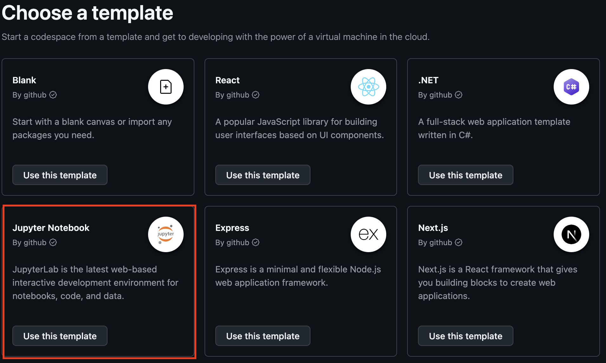
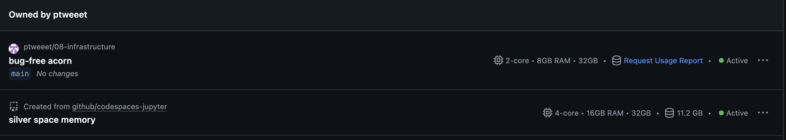
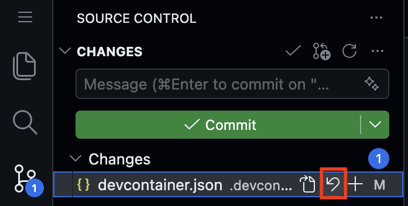
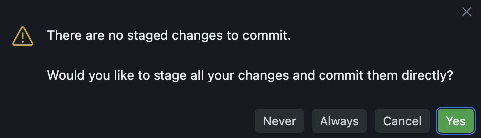
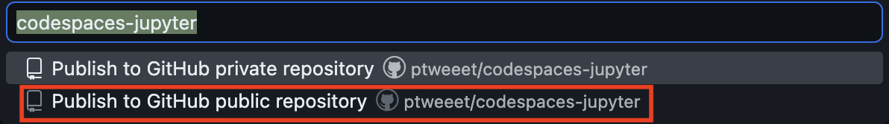
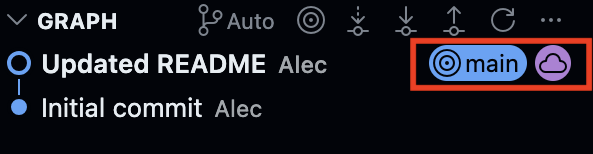



## Information

```{r}
#| label: information-1
#| echo: false
learnr2::student_info()
```

## Introduction

This tutorial explores devcontainers --- configuration files that define how a GitHub Codespace is set up. You will examine a `devcontainer.json` file to understand how it specifies the starting image, installed packages, VS Code extensions, and startup commands that make a Codespace ready to use. You will also compare two different Codespace configurations side by side.

### Exercise 1

You should be doing this tutorial in a repo named `devcontainers`. If you are not, create one and then connect to it.

Copy and paste the URL for your `devcontainers` repository.

```{r}
#| label: introduction-1
#| echo: false
learnr2::question(
  "Copy and paste the URL for your devcontainers repository.",
  type = "reflection",
  show_text = FALSE
)
```

###

```{.output}
https://github.com/ppbds-student/devcontainers
```

###

The [`codespace-starter`](https://github.com/PPBDS/codespace-starter) repo you have been using includes a `.devcontainer/devcontainer.json` file that tells GitHub exactly what to install in any new codespace. This is what ensures everyone who opens a codespace from the same repo gets the same tools, extensions, and settings.

### Exercise 2

Copy and paste the URL for your Codespace.

```{r}
#| label: introduction-2
#| echo: false
learnr2::question(
  "Copy and paste the URL for your Codespace.",
  type = "reflection",
  show_text = FALSE
)
```

###

```{.output}
https://congenial-chainsaw-wv757pv4pp67cpw.github.dev/
```

###

Every codespace runs on a remote computer provided by GitHub. The URL you just pasted is a unique address for your specific machine in the cloud --- a different person opening a Codespace from the same repo will get a different URL, but the same setup.

### Exercise 3

At the bash Terminal, run `pwd`, then `ls -a`. CP/CR.

```{r}
#| label: introduction-3
#| echo: false
learnr2::question(
  "At the bash Terminal, run pwd, then ls -a. CP/CR.",
  type = "reflection",
  show_text = FALSE
)
```

###


```{.output}
devcontainers $ pwd
/workspaces/devcontainers
devcontainers $ ls -a
.  ..  .git
devcontainers $
```

###

Your `devcontainers` repo starts almost empty. The `.git` directory shows it is tracked by Git, but there is nothing else here yet. In particular, there is no `.devcontainer` directory, even though this Codespace clearly has one configured.

### Exercise 4

In the bash Terminal, run `cd ../codespace-starter`, then run `pwd`. CP/CR.

```{r}
#| label: introduction-4
#| echo: false
learnr2::question(
  "In the bash Terminal, run cd ../codespace-starter, then run pwd. CP/CR.",
  type = "reflection",
  show_text = FALSE
)
```

###

Your output should look like:

```{.output}
devcontainers $ cd ../codespace-starter
codespace-starter $ pwd
/workspaces/codespace-starter
codespace-starter $
```

###

Both repos live side by side under `/workspaces`: your own `devcontainers` and the `codespace-starter` you launched from. The `..` in `cd ../codespace-starter` means "the parent directory," so the command moves up to `/workspaces`, then down into `codespace-starter`. The `devcontainer.json` that configured this machine lives here, not in your work repo. The prompt changed from `devcontainers $` to `codespace-starter $` because it always shows the name of the directory you are in.

### Exercise 5

In the bash Terminal, run `cat .devcontainer/devcontainer.json`. CP/CR.

```{r}
#| label: introduction-5
#| echo: false
learnr2::question(
  "In the bash Terminal, run cat .devcontainer/devcontainer.json. CP/CR.",
  type = "reflection",
  show_text = FALSE
)
```

###

This is the file GitHub read when it built the Codespace you are sitting in. Keep this Codespace open. You will need it alongside a second Codespace in the next section.

## Jupyter Notebook Devcontainer

A `devcontainer.json` file captures the entire setup --- starting image, packages, extensions, and startup commands --- so that any codespace opened from the repo starts in an identical, ready-to-use state. In this section you will examine the devcontainer for GitHub's Jupyter Notebook template, which sets up a codespace for doing data science with Python and Jupyter Notebooks.

### Exercise 1

Go to https://github.com/codespaces/templates. Then press the "Use This Template" button for the Jupyter Notebook template. This will open a new Codespace using this template. Copy and paste its URL.

{width=90%}

```{r}
#| label: devcontainers-1
#| echo: false
learnr2::question(
  "Go to https://github.com/codespaces/templates. Then press the \"Use This Template\" button for the Jupyter Notebook template. This will open a new Codespace using this template. Copy and paste its URL.",
  type = "reflection",
  show_text = FALSE
)
```

###

```{.output}
https://silver-space-adventure-97xrvw59xhx.github.dev/
```

###

The Jupyter Notebook template is a pre-built Codespace for Python data science using Jupyter notebooks --- similar to how `codespace-starter` is set up for R, Quarto, and running tutorials.

### Exercise 2

You should have two Codespaces open. Go to https://github.com/codespaces. Then paste a screenshot of the two table rows corresponding to your open Codespaces. To take a screenshot, press `Cmd + Ctrl + Shift + 4` on a Mac, `Win + Shift + S` on Windows, or `Ctrl + Shift + Show windows` on a Chromebook, select the area, then click in the answer box and press `Cmd + V` (Mac) or `Ctrl + V` (Windows) to paste it.

{width=90%}

```{r}
#| label: devcontainers-2
#| echo: false
learnr2::question(
  "You should have two Codespaces open. Go to https://github.com/codespaces. Then paste a screenshot of the two table rows corresponding to your open Codespaces.",
  type = "reflection",
  allow_image = TRUE,
  allow_text = FALSE,
  show_text = FALSE
)
```

###

```{.output}
devcontainers      ppbds-student/devcontainers       main    Active
codespaces-jupyter    ppbds-student/codespaces-jupyter     main    Active
```

###

The `github.com/codespaces` page is where you manage all your active Codespaces. Each one uses hours and storage from your GitHub monthly limit, so stop or delete ones you're not using.

### Exercise 3

In this new Jupyter Notebook codespace, select the `devcontainer.json` file within the `.devcontainer` directory in the Explorer. Find the line beginning with "image", copy and paste.

```{r}
#| label: devcontainers-3
#| echo: false
learnr2::question(
  "In this new Jupyter Notebook codespace, select the devcontainer.json file within the .devcontainer directory in the Explorer. Find the line beginning with \"image\", copy and paste.",
  type = "reflection",
  show_text = FALSE
)
```

###

```{.output}
"image": "mcr.microsoft.com/devcontainers/universal:2",
```

###

The `image` field tells GitHub which pre-built setup to use --- think of it as choosing a computer that already has certain software installed. `mcr.microsoft.com/devcontainers/universal:2` is Microsoft's general-purpose setup with Python and several other programming languages pre-installed.

### Exercise 4

In the same file, find the chunk of code beginning with `"vscode": {`. Copy and paste this chunk, ending with the bracket that closes the one on the first line.


```{r}
#| label: devcontainers-4
#| echo: false
learnr2::question(
  "In the same file, find the chunk of code beginning with \"vscode\": {. Copy and paste this chunk, ending with the bracket that closes the one on the first line.",
  type = "reflection",
  show_text = FALSE
)
```

###

```{.output}
"vscode": {
      "extensions": [
        "ms-toolsai.jupyter",
        "ms-python.python"
      ]
    }
```

###

This block lists which VS Code extensions to pre-install. `ms-toolsai.jupyter` enables Jupyter notebooks. `ms-python.python` adds Python code completion and error highlighting.

### Exercise 5

Find the line beginning with `"updateContentCommand"` in `devcontainer.json`. Copy and paste it.

```{r}
#| label: devcontainers-5
#| echo: false
learnr2::question(
  "Find the line beginning with \"updateContentCommand\" in devcontainer.json. Copy and paste it.",
  type = "reflection",
  show_text = FALSE
)
```

###

Your answer should look like this:

```{.output}
"updateContentCommand": "python3 -m pip install -r requirements.txt",
```

###

`updateContentCommand` runs when the Codespace is first created and again whenever the repo's files change. `pip` is Python's package installer, and `-r requirements.txt` tells it to install every package listed in that file.

### Exercise 6

Navigate to `requirements.txt` in the Explorer. Copy and paste the entire file.

```{r}
#| label: devcontainers-15
#| echo: false
learnr2::question(
  "Navigate to requirements.txt in the Explorer. Copy and paste the entire file.",
  type = "reflection",
  show_text = FALSE
)
```

###

Your answer should look like this:

```{.output}
ipywidgets==8.1.8
matplotlib==3.8.4
pandas==2.2.2
torch==2.8.0
torchvision==0.23.0
tqdm==4.66.4
pillow>=12.1.1
fonttools>=4.60.0
filelock>=3.20.3
Pygments==2.20.0
```

###

`requirements.txt` lists the Python packages a project needs, one per line, and `==` pins each to an exact version so every Codespace gets the same one. `pandas` and `matplotlib` are the Python equivalents of the tidyverse tools you have been using in R.


### Exercise 7

Tell AI to edit `devcontainer.json` so it installs and configures the environment for using R instead of Python. 

Copy and paste your new `devcontainer.json`.

```{r}
#| label: devcontainers-6
#| echo: false
learnr2::question(
  "Copy and paste your new devcontainer.json.",
  type = "reflection",
  show_text = FALSE
)
```

###

My new file looks like this:

```{.output}
{
  "image": "mcr.microsoft.com/devcontainers/universal:2",
  "hostRequirements": {
    "cpus": 4
  },
  "waitFor": "onCreateCommand",
  "updateContentCommand": "Rscript -e \"if (!requireNamespace('remotes', quietly=TRUE)) install.packages('remotes', repos='https://cloud.r-project.org')\"",
  "postCreateCommand": "",
  "customizations": {
    "codespaces": {
      "openFiles": []
    },
    "vscode": {
        "extensions": [
        "ms-toolsai.jupyter",
        "Ikuyadeu.r"
      ]
    }
  }
}
```

###

Describing what you want in plain English works just as well for configuration files like `devcontainer.json` as it does for analysis code. You can also publish your own repo as a template and reuse it for future projects.

### Exercise 8

Revert the changes to `devcontainer.json`. Go to the Source Control side bar and press the revert button on the right.

{width=90%}

Run `git status` in a bash Terminal. CP/CR.

```{r}
#| label: devcontainers-7
#| echo: false
learnr2::question(
  "Run git status in a bash Terminal. CP/CR.",
  type = "reflection",
  show_text = FALSE
)
```

###

You should see something like this:

```{.output}
@ppbds-student ➜ /workspaces/codespaces-jupyter (main) $ git status
On branch main
nothing to commit, working tree clean
@ppbds-student ➜ /workspaces/codespaces-jupyter (main) $
```

###

Until you commit, changes exist only in your local files and can be discarded at any time. The revert button worked because the change to `devcontainer.json` was never committed. Once a change is committed, undoing it requires a new commit rather than a simple discard.


### Exercise 9


<!-- DK: What is going on here? Can we really commit (and push?!) changes in the Jupyter codespace? How does that work? -->

Replace the first paragraph of `README.md` with:

```default
This is YOUR NAME's new Python Codespace!
```

Save the changes. In the Source Control side bar, write a commit message like "Updated README". Then, press the "Commit Button". A pop-up will appear:

{width=90%}

Press "Yes".

Run `git log --oneline` to view the Git history. CP/CR.

```{r}
#| label: devcontainers-8
#| echo: false
learnr2::question(
  "Run git log --oneline to view the Git history. CP/CR.",
  type = "reflection",
  show_text = FALSE
)
```

###

Your output should look something like this:

```{.output}
@ppbds-student ➜ /workspaces/codespaces-jupyter (main) $ git log --oneline
bf71a79 (HEAD -> main) Updated README
7c6c35a Initial commit
@ppbds-student ➜ /workspaces/codespaces-jupyter (main) $
```

###

This pop-up never appears in a Codespace started from `codespace-starter`, whose `devcontainer.json` enables smart commit, a VS Code setting that stages every changed file when you press Commit. The Jupyter template's `devcontainer.json` does not turn it on, so VS Code asks.

### Exercise 10

Navigate to `.gitignore` in the Explorer. Copy and paste the entire file.

```{r}
#| label: devcontainers-9
#| echo: false
learnr2::question(
  "Navigate to .gitignore in the Explorer. Copy and paste the entire file.",
  type = "reflection",
  show_text = FALSE
)
```

###

```{.output}
notebooks/data
notebooks/cifar_net.pth
.ipynb_checkpoints/
```

###

Each line names files Git should not track, either because they may be very large (`notebooks/data`, `notebooks/cifar_net.pth`) or because they are temporary (`.ipynb_checkpoints/`).

### Exercise 11

Navigate to the `data` directory and open `atlantis.csv`. Paste the top 5 lines.

```{r}
#| label: devcontainers-10
#| echo: false
learnr2::question(
  "Navigate to the data directory and open atlantis.csv. Paste the top 5 lines.",
  type = "reflection",
  show_text = FALSE
)
```

###

```{.output}
year,population
2000,12400
2001,12800
2002,13800
2003,13600
```

###

CSV (comma-separated values) is a plain-text format where each row is a record and each column is separated by a comma --- `atlantis.csv` contains simulated year-by-year population data for a fictional city.

### Exercise 12

In the Explorer, navigate to the `notebooks` directory, then `populations.ipynb`. Double click the heading of the document to open the editor for that section. Take a screenshot of that first cell, with its text open for editing, and paste it below.

```{r}
#| label: devcontainers-11
#| echo: false
learnr2::question(
  "In the Explorer, navigate to the notebooks directory, then populations.ipynb. Double click the heading of the document to open the editor for that section. Take a screenshot of that first cell, with its text open for editing, and paste it below.",
  type = "reflection",
  allow_image = TRUE,
  allow_text = FALSE,
  show_text = FALSE
)
```

###

The text in your screenshot should be:

```{.output}
# Population Data from CSV

This notebooks reads sample population data from `data/atlantis.csv` and plots it using Matplotlib. Edit `data/atlantis.csv` and re-run this cell to see how the plots change!
```

###

A `.ipynb` file is a Jupyter notebook --- like a Quarto document, it mixes text, code, and output in runnable cells. `populations.ipynb` reads population data from `atlantis.csv` and plots it with **matplotlib**.

### Exercise 13

Go to the Source Control side bar and press the "Publish Branch" button.

You may be asked to sign into GitHub. If so, select "Allow" then your GitHub account. This happens because we created this Codespace directly from a template. We have a local Git repository in the Codespace, but do not yet have a Git Repository on GitHub. Press the "Publish Branch" button again.

Now you can name the GitHub repository and then select if you'd like to make it private or public. Name it `codespaces-jupyter` and choose public.

{width=90%}

Run `git log --oneline`. CP/CR.


```{r}
#| label: devcontainers-12
#| echo: false
learnr2::question(
  "Run git log --oneline. CP/CR.",
  type = "reflection",
  show_text = FALSE
)
```

###

```{.output}
@ppbds-student ➜ /workspaces/codespaces-jupyter (main) $ git log --oneline
bf71a79 (HEAD -> main, origin/main) Updated README
7c6c35a Initial commit
@ppbds-student ➜ /workspaces/codespaces-jupyter (main) $
```

Also notice how the Graph section of the Source Control side bar shows the same information.

{width=90%}


###

`(HEAD -> main, origin/main)` on the same commit means your local branch and GitHub are up to date with each other. In the graph, a purple cloud icon marks a commit that has been pushed to GitHub.

### Exercise 14

Go to GitHub. In the upper-right corner, click your profile picture, then select "Your repositories". Click the repository named `codespaces-jupyter`. Paste the URL of the repo.


```{r}
#| label: devcontainers-13
#| echo: false
learnr2::question(
  "Go to GitHub. In the upper-right corner, click your profile picture, then select \"Your repositories\". Click the repository named codespaces-jupyter. Paste the URL of the repo.",
  type = "reflection",
  show_text = FALSE
)
```

###

```{.output}
https://github.com/ppbds-student/codespaces-jupyter
```
###

Codespaces started from `codespace-starter` are backed by an existing GitHub repo, so pushing just sends commits to a remote that already exists. This Codespace was created directly from a template, so there was no GitHub repo yet. "Publish Branch" is what creates it.

### Exercise 15

If you haven't already, stop the Jupyter Notebook Codespace. Open the Command Palette with `Cmd/Ctrl + Shift + P`, type `>stop`, and select **"Codespaces: Stop Current Codespace"**.

Then go to https://github.com/codespaces. Find the row for the Jupyter Notebook Codespace and paste a screenshot of it.

```{r}
#| label: devcontainers-14
#| echo: false
learnr2::question(
  "If you haven't already, stop the Jupyter Notebook Codespace: open the Command Palette with Cmd/Ctrl + Shift + P, type >stop, and select Codespaces: Stop Current Codespace. Then go to https://github.com/codespaces. Find the row for the Jupyter Notebook Codespace and paste a screenshot of it.",
  type = "reflection",
  allow_image = TRUE,
  allow_text = FALSE,
  show_text = FALSE
)
```

###

```{.output}
codespaces-jupyter    ppbds-student/codespaces-jupyter    main    Stopped
```

###

Stopped Codespaces don't use compute hours but still occupy storage --- they can be restarted at any time. Deleting a codespace frees the storage entirely but cannot be undone.

## New Devcontainer

In the previous section you explored a devcontainer someone else wrote. Now you will build one from scratch. You will open a blank codespace with no configuration at all, manually create the devcontainer files, use AI to draft the JSON, replace it with a clean version, and rebuild the container to see the new environment take effect.

### Exercise 1

Go to https://github.com/codespaces/templates. Click "Use This Template" for the **Blank** template. This will open a new blank codespace. You should now have two codespaces open: the one running this tutorial and the new blank one.

Copy and paste the URL of the new blank codespace.

```{r}
#| label: new-devcontainer-1
#| echo: false
learnr2::question(
  "Copy and paste the URL of the new blank codespace.",
  type = "reflection",
  show_text = FALSE
)
```

###

Without a `.devcontainer` directory, GitHub falls back to a generic default setup with no customization. This is the starting point for any project you configure from scratch.

### Exercise 2

In the blank codespace, open the Explorer. Right-click in the file tree and select **"New Folder"**. Name it `.devcontainer`. Then right-click the new folder and select **"New File"**. Name it `devcontainer.json`.

In the bash Terminal, run:

```bash
ls .devcontainer/
```

CP/CR.

```{r}
#| label: new-devcontainer-2
#| echo: false
learnr2::question(
  "In the blank codespace, open the Explorer. Right-click in the file tree and select \"New Folder\". Name it .devcontainer. Then right-click the new folder and select \"New File\". Name it devcontainer.json. In the bash Terminal, run ls .devcontainer/. CP/CR.",
  type = "reflection",
  show_text = FALSE
)
```

###

Your output should look like:

```{.output}
devcontainer.json
```

###

GitHub Codespaces looks for a file named exactly `devcontainer.json` inside a directory named exactly `.devcontainer` at the root of the repo. The leading dot makes `.devcontainer` a hidden directory --- it won't appear in `ls` without the `-a` flag, but it is visible in VS Code's Explorer by default.

### Exercise 3

Open an AI chatbot --- ChatGPT, Gemini, Claude, or any other. Ask it:

```default
Write a devcontainer.json for an R data science project.
```

CP/CR the AI's full response.

```{r}
#| label: new-devcontainer-3
#| echo: false
learnr2::question(
  "Open an AI chatbot, ChatGPT, Gemini, Claude, or any other. Ask it: Write a devcontainer.json for an R data science project. CP/CR the AI's full response.",
  type = "reflection",
  show_text = FALSE
)
```

###

AI tends to produce longer `devcontainer.json` files than needed, adding optional fields like `postCreateCommand` or `features` as a precaution. Reviewing and simplifying the output is a normal part of using AI for technical setup work.

### Exercise 4

Open `.devcontainer/devcontainer.json` in the editor. Replace all of its contents with the following:

```json
{
  "name": "R Dev Container",
  "image": "ghcr.io/rocker-org/devcontainer/tidyverse:4",
  "customizations": {
    "vscode": {
      "extensions": [
        "REditorSupport.r"
      ]
    }
  }
}
```

Save the file. Then in the **bash Terminal**, run:

```bash
cat .devcontainer/devcontainer.json
```

CP/CR.

```{r}
#| label: new-devcontainer-4
#| echo: false
learnr2::question(
  "Open .devcontainer/devcontainer.json in the editor. Replace all of its contents with a JSON object with three fields: \"name\" set to \"R Dev Container\", \"image\" set to \"ghcr.io/rocker-org/devcontainer/tidyverse:4\", and \"customizations\" containing a \"vscode\" block whose \"extensions\" list holds \"REditorSupport.r\". Save the file. Then in the bash Terminal, run cat .devcontainer/devcontainer.json. CP/CR.",
  type = "reflection",
  show_text = FALSE
)
```

###

```{.output}
{
  "name": "R Dev Container",
  "image": "ghcr.io/rocker-org/devcontainer/tidyverse:4",
  "customizations": {
    "vscode": {
      "extensions": [
        "REditorSupport.r"
      ]
    }
  }
}
```

###

This file is simpler than what the AI produced. Fewer fields means fewer things that can go wrong, so add only what the project needs.

### Exercise 5

Click the blue connection indicator in the bottom-left corner of VS Code (it shows text like **"Codespaces: ..."**). From the menu that appears, select **"Rebuild Container"**, then **"Full Rebuild"**. Wait for the rebuild to complete --- the window will reload when the new container is ready.

Once the Codespace has reloaded, in the bash Terminal run:

```bash
R --version
```

CP/CR.

```{r}
#| label: new-devcontainer-5
#| echo: false
learnr2::question(
  "Click the blue connection indicator in the bottom-left corner of VS Code (it shows text like \"Codespaces: ...\"). From the menu that appears, select \"Rebuild Container\", then \"Full Rebuild\". Wait for the rebuild to complete; the window will reload when the new container is ready. Once the Codespace has reloaded, in the bash Terminal run R --version. CP/CR.",
  type = "reflection",
  show_text = FALSE
)
```

###

Your output should begin with something like:

```{.output}
R version 4.6.1 (2026-06-13) -- "Reassured Reassurer"
```
Note that your R version may differ as R releases new versions regularly.

###

A full rebuild constructs the container from scratch using the updated `devcontainer.json`, which is slower but guarantees the Codespace matches the configuration exactly. Because the Rocker image already has R pre-installed, R is available the moment the rebuild finishes.

### Exercise 6

Find the line beginning with `"image"`. Copy and paste it.

```{r}
#| label: new-devcontainer-6
#| echo: false
learnr2::question(
  "Find the line beginning with \"image\". Copy and paste it.",
  type = "reflection",
  show_text = FALSE
)
```

###

Your answer should look like:

```{.output}
"image": "ghcr.io/rocker-org/devcontainer/tidyverse:4",
```

###

`ghcr.io/rocker-org/devcontainer/tidyverse:4` is a pre-built image from the [Rocker Project](https://rocker-project.org/) that comes with R 4.x, the tidyverse, and common data science packages already installed --- no install scripts needed.

### Exercise 7

Find the `"customizations"` block. Copy and paste the entire block, from the `"customizations": {` line through its closing `}`.

```{r}
#| label: new-devcontainer-7
#| echo: false
learnr2::question(
  "Find the \"customizations\" block. Copy and paste the entire block, from the \"customizations\": { line through its closing }.",
  type = "reflection",
  show_text = FALSE
)
```

###

Your answer should look like:

```{.output}
"customizations": {
  "vscode": {
    "extensions": [
      "REditorSupport.r"
    ]
  }
}
```

###

The `customizations` block holds tool-specific settings, and each tool reads only its own key. VS Code reads `vscode` and ignores the rest, so the same `devcontainer.json` can also work with other editors.

### Exercise 8

Find the line containing `"REditorSupport.r"`. Copy and paste it.

```{r}
#| label: new-devcontainer-8
#| echo: false
learnr2::question(
  "Find the line containing \"REditorSupport.r\". Copy and paste it.",
  type = "reflection",
  show_text = FALSE
)
```

###

Your answer should look like:

```{.output}
"REditorSupport.r"
```

###

Extension IDs follow the format `publisher.extension-name`. `REditorSupport.r` provides colored code, code completion, and inline R output --- the same extension you've been using throughout this course.

### Exercise 9

In the blank Codespace, go to the Source Control sidebar. Write a commit message like **"add R devcontainer"** and press the **Commit** button. Then press **"Publish Branch"**. Name the repository `r-devcontainer` and choose public.

{width=90%}

Run `git log --oneline`. CP/CR.

```{r}
#| label: new-devcontainer-9
#| echo: false
learnr2::question(
  "Run git log --oneline. CP/CR.",
  type = "reflection",
  show_text = FALSE
)
```

###

Your log should look like this:

```{.output}
main $ git log --oneline
abc1234 (HEAD -> main, origin/main) add R devcontainer
def5678 Initial commit
main $
```

###

`(HEAD -> main, origin/main)` on the same commit means your local branch and GitHub are up to date with each other.

### Exercise 10

Go to GitHub. In the upper-right corner, click your profile picture, then select **"Your repositories"**. Click the repository named `r-devcontainer`. Paste the URL of the repo.

```{r}
#| label: new-devcontainer-10
#| echo: false
learnr2::question(
  "Go to GitHub. In the upper-right corner, click your profile picture, then select \"Your repositories\". Click the repository named r-devcontainer. Paste the URL of the repo.",
  type = "reflection",
  show_text = FALSE
)
```

###

Your URL should look something like this:

```{.output}
https://github.com/ppbds-student/r-devcontainer
```

###

This Codespace was created directly from a template, so there was no GitHub repo yet. "Publish Branch" is what creates it.

### Exercise 11

If you haven't already, stop the blank codespace. Open the Command Palette with `Cmd/Ctrl + Shift + P`, type `>stop`, and select **"Codespaces: Stop Current Codespace"**.

Then go to https://github.com/codespaces. Find the row for the blank Codespace and paste a screenshot of it.

```{r}
#| label: new-devcontainer-11
#| echo: false
learnr2::question(
  "If you haven't already, stop the blank Codespace: open the Command Palette with Cmd/Ctrl + Shift + P, type >stop, and select Codespaces: Stop Current Codespace. Then go to https://github.com/codespaces. Find the row for the blank Codespace and paste a screenshot of it.",
  type = "reflection",
  allow_image = TRUE,
  allow_text = FALSE,
  show_text = FALSE
)
```

###

Stopped codespaces don't use compute hours but still occupy storage --- they can be restarted at any time. Deleting a codespace frees the storage entirely but cannot be undone.

## Summary

This tutorial introduced devcontainers as a way to define and share consistent codespace setups. You toured the Jupyter Notebook template's `devcontainer.json` --- its starting image, VS Code extensions, and startup command --- then built your own minimal R `devcontainer.json` from scratch, used AI to draft a first version, replaced it with a clean version, and rebuilt a codespace to confirm it worked. 

### Exercise 1

Go to https://github.com/codespaces. Stop any Codespaces you are no longer using by clicking the three-dot menu next to each one and selecting "Stop codespace". Paste the URL of your `codespaces-jupyter` GitHub repository below.

```{r}
#| label: summary-1
#| echo: false
learnr2::question(
  "Go to https://github.com/codespaces. Stop any Codespaces you are no longer using by clicking the three-dot menu next to each one and selecting \"Stop codespace\". Paste the URL of your codespaces-jupyter GitHub repository below.",
  type = "reflection",
  show_text = FALSE
)
```

###

Your URL should look something like:

```{.output}
https://github.com/ppbds-student/codespaces-jupyter
```

###

Stopping codespaces when you are done with them conserves your free monthly compute hours. Deleted codespaces cannot be recovered, but stopped ones can be restarted at any time.

### Exercise 2

Paste the URL of the `r-devcontainer` GitHub repository you created in the New Devcontainer section.

```{r}
#| label: summary-2
#| echo: false
learnr2::question(
  "Paste the URL of the r-devcontainer GitHub repository you created in the New Devcontainer section.",
  type = "reflection",
  show_text = FALSE
)
```

###

```{.output}
https://github.com/ppbds-student/r-devcontainer
```

###

Because the `devcontainer.json` you wrote is committed to `r-devcontainer`, the Codespace configuration travels with the repo --- anyone who launches a Codespace from it gets the exact same R setup. This is the same principle behind `requirements.txt`: capture your setup in Git so it can be reproduced by anyone.

## Download answers

```{r}
#| label: download-answers-1
#| echo: false
learnr2::question(
  "How many minutes, approximately, did it take you to complete this
  tutorial? For example, an hour and a half would be 90 minutes.",
  type = "reflection_editable",
  validate = "integer"
)
```

###

```{r}
#| label: download-answers-2
#| echo: false
learnr2::download_answers_button(filename_prefix = "devcontainers")
```
