

```{r}
#| label: setup
#| include: false
library(tidyverse)
```

## Information

```{r}
#| label: information-1
#| echo: false
learnr2::student_info()
```

## Introduction

This tutorial covers [Git](https://git-scm.com/), a program for keeping track of changes in your code, and [GitHub](https://github.com/), the leading platform for storing your code in the cloud. Some material is from [*R for Data Science (2e)*](https://r4ds.hadley.nz/) by Hadley Wickham, Mine Çetinkaya-Rundel, and Garrett Grolemund. 

The most useful references for Git/GitHub are [*Happy Git and GitHub for the useR*](https://happygitwithr.com/) and [*Pro Git*](https://git-scm.com/book/en/v2). Refer to these for questions and further learning. Or use AI!

## Using Git

GitHub is an online drive for all your R code and projects. In the professional world, what you have in your GitHub account is often more important than what you have on your resume. It is a verifiable demonstration of your abilities.

Until now, `connect-repo` has done all the GitHub work for you. In this tutorial we open that black box: you will read the commands it runs, run the important ones yourself --- creating, wiring, and deleting a repo by hand --- and learn to read what Git is telling you about your files.

[Git](https://en.wikipedia.org/wiki/Git) is "software for tracking changes in any set of files, usually used for coordinating work among programmers collaboratively developing source code during software development."

### Exercise 1

You should be doing this tutorial in a repo named `github-introduction`. If you are not, create one and then connect to it. You may need to restart this tutorial after you do so.

Copy and paste the URLs for:

1. Your `github-introduction` repository on GitHub. Find it under **Your repositories**, as you learned in the Workflow tutorial.

2. This Codespace --- the address in your browser's address bar, ending in `.github.dev`.

```{r}
#| label: using-git-1
#| echo: false
learnr2::question(
  "2. This Codespace -- the address in your browser's address bar, ending in .github.dev.",
  type = "reflection",
  show_text = FALSE
)
```

###

Your answer should look something like:

```
https://github.com/your-username/github-introduction
https://congenial-chainsaw-wv757pv4pp67cpw.github.dev/
```

###

Notice the two URLs look quite different. Your repo URL (`github.com/...`) is where your code lives — think of it as the filing cabinet. Your Codespace URL (`*.github.dev`) is where you work on that code — the desk you sit at to open, edit, and run files. The filing cabinet exists permanently on GitHub; the desk is spun up on demand and shut down when you're done.

### Exercise 2

At the bash Terminal, run `pwd`. CP/CR.

```{r}
#| label: using-git-2
#| echo: false
learnr2::question(
  "At the bash Terminal, run pwd. CP/CR.",
  type = "reflection",
  show_text = FALSE
)
```

###

Your answer should look like:

```
github-introduction $ pwd
/workspaces/github-introduction
github-introduction $
```

You should be in a directory named `github-introduction`. `connect-repo` created it, side by side with `codespace-starter`, under `/workspaces`.

### Exercise 3

At the bash Terminal, run `ls`. CP/CR.

```{r}
#| label: using-git-3
#| echo: false
learnr2::question(
  "At the bash Terminal, run ls. CP/CR.",
  type = "reflection",
  show_text = FALSE
)
```

###

Your answer should look like:

```
github-introduction $ ls
AGENTS.md
github-introduction $
```

The only visible file is `AGENTS.md`, which `connect-repo` copied in when it created the repo. It holds guidance for AI assistants working with you in this course --- agents read instruction files like this from the folder they run in.

### Exercise 4

At the bash Terminal, run `ls -a`. The `a` option tells `ls` to show all directories and files, including hidden ones, which start with a dot (`.`). CP/CR.

```{r}
#| label: using-git-4
#| echo: false
learnr2::question(
  "At the bash Terminal, run ls -a. The a option tells ls to show all directories and files, including hidden ones, which start with a dot (.). CP/CR.",
  type = "reflection",
  show_text = FALSE
)
```

###

Your answer should look like:

```
github-introduction $ ls -a
.  ..  AGENTS.md  .git
github-introduction $
```

`.` refers to the current directory. `..` stands for the parent directory. These two links are present in (almost) every directory on your computer.

`.git` is a hidden directory used by the program Git to keep track of all the files in your project. 

Unless you have a good reason, you should never mess with the contents of a hidden directory like `.git`.

### Exercise 5

Time to open the black box. The `connect-repo` script has a `--help` option that explains --- without running anything --- every command it issues. Run:

```
connect-repo --help
```

Read the whole thing. Then CP/CR the numbered steps (1 through 5).

```{r}
#| label: using-git-5
#| echo: false
learnr2::question(
  "Read the whole thing. Then CP/CR the numbered steps (1 through 5).",
  type = "reflection",
  show_text = FALSE
)
```

###

The key part of the output:

```
  1. ACT AS YOU, NOT AS THE CODESPACE
         unset GITHUB_TOKEN GH_TOKEN
     A Codespace starts with a built-in token that can only touch
     codespace-starter and can't create repos. Clearing it makes `gh` and
     `git` use YOUR GitHub login instead.

  2. SIGN IN TO GITHUB AS YOURSELF (once per Codespace)
         gh auth login --hostname github.com --git-protocol https --web --clipboard=false
     Opens a browser sign-in. Click Authorize, then come back.

  3. MAKE `git push` AUTHENTICATE AS YOU
         git config --global credential.helper store
         # then save your token (shown by `gh auth token`) into ~/.git-credentials
     Stores your token so pushes — from the terminal AND the VS Code Source
     Control panel — go out as you, not as the built-in Codespace token.

  4. CREATE A NEW REPO, OR CONNECT TO ONE THAT EXISTS
     New repo on your account (doesn't exist yet):
         gh repo create <name> --public --clone
     Existing repo — yours, or an org's / someone else's via owner/<name>:
         gh repo clone <name>          # your own
         gh repo clone owner/<name>    # an org / another user (needs read access)
     Either way you end up with the repo at /workspaces/<name>.

  5. ADD AI-ASSISTANT GUIDANCE (default; skip with --no-agents)
     Copies AGENTS.md into your new repo. It tells AI assistants (GitHub
     Copilot, Antigravity, and friends) how to work with you in this course:
     short, narrated steps and brief answers. Pass --no-agents if you'd
     rather work without it.
```

###

There is no magic here --- the script says so itself. `connect-repo` is a convenience wrapper around a handful of commands, and `--help` is the same convention you met with `ls --help` in the Workflow tutorial: a safe way to learn what a program does without running it. The two programs doing the real work are `git` (tracking changes) and `gh`, GitHub's official command-line program (talking to github.com). You will now run the important commands yourself.

###

Step 5 explains the one file you found in Exercise 3. `AGENTS.md` is a plain-text file that `connect-repo` copies into every new repo. GitHub Copilot and the command-line agents (`agy`, `claude`, and the rest) read it from the root of the repo they are running in and follow its rules: short, narrated steps, ask once before acting, and don't solve whole worksheets for you. It is an ordinary file as far as Git is concerned, so it will be part of your first commit later in this tutorial. If you ever want a repo without it, `connect-repo --no-agents <name>` skips the copy.

### Exercise 6

Start with identity. Run `gh auth status`. CP/CR.

```{r}
#| label: using-git-6
#| echo: false
learnr2::question(
  "Start with identity. Run gh auth status. CP/CR.",
  type = "reflection",
  show_text = FALSE
)
```

###

```
github-introduction $ gh auth status
github.com
  ✓ Logged in to github.com account your-username (/home/rstudio/.config/gh/hosts.yml)
  - Active account: true
  - Git operations protocol: https
  - Token: gho_************************************
  - Token scopes: 'gist', 'read:org', 'repo', 'workflow'
```

###

This is steps 1--3 of the script, already done: when you first ran `connect-repo`, it signed you in, and every `gh` and `git` command since has acted as *you*. The path in parentheses is where `gh` keeps that login; it lives inside this Codespace, which is why a brand-new Codespace asks you to sign in again. Note the **token scopes** line --- the list of powers your login carries. `repo` means you can create and push to repositories. Remember this list; it matters in a few exercises. When an AI agent pushes code for you, it is using exactly these credentials.

### Exercise 7

Now step 4, by hand. Let's create a throwaway repo --- we will delete it shortly. Run these commands, one at a time:

```
cd /workspaces
gh repo create scratch-repo --public --clone
```

Then run `ls`. CP/CR.

```{r}
#| label: using-git-7
#| echo: false
learnr2::question(
  "Then run ls. CP/CR.",
  type = "reflection",
  show_text = FALSE
)
```

###

```
github-introduction $ cd /workspaces
workspaces $ gh repo create scratch-repo --public --clone
✓ Created repository your-username/scratch-repo on github.com
  https://github.com/your-username/scratch-repo
workspaces $ ls
codespace-starter  github-introduction  scratch-repo
workspaces $
```

If you have created other repos in this Codespace, `ls` lists them too.

###

One command did two jobs: it created the filing cabinet on GitHub, and `--clone` gave you a local folder, `scratch-repo`, wired to it. The output is short because there is nothing to copy down: a brand-new repo has no commits yet, so Git has no history to show you --- as you will see in a moment. This single command is the heart of `connect-repo`. Every repo you have made this course --- `workflow`, `code`, `quarto`, all of them --- was born exactly this way. (The only extra in those repos is `AGENTS.md`, which `connect-repo` copies in afterwards; `gh repo create` does not.)

### Exercise 8

How does the local folder know which GitHub repo it belongs to? Run:

```
cd scratch-repo
git remote -v
git log
```

CP/CR.

```{r}
#| label: using-git-8
#| echo: false
learnr2::question(
  "CP/CR.",
  type = "reflection",
  show_text = FALSE
)
```

###

```
workspaces $ cd scratch-repo
scratch-repo $ git remote -v
origin  https://github.com/your-username/scratch-repo.git (fetch)
origin  https://github.com/your-username/scratch-repo.git (push)
scratch-repo $ git log
fatal: your current branch 'main' does not have any commits yet
scratch-repo $
```

###

`origin` is Git's conventional nickname for the copy of your repo on GitHub. This is the wiring: when you push, Git sends commits to `origin`; when you pull, it fetches from `origin`. The clone set this up automatically. When something goes wrong with pushing --- and someday it will --- `git remote -v` is the first thing to check: it tells you where Git *thinks* your work is going.

The remote URL ends in `.git`. That is the address Git uses to talk to GitHub; drop the `.git` and you have the address of the repo's web page, which is why the two look so alike.

`git log` is the proof that a new repo is empty. It does not print an empty list; it refuses outright, because the `main` branch does not have a single commit yet. The "fatal" is Git being dramatic, not a sign that anything is broken.

### Exercise 9

We don't need `scratch-repo`. Try to delete it from the command line. Run `gh repo delete scratch-repo`. CP/CR whatever happens --- including a refusal.

```{r}
#| label: using-git-9
#| echo: false
learnr2::question(
  "We don't need scratch-repo. Try to delete it from the command line. Run gh repo delete scratch-repo. CP/CR whatever happens -- including a refusal.",
  type = "reflection",
  show_text = FALSE
)
```

###

```
scratch-repo $ gh repo delete scratch-repo
? Type your-username/scratch-repo to confirm deletion: your-username/scratch-repo
HTTP 403: Must have admin rights to Repository. (https://api.github.com/repos/your-username/scratch-repo)
This API operation needs the "delete_repo" scope. To request it, run:  gh auth refresh -h github.com -s delete_repo
scratch-repo $
```

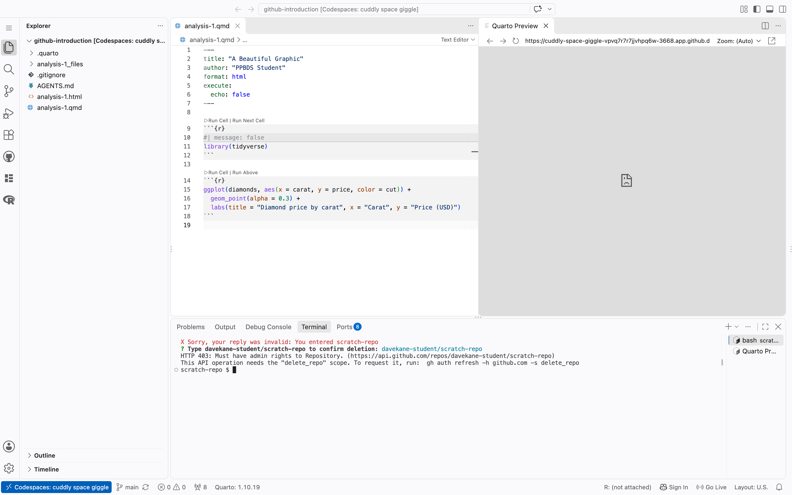{width=90%}

`gh` first makes you type the repo's *full* name, `your-username/scratch-repo` --- typing just `scratch-repo` is rejected and the question is asked again. Only after you confirm does GitHub refuse. Your exact message may differ. The point is the refusal.

###

Look back at the token scopes from Exercise 6: `delete_repo` was not among them. Deleting a repository is so destructive --- the history, the issues, the published site, all gone, unrecoverable --- that your everyday credentials deliberately lack the power. You *could* grant it with the `gh auth refresh` command shown, and the command-line route is occasionally useful. But don't. The normal way to delete a repo is the website, which forces you to slow down.

### Exercise 10

Delete `scratch-repo` from the website. Go to its page on GitHub (`https://github.com/your-username/scratch-repo`), click **Settings** in the top menu, and scroll all the way to the bottom, to the **Danger Zone**. Click **Delete this repository**, and follow the prompts --- GitHub will make you type the repository's full name to confirm.

Then, back in the bash Terminal, confirm it is gone and clean up the local clone. Run these commands, one at a time:

```
cd /workspaces
gh repo view scratch-repo
rm -rf scratch-repo
ls
cd github-introduction
```

CP/CR.

```{r}
#| label: using-git-10
#| echo: false
learnr2::question(
  "CP/CR.",
  type = "reflection",
  show_text = FALSE
)
```

###

```
scratch-repo $ cd /workspaces
workspaces $ gh repo view scratch-repo
GraphQL: Could not resolve to a Repository with the name 'your-username/scratch-repo'. (repository)
workspaces $ rm -rf scratch-repo
workspaces $ ls
codespace-starter  github-introduction
workspaces $ cd github-introduction
github-introduction $
```

###

Two lessons. First, the Danger Zone's type-the-full-name ritual is friction by design: irreversible actions should be hard to do absentmindedly. You will delete repos fairly often --- abandoned experiments, practice work, wrongly named projects --- so remember where this lives: **Settings, bottom of the page**. Second, notice that deleting the repo on GitHub did *not* delete the local clone: the filing cabinet and the desk are separate, and we had to `rm -rf` the folder ourselves. The same is true in reverse --- deleting a local folder never touches GitHub.

### Exercise 11

Create a new Quarto document. From the three horizontal bar icon in the Activity Bar, select `File -> New File...`, then select `Quarto Document` from the drop-down menu. This opens the new file in the Editor.

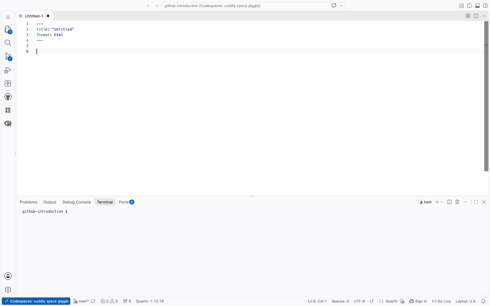{width=90%}

The new file has no name yet, so its Editor tab reads `Untitled-1`, with a black dot showing that it has never been saved.

Change the title to "Analysis 1" and add your name as the author. Save the file with `Cmd/Ctrl + S`. Because the file is new, VS Code shows a Save As box with a path field; make sure the path ends in `github-introduction/analysis-1.qmd` and press **OK**.

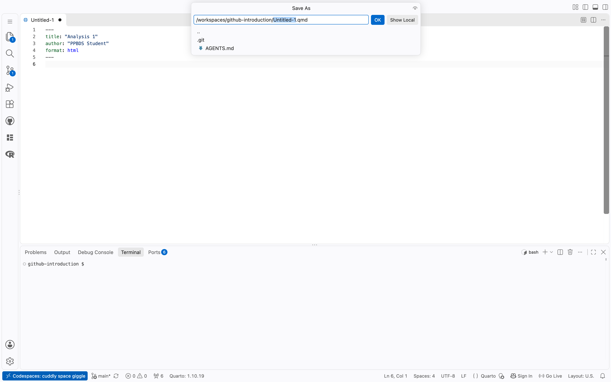{width=90%}

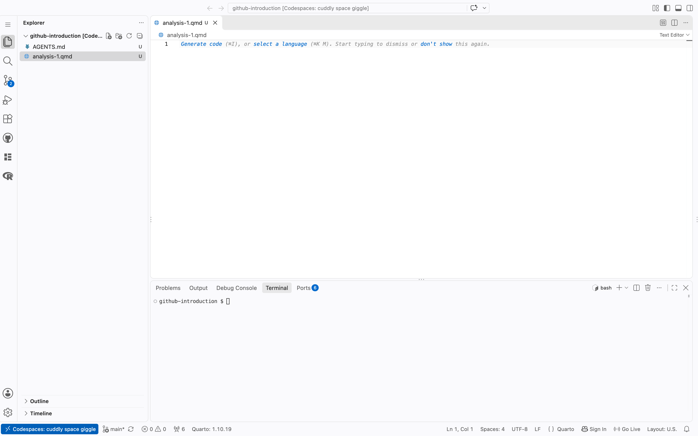{width=90%}

After saving, the tab reads `analysis-1.qmd` and is green with a "U": the file is saved, but **U**ntracked by Git. (The Codespace auto-saves after a short delay, so from now on the black dot appears only briefly as you type.)

Then run `cat analysis-1.qmd`.

CP/CR.

```{r}
#| label: using-git-11
#| echo: false
learnr2::question(
  "Then run cat analysis-1.qmd. CP/CR.",
  type = "reflection",
  show_text = FALSE
)
```

###

You should have something like this:

```
github-introduction $ cat analysis-1.qmd 
---
title: "Analysis 1"
author: "PPBDS Student"
format: html
---

github-introduction $
```


### Exercise 12

Click the Source Control button in the Activity Bar. This opens the Source Control pane, which is an interface to using Git and GitHub.

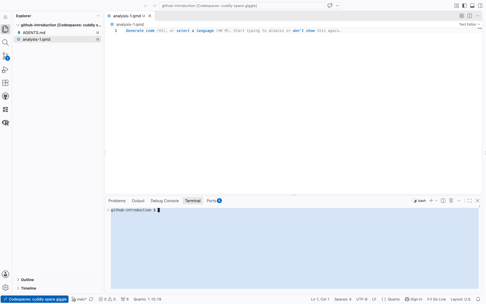{width=90%}

The top part of the pane shows the files that have been added or modified. This is Git telling you what it thinks has changed. Again, the "U" at the end of the lines for `AGENTS.md` and `analysis-1.qmd` indicates that Git has noticed these files but that they are **U**ntracked.

Render `analysis-1.qmd` with `Cmd/Ctrl + Shift + K`.

Three things happen. A new terminal named **Quarto Preview** appears in the Panel and fills with output; a **Quarto Preview** tab opens in the Editor beside your file, showing the rendered HTML; and VS Code pops up a notice that your application is running on port NNNN, with an **Open in Browser** button. Ignore the notice.

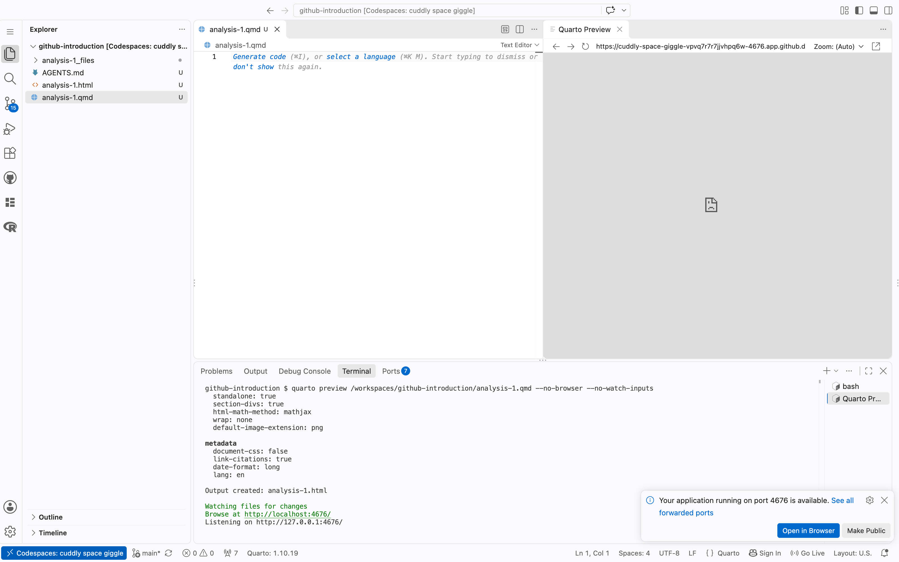{width=90%}

Copy/paste the last few lines from the Quarto Preview terminal.

```{r}
#| label: using-git-12
#| echo: false
learnr2::question(
  "The Terminal fills with a bunch of output. Copy/paste the last few lines.",
  type = "reflection",
  show_text = FALSE
)
```

###

Your answer should look like:

```
metadata
  document-css: false
  link-citations: true
  date-format: long
  lang: en
  
Output created: analysis-1.html

Watching files for changes
Browse at http://localhost:4676/
Listening on http://127.0.0.1:4676/
```

The port number is different every time. The first line of that terminal shows the command the shortcut ran for you: `quarto preview /workspaces/github-introduction/analysis-1.qmd --no-browser --no-watch-inputs`.

### Exercise 13

The VS Code window has changed quite a bit. The Quarto Preview tab shows the HTML. The Source Control pane now includes many new files. The Quarto Preview terminal is not showing a prompt, because `quarto preview` is still running, watching for changes.

Stop it: click the **Quarto Preview** tab on the right side of the Panel and press `Ctrl + c`. Then close the Quarto Preview tab in the Editor.

From the bash Terminal, run `ls`. CP/CR.

```{r}
#| label: using-git-13
#| echo: false
learnr2::question(
  "From the bash Terminal, run ls. CP/CR.",
  type = "reflection",
  show_text = FALSE
)
```

###

Your answer should look like:

```
github-introduction $ ls
AGENTS.md  analysis-1_files  analysis-1.html  analysis-1.qmd
github-introduction $ 
```

The bottom part of the Source Control pane shows the history of changes in this repo. It is empty, since you have not made a commit yet.

### Exercise 14

Look more closely at the Source Control pane:

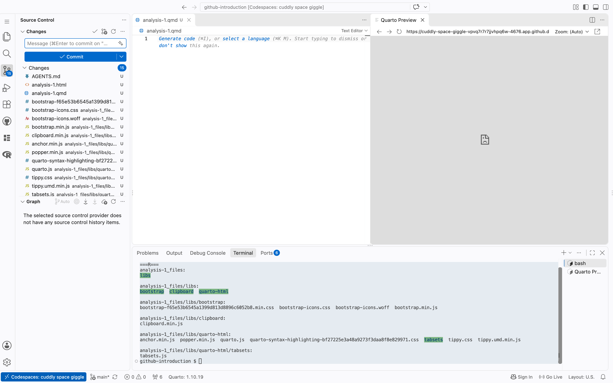{width=90%}

We have many new files, like `analysis-1.html`, created when we rendered `analysis-1.qmd`. They have "U" indicators because, according to Git, they are **U**ntracked. Many of these files are weird and confusing. It turns out that all these files live in the `analysis-1_files` directory.

From the bash Terminal, run `ls -R analysis-1_files`. The `-R` option means **r**ecursive. CP/CR.


```{r}
#| label: using-git-14
#| echo: false
learnr2::question(
  "From the bash Terminal, run ls -R analysis-1_files. The -R option means recursive. CP/CR.",
  type = "reflection",
  show_text = FALSE
)
```

###

Your answer should look like:

```
github-introduction $ ls -R analysis-1_files
analysis-1_files:
libs

analysis-1_files/libs:
bootstrap  clipboard  quarto-html

analysis-1_files/libs/bootstrap:
bootstrap-f65e53b6545a1399d813d8896c6052b8.min.css  bootstrap-icons.css  bootstrap-icons.woff  bootstrap.min.js

analysis-1_files/libs/clipboard:
clipboard.min.js

analysis-1_files/libs/quarto-html:
anchor.min.js  popper.min.js  quarto.js  quarto-syntax-highlighting-bf27225e3a48a9273f3daa8f8e829971.css  tabsets  tippy.css  tippy.umd.min.js

analysis-1_files/libs/quarto-html/tabsets:
tabsets.js
github-introduction $ 
```

Whenever you render a document using Quarto, it creates a directory called `base-name-of-your-file_files`. Since the base name of `analysis-1.qmd` is `analysis-1`, the new directory is `analysis-1_files`. This directory is filled with the programs, information, and other files that helped turn `analysis-1.qmd` into `analysis-1.html`. This is mostly confusing stuff that we should ignore. In fact, we usually don't even want it monitored by Git or stored on GitHub.

### Exercise 15

From the three horizontal bar icon, `File -> New Text File`. Save this new file as `.gitignore`. (Don't forget the leading period.) 

From the bash Terminal, run `ls -a`. CP/CR.

```{r}
#| label: using-git-15
#| echo: false
learnr2::question(
  "From the bash Terminal, run ls -a. CP/CR.",
  type = "reflection",
  show_text = FALSE
)
```

###

Your answer should look like:

```
github-introduction $ ls -a
.  ..  AGENTS.md  analysis-1_files  analysis-1.html  analysis-1.qmd  .git  .gitignore
github-introduction $ 
```

Because `.gitignore` begins with a `.`, it is a hidden file. It would not appear if we just used `ls`. Note that the Source Control pane now shows a new file, `.gitignore` with an associated "U", meaning it is also untracked.

### Exercise 16

The purpose of the `.gitignore` file is to specify the files and directories that **Git** should **ignore**. Add a new line to the file, `analysis-1_files`, followed by an empty line. Save your changes.

From the bash Terminal, run `cat .gitignore`. CP/CR.

```{r}
#| label: using-git-16
#| echo: false
learnr2::question(
  "From the bash Terminal, run cat .gitignore. CP/CR.",
  type = "reflection",
  show_text = FALSE
)
```

###

Your answer should look like:

```
github-introduction $ cat .gitignore
analysis-1_files
github-introduction $ 
```

The `analysis-1_files` line in `.gitignore` tells Git to ignore the `analysis-1_files` directory and everything in it.

Note the change in the Source Control pane!

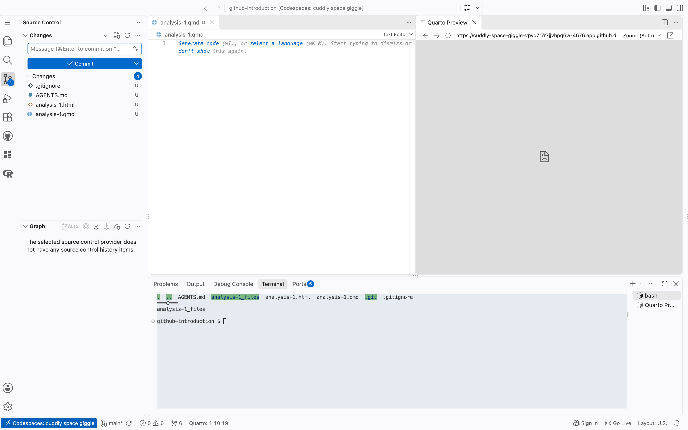{width=90%}

Now, according to Git, there have been only four changes to the repo. (Of course, there have been more changes, but Git is ignoring anything that resides in `analysis-1_files`.) Four files --- `analysis-1.qmd`, `analysis-1.html`, `.gitignore`, and `AGENTS.md` --- are untracked (U).


### Exercise 17

In the box above the **Commit** button, add "initial version" as your commit comment. Press **Commit**. The Codespace stages everything for you, so no dialog appears and the four files vanish from the Changes list.

From the bash Terminal, run `git log`. CP/CR.

```{r}
#| label: using-git-17
#| echo: false
learnr2::question(
  "From the bash Terminal, run git log. CP/CR.",
  type = "reflection",
  show_text = FALSE
)
```

###

Your answer should look like this:

```
github-introduction $ git log
commit 81f70abb905c2c8d328a919115e18038ab3df006 (HEAD -> main)
Author: Your Name <your-username@users.noreply.github.com>
Date:   Tue Oct 13 00:05:06 2026 +0000

    initial version
```

`git log` generates a record --- a "log" --- of all the Git actions we have taken. There is exactly one commit. Remember that `git log` in `scratch-repo` could only complain that `main` had no commits yet? Your `github-introduction` repo was born the same way --- empty --- and this commit, which adds `analysis-1.qmd`, `analysis-1.html`, `.gitignore`, and `AGENTS.md`, is the first entry in its history. The `Author` line is your GitHub login and the e-mail address attached to your account; the Codespace set both up for you.

### Exercise 18

Return to editing `analysis-1.qmd`. Add a line beginning with your actual name: "[Your name] is a data maestro!" Make sure there is a blank line at the end of the document, and save.

Run `cat analysis-1.qmd`. CP/CR.

```{r}
#| label: using-git-18
#| echo: false
learnr2::question(
  "Run cat analysis-1.qmd. CP/CR.",
  type = "reflection",
  show_text = FALSE
)
```


###

Your answer should look something like this:

```
github-introduction $ cat analysis-1.qmd
---
title: "Analysis 1"
author: "PPBDS Student"
format: html
---

PPBDS student is a data maestro!
github-introduction $ 
```


### Exercise 19

Within the Source Control pane, press the "Open File" button for `analysis-1.qmd`, which is the first of the symbols that appear to the right of the file name when you hover over it. 

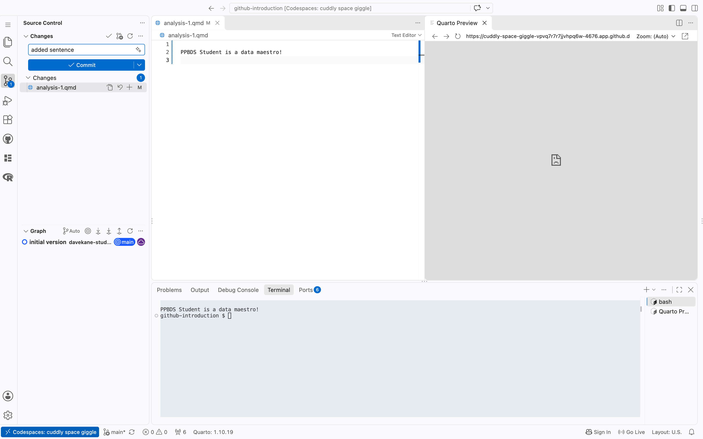{width=90%}

Notice how there is now an orange "M" next to the file name. This indicates that Git is now tracking the file's changes and that it has been **M**odified.

Hold your cursor over the symbol (a curved arrow) next to the "Open File" button. What is the name for this button?

```{r}
#| label: using-git-19
#| echo: false
learnr2::question(
  "Hold your cursor over the symbol (a curved arrow) next to the \"Open File\" button. What is the name for this button?",
  learnr2::answer("Discard Changes", correct = TRUE),
  type = "reflection",
  show_text = FALSE
)
```

###

Clicking this button gets rid of any changes made since the last time you told Git to save them. 

### Exercise 20

Hold your cursor over the symbol --- `+`, a plus sign --- next to the "Discard Changes" button. What is the name for this button?

```{r}
#| label: using-git-20
#| echo: false
learnr2::question(
  "Hold your cursor over the symbol -- +, a plus sign -- next to the \"Discard Changes\" button. What is the name for this button?",
  learnr2::answer("Stage Changes", correct = TRUE),
  type = "reflection",
  show_text = FALSE
)
```

###

Saving changes in Git is, in theory, a two-step process. The first step is to "stage" the changes. The second step is to "commit" the changes. For the most part, we don't stage. We just "commit," which incorporates the staging process automatically.

### Exercise 21

Commit the changes with a comment like "added sentence". 

Run `git log`. CP/CR the latest entry.

```{r}
#| label: using-git-21
#| echo: false
learnr2::question(
  "Run git log. CP/CR the latest entry.",
  type = "reflection",
  show_text = FALSE
)
```

###

Your answer should look something like:

```
github-introduction $ git log
commit 4c0f3f9d2b7e1a6c5d8e9f0a1b2c3d4e5f6a7b8c (HEAD -> main)
Author: Your Name <your-username@users.noreply.github.com>
Date:   Tue Oct 13 00:07:10 2026 +0000

    added sentence
```

Still only `(HEAD -> main)`: two commits now, both of them local.

### Exercise 22

The Source Control pane now looks like this:

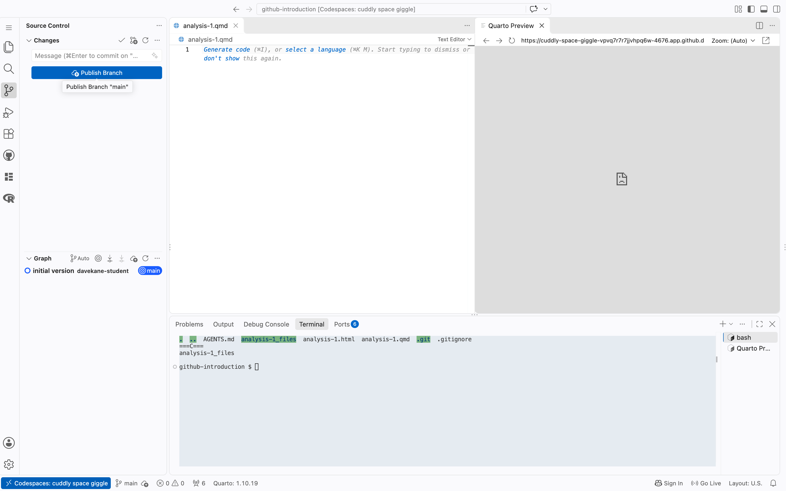{width=90%}

Although you have committed your changes to Git --- i.e., the changes have been made locally --- you still need to "push" the changes to GitHub. Hover your cursor over the **Publish Branch** button. What does the pop-up say?

```{r}
#| label: using-git-22
#| echo: false
learnr2::question(
  "Although you have committed your changes to Git -- i.e., the changes have been made locally -- you still need to \"push\" the changes to GitHub. Hover your cursor over the \"Publish Branch\" button. What does the pop-up say?",
  learnr2::answer("Publish Branch \"main\"", correct = TRUE),
  type = "reflection",
  show_text = FALSE
)
```

###

The button says **Publish Branch** rather than **Sync Changes** because this is the repo's very first push: GitHub does not yet have a `main` branch to sync with. After this one push the button will read **Sync Changes** with a count of the commits waiting to go out.

Note the bottom portion of the pane, the Source Control Graph, which shows the Git history of this repo. Before you committed, it was empty. Now it lists your commits, the newest on top, each marked only with `main` --- there is no cloud icon anywhere, because nothing has reached GitHub yet. (The picture was taken after a single commit; you have two.)

### Exercise 23

Press the **Publish Branch** button.

###

The Source Control View should now look like this:

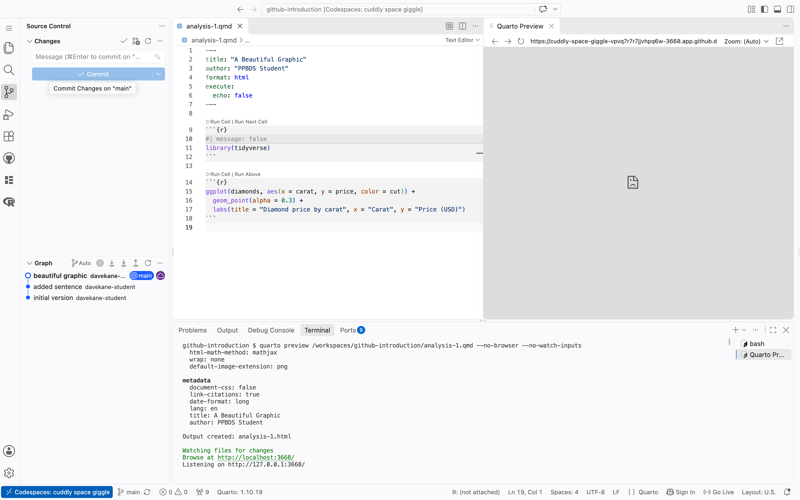{width=90%}

The button is gone, and a purple cloud icon has appeared on the most recent commit, beside the local `main` branch. The cloud represents the remote tracking branch on GitHub, called `origin/main`: the `main` branch on the `origin` repo, which is the GitHub repo. Until now there was no such thing.

From the bash Terminal, run `git log` again. CP/CR.

```{r}
#| label: using-git-23
#| echo: false
learnr2::question(
  "From the bash Terminal, run git log again. CP/CR.",
  type = "reflection",
  show_text = FALSE
)
```

###

Your answer should look like:

```
github-introduction $ git log
commit 4c0f3f9d2b7e1a6c5d8e9f0a1b2c3d4e5f6a7b8c (HEAD -> main, origin/main)
Author: Your Name <your-username@users.noreply.github.com>
Date:   Tue Oct 13 00:07:10 2026 +0000

    added sentence

commit 81f70abb905c2c8d328a919115e18038ab3df006
Author: Your Name <your-username@users.noreply.github.com>
Date:   Tue Oct 13 00:05:06 2026 +0000

    initial version
```

This looks the same as before, except that "(HEAD -> main)" in the top line has changed to "(HEAD -> main, origin/main)". This tells us that our changes have been pushed to GitHub, not simply committed locally. We will save a discussion of what `"HEAD"` means for later.

A term like "commit 4c0f3f9d2b7e1a6c5d8e9f0a1b2c3d4e5f6a7b8c" gives us the address of that commit. We can use that string to revert to the codebase as it looked after that commit.

### Exercise 24

If you look at the GitHub page for `github-introduction`, you will see that the changes have been pushed to GitHub. If your computer stops working, you won't lose any of your work.

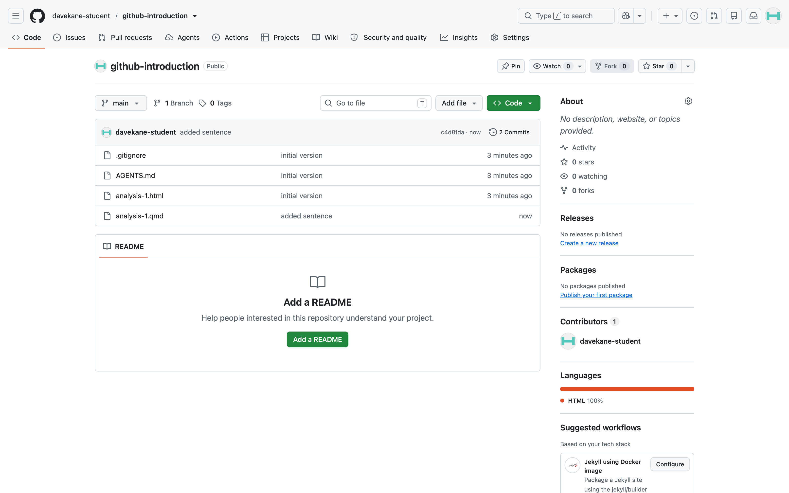{width=90%}

This page shows the files from your project that have been pushed to GitHub: `.gitignore`, `AGENTS.md`, `analysis-1.html`, and `analysis-1.qmd` --- and no `analysis-1_files`, thanks to `.gitignore`. Click the **2 Commits** link at the top right of the file list. This will show a page with the history of commits that you have pushed to GitHub.

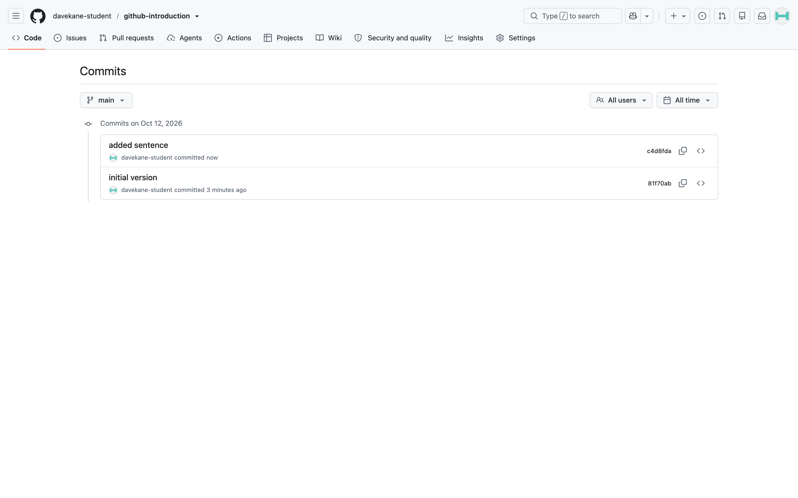{width=90%}

Paste a screenshot of this page.

```{r}
#| label: using-git-24
#| echo: false
learnr2::question(
  "Paste a screenshot of this page.",
  type = "reflection",
  allow_image = TRUE,
  show_text = FALSE
)
```

###

You should have something like this:

```
Commits
Commits on Oct 13, 2026

    added sentence
    your-username committed 3 minutes ago

    initial version
    your-username committed 6 minutes ago
```

Two commits, newest first, matching your `git log`. GitHub's history is your history: nothing more, nothing less.

###

As AI writes more and more of our code, it's becoming increasingly important to get good at managing this code with Git and GitHub.

## Publishing with GitHub Pages

An HTML file rendered by Quarto only lives on your computer (or Codespace) — it isn't accessible to anyone else. [GitHub Pages](https://pages.github.com/) solves this by serving the static files from your GitHub repository as a public website, giving you a real URL you can share with anyone.

GitHub Pages isn't the only option. [Netlify](https://www.netlify.com/), [Quarto Pub](https://quartopub.com/), and [Posit Connect](https://posit.co/products/enterprise/connect/) are some popular alternatives for hosting HTML files and websites.

### Exercise 1

Let's make `analysis-1.qmd` worth publishing. Set it up as you learned in the Quarto tutorial:

* Change the title to "A Beautiful Graphic" and add your name as the author.

* Add `execute: echo: false` to the YAML header. Make sure to use two spaces, not a tab, when indenting.

* Add a code chunk which loads **tidyverse**, with `#| message: false`.

* Add a second code chunk holding an AI-generated plot that uses ggplot and a built-in data set. Render with `Cmd/Ctrl + Shift + K` and iterate with your AI until you have a graphic of which you are proud.

(In the Antigravity tutorial you met a CLI agent that can edit your files directly. Either approach is fine throughout these Git tutorials: ask an AI in a chat window and copy/paste the code by hand, or let an agent write it into your file for you. Use whichever you prefer.)

In the R Terminal, run `learnr2::show_file("analysis-1.qmd", chunk = "Last")`. CP/CR.

```{r}
#| label: publishing-with-github-pages-1
#| echo: false
learnr2::question(
  "In the R Terminal, run learnr2::show_file(\"analysis-1.qmd\", chunk = \"Last\"). CP/CR.",
  type = "reflection",
  show_text = FALSE
)
```

###

```
ggplot(mpg, aes(x = displ, y = hwy, color = class)) +
  geom_point(alpha = 0.7) +
  scale_color_brewer(palette = "Set2") +
  scale_size_continuous(range = c(2, 8)) +
  labs(
    title = "Highway MPG vs Engine Displacement by Vehicle Class",
    subtitle = "Larger points indicate higher city MPG",
    x = "Engine Displacement (L)",
    y = "Highway MPG",
    color = "Vehicle Class",
    size = "City MPG"
  ) +
  theme_minimal() +
  theme(
    plot.title = element_text(size = 16, face = "bold", hjust = 0.5),
    plot.subtitle = element_text(size = 12, hjust = 0.5),
    legend.position = "right",
    legend.box = "vertical",
    panel.grid.major = element_line(color = "grey90"),
    panel.grid.minor = element_blank()
  )
```

###

My image looks like:

```{r}
#| label: publishing-with-github-pages-1-answer
#| echo: false
ggplot(mpg, aes(x = displ, y = hwy, color = class)) +
  geom_point(alpha = 0.7) +
  scale_color_brewer(palette = "Set2") +
  scale_size_continuous(range = c(2, 8)) +
  labs(
    title = "Highway MPG vs Engine Displacement by Vehicle Class",
    subtitle = "Larger points indicate higher city MPG",
    x = "Engine Displacement (L)",
    y = "Highway MPG",
    color = "Vehicle Class",
    size = "City MPG"
  ) +
  theme_minimal() +
  theme(
    plot.title = element_text(size = 16, face = "bold", hjust = 0.5),
    plot.subtitle = element_text(size = 12, hjust = 0.5),
    legend.position = "right",
    legend.box = "vertical",
    panel.grid.major = element_line(color = "grey90"),
    panel.grid.minor = element_blank()
  )
```

Nothing in this exercise was new: the YAML header, the setup chunk, `#| message: false`, and `execute: echo: false` all come straight from the Quarto tutorial. What *is* new is what comes next: publishing this page from a repo you have managed with raw Git commands.

### Exercise 2

If you click the Source Control button, your Codespaces window should look something like this:

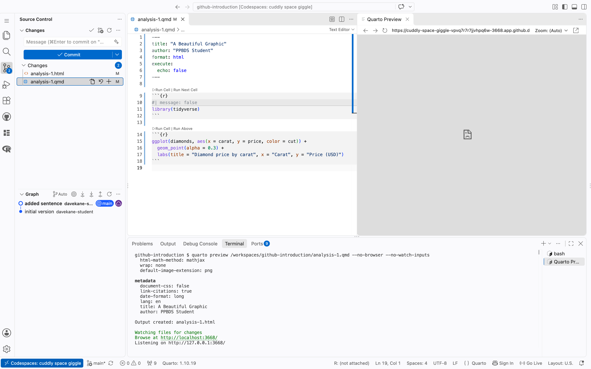{width=90%}

Commit your files with a message like "beautiful graphic". Once you do, the button reads **Sync Changes 1**, and hovering over it shows "Push 1 commits to origin/main" --- this is not the first push, so GitHub already has a `main` branch to sync with. The Graph now has a third entry, your new commit, marked `main`, while the cloud for `origin/main` still sits on "added sentence".

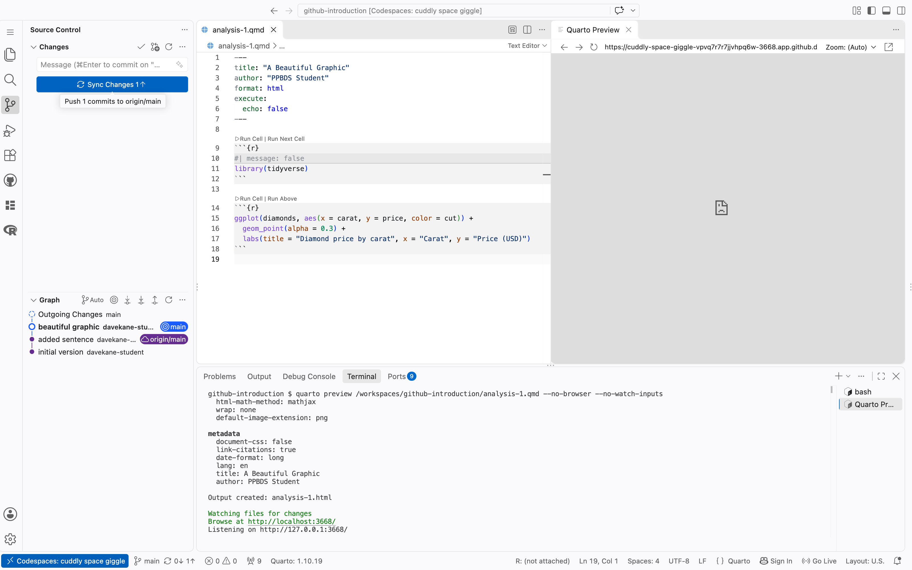{width=90%}

Press **Sync Changes** to push. Don't forget that "push" means the same thing as "sync."

Click the **Quarto Preview** tab in the Panel and use `Ctrl + c` to stop the Quarto watching process. From the bash Terminal, run `git log -n 1`. CP/CR.

```{r}
#| label: publishing-with-github-pages-2
#| echo: false
learnr2::question(
  "Use Ctrl + c to stop the Quarto watching process. From the bash Terminal, run git log -n 1. CP/CR.",
  type = "reflection",
  show_text = FALSE
)
```

###

```
github-introduction $ git log -n 1
commit 42b4257f7223a2ef8af1c6a7399ec777f2b90a3f (HEAD -> main, origin/main)
Author: Your Name <your-username@users.noreply.github.com>
Date:   Tue Oct 13 00:10:30 2026 +0000

    beautiful graphic
github-introduction $
```

We are being a little sloppy to equate "pushing" with "syncing." Strictly speaking, "syncing" does two things: it "pushes" your changes to GitHub *and* it "pulls" any changes made on GitHub to your local computer. But, in this case, because no one else but you can change the GitHub repo, there is nothing to "pull." 

### Exercise 3

Let's publish our results to [GitHub Pages](https://pages.github.com/). Before we do, go to the GitHub repo for `github-introduction`, click on the "Settings" top menu item, and then click on the "Pages" side menu item.

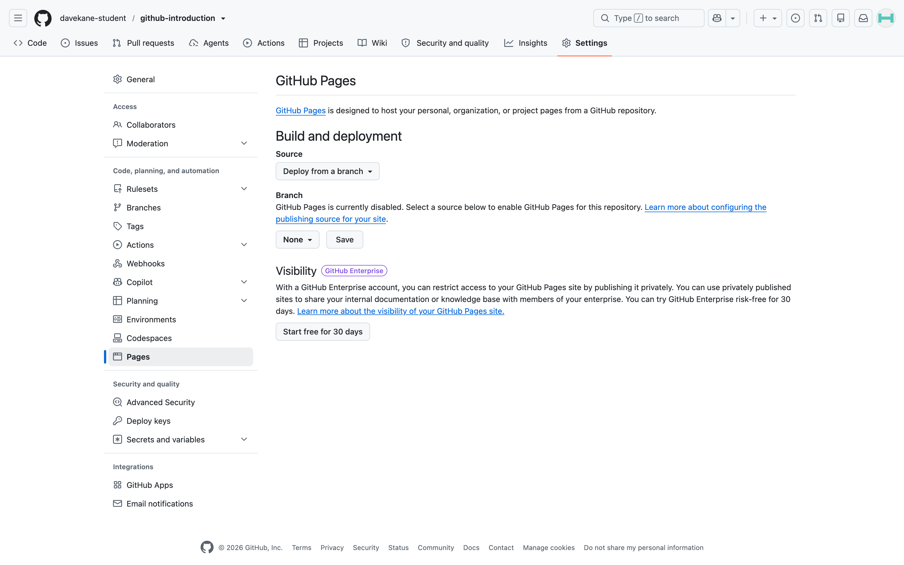{width=90%}

We won't modify these options by hand. But it is useful to know where the details are located.

From the bash Terminal, run `quarto publish gh-pages analysis-1.qmd`. Respond with "Y" when it asks whether you want to publish. (This might take a minute to run.) 

CP/CR just the first 10 or so lines of the output.


```{r}
#| label: publishing-with-github-pages-3
#| echo: false
learnr2::question(
  "CP/CR just the first 10 or so lines of the output.",
  type = "reflection",
  show_text = FALSE
)
```

###

Here is what I see, broken up to allow for comments:

```
github-introduction $ quarto publish gh-pages analysis-1.qmd
? Publish site to https://your-username.github.io/github-introduction/ using gh-pages? (Y/n) › Yes
```

There are settings that will prevent this question from being asked every time we update the website. Otherwise, Quarto will check each time.

```
Switched to a new branch 'gh-pages'
[gh-pages (root-commit) 08825ec] Initializing gh-pages branch
remote: 
remote: Create a pull request for 'gh-pages' on GitHub by visiting:        
remote:      https://github.com/your-username/github-introduction/pull/new/gh-pages        
remote: 
To https://github.com/your-username/github-introduction.git
 * [new branch]      HEAD -> gh-pages
```

By default, `quarto publish` follows the standard GitHub Pages approach of creating a new Git "branch" called `gh-pages`. Branches are lightweight pointers to specific commits. They allow you to isolate work in progress, experiment with new features, and collaborate effectively without affecting the main codebase. Note the `.git` on the end of the address, as in `git remote -v`: this is Git talking to GitHub, not a web page.

```
Switched to branch 'main'
Your branch is up to date with 'origin/main'.
From https://github.com/your-username/github-introduction
 * branch            gh-pages   -> FETCH_HEAD
Rendering for publish:


processing file: analysis-1.qmd
1/5                  
2/5 [unnamed-chunk-1]
3/5                  
4/5 [unnamed-chunk-2]
5/5                  
output file: analysis-1.knit.md
```

`quarto publish` processes `analysis-1.qmd` in the same way that `quarto preview` or `quarto render` does. Further down, after the `pandoc` and `metadata` blocks, you will see a line reading `fatal: pathspec '.' did not match any files`. It looks alarming but is harmless --- the fresh `gh-pages` branch has nothing in it yet for Git to tidy away --- and the output carries on to `[✓] Published to https://your-username.github.io/github-introduction/`.

### Exercise 4

Go to your `github-introduction` page on GitHub. Refresh the page. `quarto publish` has changed some of the items: there are now 2 branches and 3 commits, and a **Deployments** card reading **github-pages** has appeared in the right-hand column. Click it. This opens the Deployments page, which shows the address of your live site. Paste a screenshot of the Deployments page.


```{r}
#| label: publishing-with-github-pages-4
#| echo: false
learnr2::question(
  "Go to your github-introduction page on GitHub. Refresh the page. quarto publish has changed some of the items: there are now 2 branches and 3 commits, and a Deployments card reading github-pages has appeared in the right-hand column. Click it. This opens the Deployments page, which shows the address of your live site. Paste a screenshot of the Deployments page.",
  type = "reflection",
  allow_image = TRUE,
  show_text = FALSE
)
```

###

Here is my repo page, with the Deployments card:

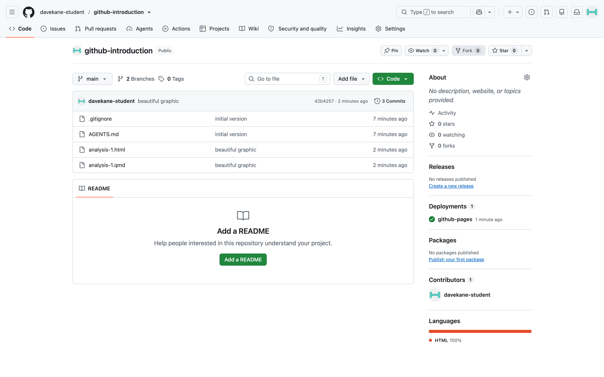{width=90%}

And the Deployments page it leads to:

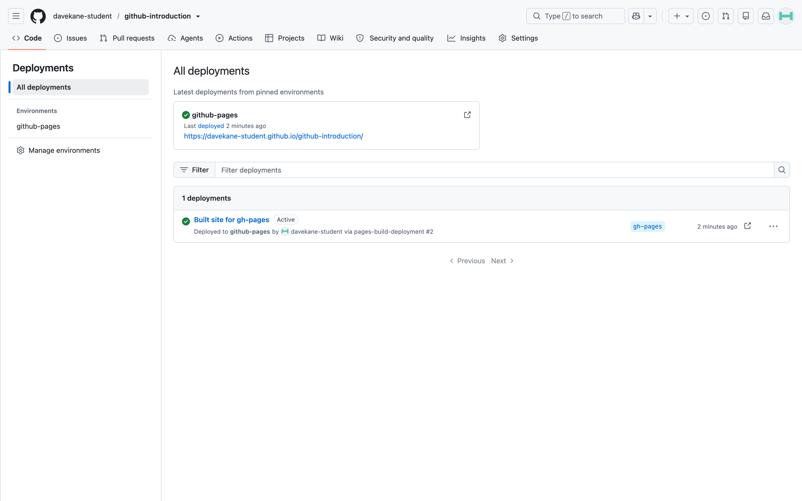{width=90%}

```
github-pages
Last deployed 2 minutes ago
https://your-username.github.io/github-introduction/
```

Visit that address: your graphic is live, on a real URL you can send to anyone. The pattern is always `https://<your-username>.github.io/<repo-name>/`.

We could have made these changes by hand, but it is much easier to let `quarto publish` handle them.

Publishing to GitHub Pages has not changed any of the files in our repo, so the "Source Control" button does not show any changes for us to deal with. Our local repo matches our `github-introduction` on GitHub. We are done!


## Summary

This tutorial covered [Git](https://git-scm.com/), a program for keeping track of changes in your code, and [GitHub](https://github.com/), the leading platform for storing your code in the cloud. Some material is from [*R for Data Science (2e)*](https://r4ds.hadley.nz/) by Hadley Wickham, Mine Çetinkaya-Rundel, and Garrett Grolemund.

The most useful reference for Git/GitHub is [*Happy Git and GitHub for the useR*](https://happygitwithr.com/). Refer to that book whenever you have a question.

## Download answers

```{r}
#| label: download-answers-1
#| echo: false
learnr2::question(
  "How many minutes, approximately, did it take you to complete this
  tutorial? For example, an hour and a half would be 90 minutes.",
  type = "reflection_editable",
  validate = "integer"
)
```

###

```{r}
#| label: download-answers-2
#| echo: false
learnr2::download_answers_button(filename_prefix = "github-1")
```
