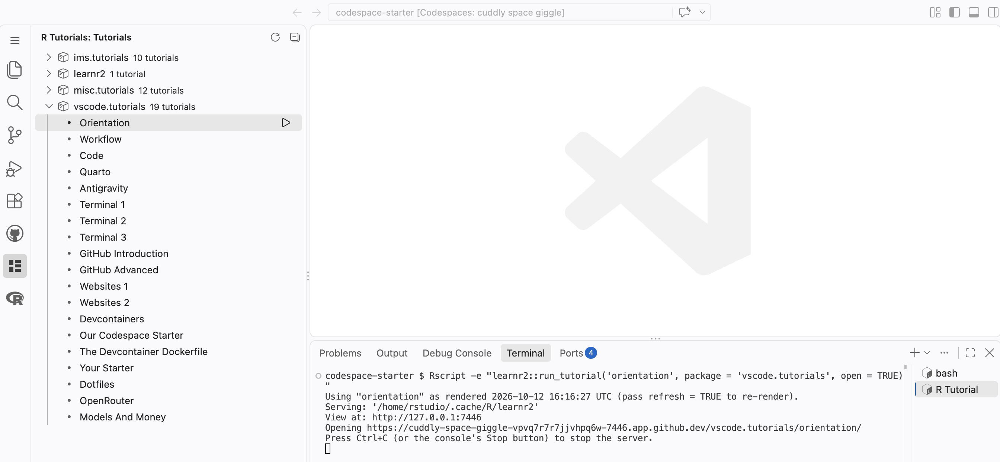
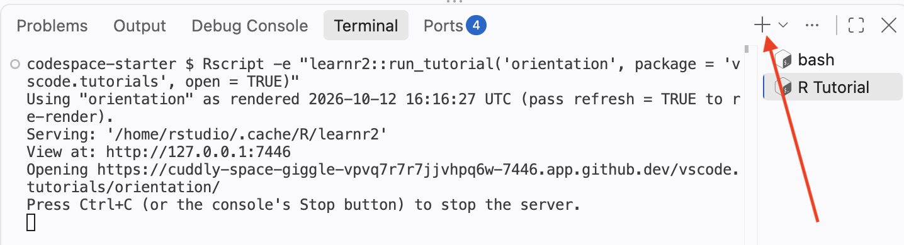
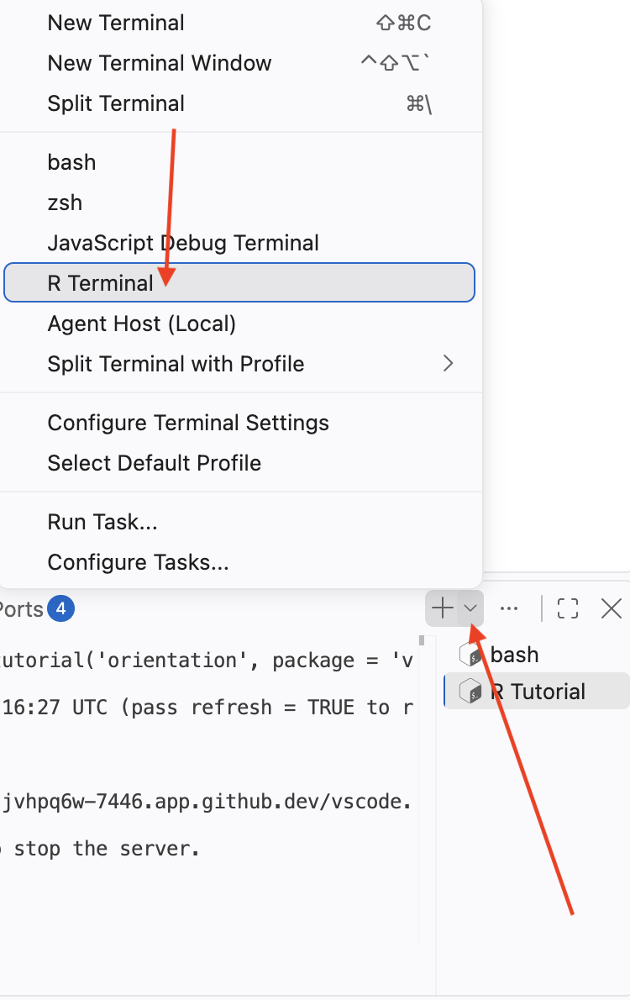
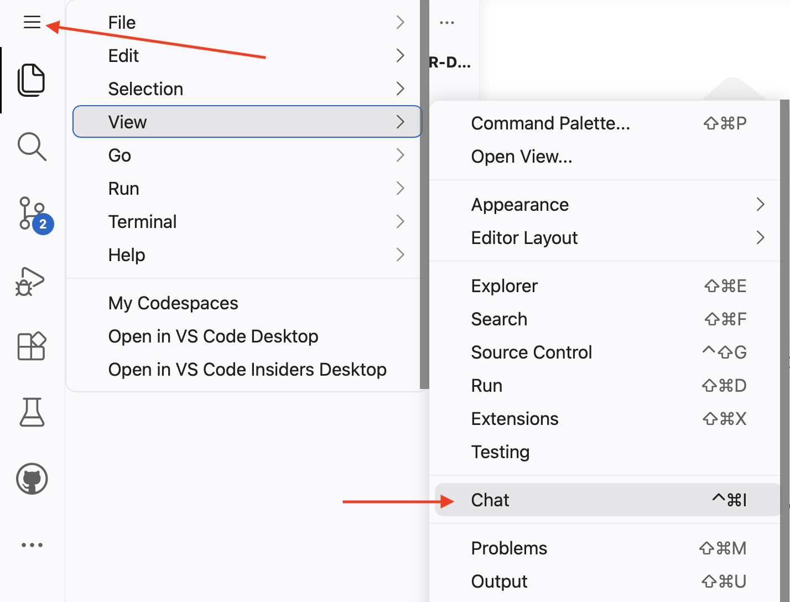
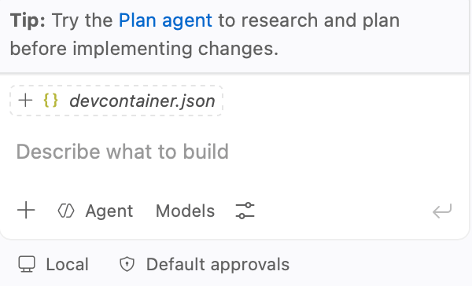
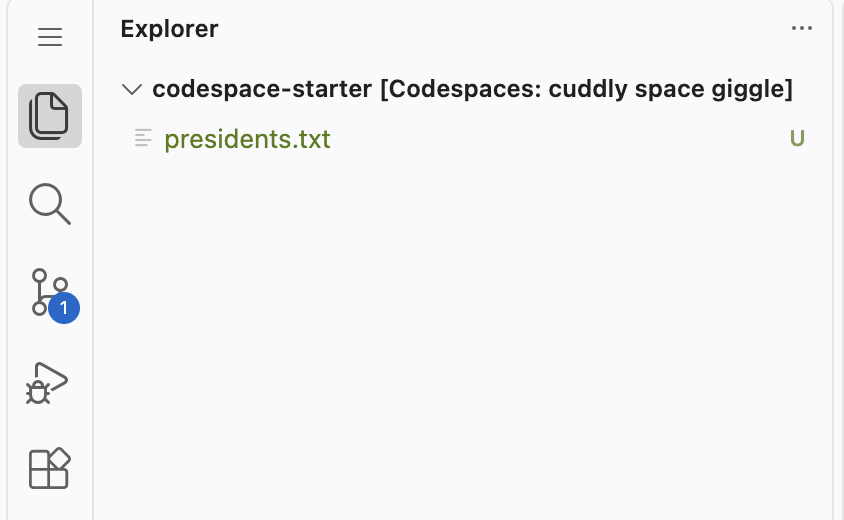
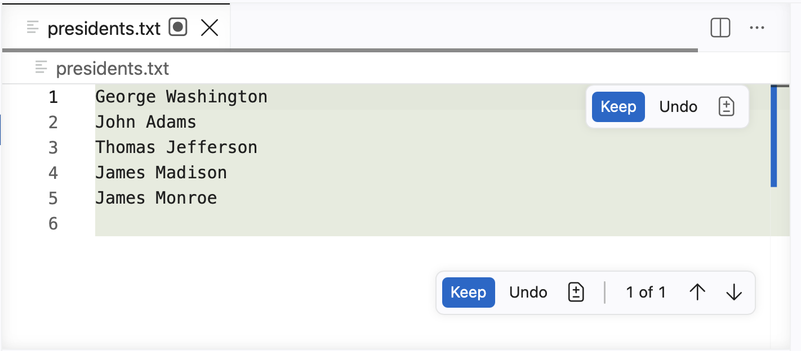
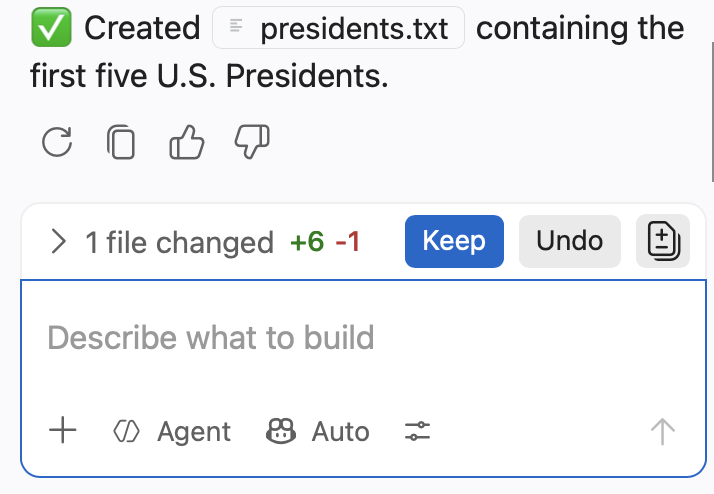
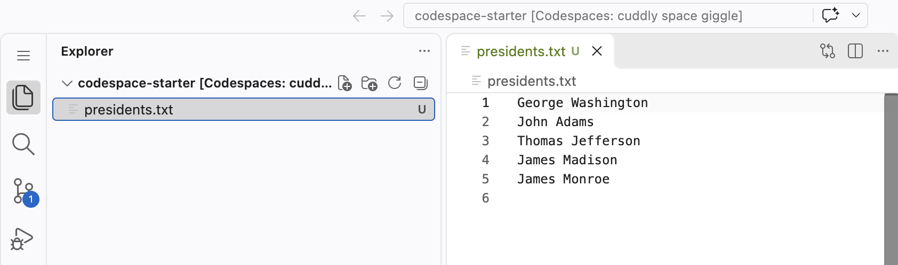
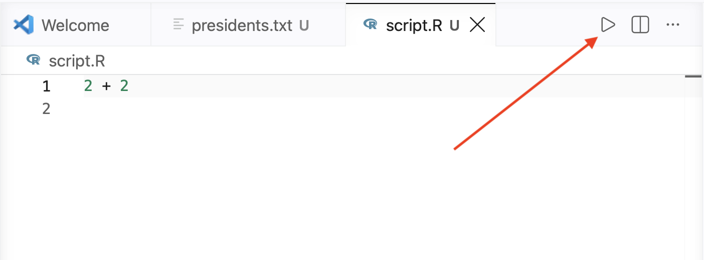



## Information

```{r}
#| label: information-1
#| echo: false
learnr2::student_info()
```

## Introduction

This tutorial provides a tour of your Visual Studio Code (VS Code) workspace: the bash Terminal, the R Terminal, and [GitHub Copilot](https://github.com/copilot), an AI coding assistant, ending with the different ways to run R code. You probably started the tutorial from a [GitHub Codespace](https://github.com/features/codespaces), as set up [here](https://ppbds.github.io/primer/getting-started.html).

###

After starting the tutorial, your Codespace looks something like this:

{width=90%}

## Bash Terminal

The **bash Terminal** is a text-based interface in which you type commands to tell your Codespace what to do. You send a command, the terminal executes it, and it (usually) gives you something back.

###

The Panel at the bottom of VS Code already shows a bash Terminal. Its tab carries a small ⚠ icon. The icon is harmless, so ignore it. The banner printed in that terminal announces that your Codespace is READY and suggests running `connect-repo`. Do **not** run it in this tutorial. The next tutorial, "Workflow," is where you create your own repo. To open another bash Terminal at any time, press the plus button (`+`) on the right side of the Panel.


{width=90%}

### Exercise 1

In the bash Terminal, run `whoami`. CP/CR. (Recall that "CP/CR" means "copy and paste the command and its response into the answer box below.")

```{r}
#| label: bash-terminal-1
#| echo: false
learnr2::question(
  "In the bash Terminal, run whoami. CP/CR.",
  type = "reflection",
  show_text = FALSE
)
```

###

```{.output}
codespace-starter $ whoami
rstudio
codespace-starter $
```

###

`whoami` prints the username of the account you are signed in as. Your Codespace is a complete computer running in the cloud, and you interact with it as the `rstudio` user. It is OK if your formatting differs from ours.

### Exercise 2

In the bash Terminal, run `echo $0`. ("Run" means to type the command and then press `Enter`, which is the `return` key on a Mac and the `enter` on Windows/Linux. "Execute" means the same thing as "run" in this context.)

CP/CR.

```{r}
#| label: bash-terminal-2
#| echo: false
learnr2::question(
  "In the bash Terminal, run echo $0. (\"Run\" means to type the command and then press Enter, which is the return key on a Mac and the enter on Windows/Linux. \"Execute\" means the same thing as \"run\" in this context.) CP/CR.",
  type = "reflection",
  show_text = FALSE
)
```

###

```{.output}
codespace-starter $ echo $0
/bin/bash
codespace-starter $
```

###

A "shell" is the program that reads and interprets the commands you type in a terminal. `echo $0` prints the name of the shell you are using: `/bin/bash`, the [Bash shell](https://en.wikipedia.org/wiki/Bash_(Unix_shell)). Every command you run in this bash Terminal --- starting with the `whoami` you just ran --- is interpreted by bash.

### Exercise 3

In the bash Terminal, run `pwd`.

CP/CR.

```{r}
#| label: bash-terminal-3
#| echo: false
learnr2::question(
  "In the bash Terminal, run pwd. CP/CR.",
  type = "reflection",
  show_text = FALSE
)
```

###

```{.output}
codespace-starter $ pwd
/workspaces/codespace-starter
codespace-starter $
```

###

`pwd` stands for **p**rint **w**orking **d**irectory --- the folder the shell is currently "in." GitHub Codespaces place your starting repository, which is `codespace-starter` in this case, under `/workspaces/`, so that is where you begin. Almost every command you run acts in this directory unless you tell it otherwise.

### Exercise 4

In the bash Terminal, run `ls`. (This is the lowercase letter `L` followed by the lowercase letter `S`.)

CP/CR.

```{r}
#| label: bash-terminal-4
#| echo: false
learnr2::question(
  "In the bash Terminal, run ls. (This is the lowercase letter L followed by the lowercase letter S.) CP/CR.",
  type = "reflection",
  show_text = FALSE
)
```

###

```{.output}
codespace-starter $ ls
codespace-starter $
```

###

`ls` **l**i**s**ts the files in the working directory. Nothing was printed because, by default, `ls` hides any file or folder whose name begins with a dot (`.`). Every entry in this directory starts with a dot, so the directory only looks empty.

### Exercise 5

In the bash Terminal, run `ls -a`.

CP/CR.

```{r}
#| label: bash-terminal-5
#| echo: false
learnr2::question(
  "In the bash Terminal, run ls -a. CP/CR.",
  type = "reflection",
  show_text = FALSE
)
```

###

```{.output}
codespace-starter $ ls -a
.  ..  .devcontainer  .git  .github  .vscode
codespace-starter $
```

###

The `-a` flag (for "all") tells `ls` to reveal the hidden entries. `.` is the current directory and `..` is the directory just above it. `.git` stores the project's version history. The other dot-folders hold settings for the Codespace, for GitHub and for VS Code, which is why they are kept out of sight. A "flag" like `-a` is an option that changes how a command behaves.

### Exercise 6

In the bash Terminal, run `sleep 5`. This command pauses execution for 5 seconds.

CP/CR.

```{r}
#| label: bash-terminal-6
#| echo: false
learnr2::question(
  "In the bash Terminal, run sleep 5. This command pauses execution for 5 seconds. CP/CR.",
  type = "reflection",
  show_text = FALSE
)
```

###

```{.output}
codespace-starter $ sleep 5
codespace-starter $
```

###

Many commands do their work silently and print nothing. We can change the duration with `sleep [number]`, where the number is how many seconds the pause lasts.

### Exercise 7

In the bash Terminal, run `sleep 60`. Before the 60 seconds are up, press `Ctrl + C` on your keyboard to cancel the running command.

CP/CR.

```{r}
#| label: bash-terminal-7
#| echo: false
learnr2::question(
  "In the bash Terminal, run sleep 60. Before the 60 seconds are up, press Ctrl + C on your keyboard to cancel the running command. CP/CR.",
  type = "reflection",
  show_text = FALSE
)
```

###

```{.output}
codespace-starter $ sleep 60
^C
codespace-starter $
```

###

`Ctrl + C` interrupts whatever process is currently running in the terminal and returns you to the prompt. The `^C` marks where you pressed it. When a command hangs or you change your mind, `Ctrl + C` stops it.

## R Terminal

The "Panel" is the bottom of the VS Code window. There are several "views" associated with the Panel, including "Output," "Ports," and "Terminal." Within the Terminal view, you can have multiple "terminals" running. Each terminal has an associated "tab" on the right side of the Panel which you can use to select that terminal. A terminal is just a window for talking to a program. A bash Terminal runs the bash shell. An R Terminal runs R.

###

The bash Terminal lets you talk to the computer. The R Terminal lets you talk to R, the programming language you will use for data science. The two work the same way: you type a command, press `Enter`, and the terminal executes the command and gives you something back. The only real difference is the language --- bash commands like `ls` and `pwd` on the one hand, R commands like `sqrt(16)` on the other.

###

Create a new R Terminal by pressing the down arrow next to the plus button on the right side of the Panel Toolbar and selecting "R Terminal."


{width=90%}

###

You may need to click on the new "R Interactive" tab at the bottom of the list of terminals in order to bring it to the top of the Panel.

### Exercise 1

In the R Terminal, run `4 + 5`.

CP/CR.

```{r}
#| label: r-terminal-1
#| echo: false
learnr2::question(
  "In the R Terminal, run 4 + 5. CP/CR.",
  type = "reflection",
  show_text = FALSE
)
```

###

```{.output}
R 4.6.1> 4 + 5
[1] 9
R 4.6.1>
```

###

At its simplest, R is a calculator. Just as the bash Terminal took `whoami` and handed back your username, the R Terminal takes `4 + 5` and hands back the result. The `[1]` at the start of the output is a counter telling you that the line begins with the first element of the result --- useful when a result has many values spread across several lines.

### Exercise 2

In the R Terminal, run `sqrt(16)`.

CP/CR.

```{r}
#| label: r-terminal-2
#| echo: false
learnr2::question(
  "In the R Terminal, run sqrt(16). CP/CR.",
  type = "reflection",
  show_text = FALSE
)
```

###

```{.output}
R 4.6.1> sqrt(16)
[1] 4
R 4.6.1>
```

###

`sqrt()` is a **function**. You "call" a function by writing its name followed by parentheses, placing any input --- here, `16` --- inside them. That input is called an **argument**. Almost everything you do in R involves calling functions on arguments.

### Exercise 3

In the R Terminal, run `getwd()`. This stands for **g**et **w**orking **d**irectory, the directory in which the R process is currently located.

CP/CR.

```{r}
#| label: r-terminal-3
#| echo: false
learnr2::question(
  "In the R Terminal, run getwd(). This stands for get working directory, the directory in which the R process is currently located. CP/CR.",
  type = "reflection",
  show_text = FALSE
)
```

###

```{.output}
R 4.6.1> getwd()
[1] "/workspaces/codespace-starter"
R 4.6.1>
```

###

`getwd()` is the R equivalent of the bash command `pwd` you ran earlier. Here it shows that R is operating inside your Codespace at `/workspaces/codespace-starter`. Note that `getwd()` takes no arguments, but you still need the parentheses to call it.

### Exercise 4

In the R Terminal, run `R.version.string`.

CP/CR.

```{r}
#| label: r-terminal-4
#| echo: false
learnr2::question(
  "In the R Terminal, run R.version.string. CP/CR.",
  type = "reflection",
  show_text = FALSE
)
```

###

```{.output}
R 4.6.1> R.version.string
[1] "R version 4.6.1 (2026-06-24)"
R 4.6.1> 
```

###

Your version of R may differ from the example above --- that's fine, as long as it's reasonably recent. `R.version.string` is not a function call --- it has no parentheses --- but a built-in variable whose value R simply prints.

### Exercise 5

`show_file()` is a commonly used function from the **learnr2** package. It makes it easy for you to share the contents of another file with your instructor, especially a file that you have edited.

###

You can generally call a function by giving its name followed by parentheses, as with `getwd()`. However, we often prefix the function name with the name of the package in which the function is found, separated by two colons. Since `show_file()` is in the **learnr2** package, we can call it using this "double-colon" notation: `learnr2::show_file()`.

In the R Terminal, run this command:

```r
learnr2::show_file(file.path(R.home(), "COPYING"), end = 7)
```

CP/CR.

```{r}
#| label: r-terminal-5
#| echo: false
learnr2::question(
  "show_file() is a commonly used function from the learnr2 package. It makes it easy for you to share the contents of another file with your instructor, especially a file that you have edited. You can generally call a function by giving its name followed by parentheses, as with getwd(). However, we often prefix the function name with the name of the package in which the function is found, separated by two colons. Since show_file() is in the learnr2 package, we can call it using this \"double-colon\" notation: learnr2::show_file(). In the R Terminal, run this command: learnr2::show_file(file.path(R.home(), \"COPYING\"), end = 7). CP/CR.",
  type = "reflection",
  show_text = FALSE
)
```

###

```{r}
#| label: r-terminal-5-answer
learnr2::show_file(file.path(R.home(), "COPYING"), end = 7)
```

`R.home()` returns the directory where R is installed, and `file.path()` joins pieces of a path together. Their help pages open when you run `?R.home` and `?file.path` in the R Terminal.

### Exercise 6

Some written answers are copies of commands and their results. Others are one or more sentences of prose.

Copy and paste everything from the exercise header above, beginning with "Exercise 6," through the end of this sentence into the answer box below. In other words, you are copying from this tutorial, not from the Terminal. Press "Submit Answer."

```{r}
#| label: r-terminal-6
#| echo: false
learnr2::question(
  "Copy and paste everything from the exercise header above, beginning with \"Exercise 6,\" through the end of this sentence into the answer box below. In other words, you are copying from this tutorial, not from the Terminal. Press \"Submit Answer.\"",
  type = "reflection",
  show_text = FALSE
)
```

###

Once you submit an answer, it is locked: you cannot change it. You also cannot click "Continue" until you have submitted every question above it. Most instructors grade tutorials on a pass/fail basis, so an honest effort is enough.

If you get stuck, write "I skipped this question" or words to that effect. Skipping a question or two is *never* a problem.

Your answers are saved in your browser, so they survive a reload of this page and even a restart of your Codespace, as long as you come back in the same browser. The **Start Over** button in the sidebar wipes them, so leave it alone unless you mean it. If the tutorial page ever greys out or stops responding, reload the browser tab. If that does not help, restart the tutorial from the R Tutorials panel, first closing the broken tab and trashing the old "R Tutorial" terminal. Your answers will still be there.

### Exercise 7

When we want to evaluate a webpage which you have created, we ask for a screenshot rather than copied text. To take one, press `Cmd + Ctrl + Shift + 4` on a Mac, `Win + Shift + S` on Windows, or `Ctrl + Shift + Show windows` on a Chromebook (the Show windows key has a rectangle and two lines on it), then select the part of the screen you want. This copies the image to your clipboard. On a Chromebook, click **Copy to clipboard** in the notification that appears. Click in the answer box and press `Cmd + V` (Mac) or `Ctrl + V` (Windows, Chromebook) to paste it.

**Note for Mac users**: the more familiar `Cmd + Shift + 4` (without Control) saves the screenshot as a file on your Desktop by default instead of copying it to the clipboard, so pasting won’t work unless you accept the option to save to the clipboard.

<!-- DK: Might be nice to have a little animation for Windows and both Mac cases. -->

###

Go to [the homepage](https://ppbds.github.io/learnr2/) of the **learnr2** package and take a screenshot of the browser window from "learnr2" in the upper-left corner through the end of the first paragraph. Paste it below.

```{r}
#| label: r-terminal-7
#| echo: false
learnr2::question(
  "Go to the homepage of the learnr2 package and take a screenshot of the browser window from \"learnr2\" in the upper-left corner through the end of the first paragraph. Paste it below.",
  type = "reflection",
  allow_image = TRUE,
  allow_text = FALSE,
  show_text = FALSE
)
```

###

Your screenshot should show the package name, **learnr2**, and the paragraph that begins "learnr2 creates interactive R tutorials that run entirely in the reader's web browser."

## GitHub Copilot

Your Codespace includes **GitHub Copilot**, an AI coding assistant that can answer questions, explain code, create and edit files, and run commands for you. 

###

Copilot Chat usually opens automatically when your Codespace starts. If it is not open, click the menu button in the top-left corner, marked with a red arrow below. Select **View**, and then click **Chat**, marked with another red arrow. You can also open Chat by pressing `Cmd/Ctrl + Alt + I`.

{width=90%}

When the Copilot Chat view opens, **Agent** will probably be selected by default from the mode menu near the chat box. Agent mode lets Copilot work with files and Terminals in your Codespace. If you are asked to sign in or authorize GitHub Copilot, follow the instructions on the screen. Keep the Chat view open throughout this section.

### Exercise 1

The bottom of the Chat window looks like this:

{width=90%}

In the Copilot chat box, type the following message and press `Enter`. Replace `<your-name>` with your actual name.

```default
Hello! My name is <your-name>
```

Copy Copilot's response into the box below.

```{r}
#| label: github-copilot-1
#| echo: false
learnr2::question(
  "In the Copilot chat box, type the following message and press Enter. Replace <your-name> with your actual name: Hello! My name is <your-name>. Copy Copilot's response into the box below.",
  type = "reflection",
  show_text = FALSE
)
```

###

```{.output}
Hello David! How can I help you today?
```

###

You "talk" to GitHub Copilot in plain English, as with ChatGPT, and it responds. Your exact response will differ from ours. AI rarely gives the same answer twice.

### Exercise 2

In Agent mode, which is the default, Copilot can create and edit files for you. Send this message:

```default
Make a file called presidents.txt which includes the names of the first 5 US Presidents.
```

Copilot might just create the file in your working directory without checking with you. Click on the Explorer icon to check.

{width=90%}

Note the `U` next to the file name. This indicates that the file is **untracked** by Git. Git is a version control system that tracks changes to files in your project. Untracked files are new files that Git has not yet been told to track.

###

You might see something different. For example, you might see a dark circle inside a box next to `presidents.txt`. A dark circle alone indicates a file that has been changed *by you* but not saved. A file created (or edited) by AI also shows a dark circle, but within a box to indicate AI involvement.

###

Or, Copilot might open the new file in the Editor and display a **Keep** button. Click **Keep** to accept the file.

{width=90%}

###

The **Keep** button may also appear in a smaller change summary near the Copilot chat box.

{width=90%}

###

From the *R Terminal* (not the bash Terminal), run:

```r
learnr2::show_file("presidents.txt")
```

CP/CR.

```{r}
#| label: github-copilot-2
#| echo: false
learnr2::question(
  "In Agent mode, which is the default, Copilot can create and edit files for you. Send this message: Make a file called presidents.txt which includes the names of the first 5 US Presidents. Copilot might just create the file in your working directory without checking with you. Click on the Explorer icon to check. Note the U next to the file name, which indicates that the file is untracked by Git. You might see something different, such as a dark circle inside a box next to presidents.txt. Or, Copilot might open the new file in the Editor and display a Keep button; click Keep to accept the file. The Keep button may also appear in a smaller change summary near the Copilot chat box. From the R Terminal (not the bash Terminal), run: learnr2::show_file(\"presidents.txt\"). CP/CR.",
  type = "reflection",
  show_text = FALSE
)
```

###

```{.output}
George Washington
John Adams
Thomas Jefferson
James Madison
James Monroe
```

###

The Explorer lists the files in your working directory, but, like plain `ls`, it hides the dot-folders you saw with `ls -a` (`.devcontainer`, `.github`, `.vscode`), which is why it looked empty until `presidents.txt` appeared. Click on `presidents.txt` to open the file in the Editor and see its contents directly.

The Explorer icon is marked with a red square below.

{width=90%}

### Exercise 3

Ask Copilot to create a very small R program. Send this message:

```default
Create an R script called script.R containing only this line: 2 + 2. Do not run the script.
```

If Copilot asks you to keep or accept the file, do so. Then run this command in the R Terminal:

```r
learnr2::show_file("script.R")
```

CP/CR.

```{r}
#| label: github-copilot-3
#| echo: false
learnr2::question(
  "Ask Copilot to create a very small R program. Send this message: Create an R script called script.R containing only this line: 2 + 2. Do not run the script. If Copilot asks you to keep or accept the file, do so. Then run this command in the R Terminal: learnr2::show_file(\"script.R\"). CP/CR.",
  type = "reflection",
  show_text = FALSE
)
```

###

```{.output}
2 + 2
```

###

An R script is a plain-text file whose name ends in `.R`. Creating or opening a script does not run it. Running the script means asking R to execute the instructions saved inside it.

### Exercise 4

In the Explorer, click `script.R` to open it in the Editor. Click the triangular **Run Source** button in the upper-right corner of the Editor. Look in the R Terminal for the generated `source()` command, the line of code, and its result.

The Run Source button is marked with a red arrow below.

{width=90%}

CP/CR.

```{r}
#| label: github-copilot-4
#| echo: false
learnr2::question(
  "In the Explorer, click script.R to open it in the Editor. Click the triangular Run Source button in the upper-right corner of the Editor. Look in the R Terminal for the generated source() command, the line of code, and its result. CP/CR.",
  type = "reflection",
  show_text = FALSE
)
```

###

```{.output}
R 4.6.1> source("/workspaces/codespace-starter/script.R", encoding = "UTF-8", echo = TRUE)

> 2 + 2
[1] 4
R 4.6.1>
```

###

The Run Source button saves the open file and sends a `source()` command with its full path to the active R Terminal. The setting `echo = TRUE` results in each instruction being displayed before R executes it.

### Exercise 5

Make sure `script.R` is still open. Place your cursor on the line `2 + 2` and press `Cmd/Ctrl + Enter`. This runs the current line rather than sourcing the entire file.

CP/CR.

```{r}
#| label: github-copilot-5
#| echo: false
learnr2::question(
  "Make sure script.R is still open. Place your cursor on the line 2 + 2 and press Cmd/Ctrl + Enter. This runs the current line rather than sourcing the entire file. CP/CR.",
  type = "reflection",
  show_text = FALSE
)
```

###

```{.output}
R 4.6.1> 2 + 2
[1] 4
R 4.6.1>
```

###

The Editor must have focus so VS Code knows which line to send to the active R Terminal.

### Exercise 6

Keep your cursor in the `script.R` Editor and press `Cmd/Ctrl + Shift + S`. This sources the entire file with echo, just like the Run Source button. CP/CR.

```{r}
#| label: github-copilot-6
#| echo: false
learnr2::question(
  "Keep your cursor in the script.R Editor and press Cmd/Ctrl + Shift + S. This sources the entire file with echo, just like the Run Source button. CP/CR.",
  type = "reflection",
  show_text = FALSE
)
```

###

```{.output}
R 4.6.1> source("/workspaces/codespace-starter/script.R", encoding = "UTF-8", echo = TRUE)

> 2 + 2
[1] 4
R 4.6.1>
```

###

The button and the keyboard shortcut both source the saved file in your current R session. Running the current line also uses that session, but it sends only the line where your cursor is located.

### Exercise 7

Now run the script outside your open R session. Press the plus button (`+`) on the right side of the Panel to open a new bash Terminal. At the bash prompt, run:

```bash
Rscript script.R
```

CP/CR.

```{r}
#| label: github-copilot-7
#| echo: false
learnr2::question(
  "Now run the script outside your open R session. Press the plus button (+) on the right side of the Panel to open a new bash Terminal. At the bash prompt, run: Rscript script.R. CP/CR.",
  type = "reflection",
  show_text = FALSE
)
```

###

```{.output}
codespace-starter $ Rscript script.R
[1] 4
codespace-starter $
```

###

`Rscript` starts a new R process, runs the file, and closes that process when the script finishes. It does not use the R session that is already open in your other Terminal.

### Exercise 8

AI can also run files for you. Return to Copilot Chat and tell your AI:

```default
Run script.R
```

Copilot will usually choose a command such as `Rscript script.R`. If it asks for permission, provide it. Copilot should report the result in the Chat view. Enter that result in the box below.

```{r}
#| label: github-copilot-8
#| echo: false
learnr2::question(
  "AI can also run files for you. Return to Copilot Chat and tell your AI: Run script.R. Copilot will usually choose a command such as Rscript script.R. If it asks for permission, provide it. Copilot should report the result in the Chat view. Enter that result in the box below.",
  type = "reflection",
  show_text = FALSE
)
```

###

`4`

###

You have now run the same script five ways: with the Run Source button, with two keyboard shortcuts, by typing `Rscript` in a bash Terminal, and by asking Copilot to run the script. Asking Copilot delegates the work, but Copilot still uses commands on the computer to carry it out.

### Exercise 9

So far, `script.R` calculates `2 + 2` and displays the result, but it does not give that result a name. In R, an **object** is a name used to store a value so you can use it again. The instruction `x <- 2 + 2` creates an object named `x` and stores the value `4` in it. An object exists only in the R session where it was created.

Ask Copilot to edit and run the script:

```default
Edit script.R so its only line is x <- 2 + 2. Then run it with Rscript.
```

If Copilot asks for permission, inspect and approve the command. When it finishes, return to the same R Terminal and run:

```r
exists("x")
```

CP/CR.

```{r}
#| label: github-copilot-9
#| echo: false
learnr2::question(
  "So far, script.R calculates 2 + 2 and displays the result, but it does not give that result a name. In R, an object is a name used to store a value so you can use it again. The instruction x <- 2 + 2 creates an object named x and stores the value 4 in it. An object exists only in the R session where it was created. Ask Copilot to edit and run the script: Edit script.R so its only line is x <- 2 + 2. Then run it with Rscript. If Copilot asks for permission, inspect and approve the command. When it finishes, return to the same R Terminal and run: exists(\"x\"). CP/CR.",
  type = "reflection",
  show_text = FALSE
)
```

###

```{.output}
R 4.6.1> exists("x")
[1] FALSE
R 4.6.1>
```

###

Copilot used `Rscript`, which created `x` in a separate R process and then closed that process. Your open R session therefore reports `FALSE`. It does not know about the `x` that briefly existed in the other session.

### Exercise 10

Open `script.R` in the Editor. It should now contain `x <- 2 + 2`. Keep your cursor in the Editor and press `Cmd/Ctrl + Shift + S` to source the file in your open R session. Then run this command in the R Terminal:

```r
x
```

CP/CR.

```{r}
#| label: github-copilot-10
#| echo: false
learnr2::question(
  "Open script.R in the Editor. It should now contain x <- 2 + 2. Keep your cursor in the Editor and press Cmd/Ctrl + Shift + S to source the file in your open R session. Then run this command in the R Terminal: x. CP/CR.",
  type = "reflection",
  show_text = FALSE
)
```

###

```{.output}
R 4.6.1> source("/workspaces/codespace-starter/script.R", encoding = "UTF-8", echo = TRUE)

> x <- 2 + 2
R 4.6.1> x
[1] 4
R 4.6.1>
```

###

This time `x` exists because the Editor sourced `script.R` in your open R session. 

The five ways to run the script do not all use the same R session:

| Method | R session used |
|---|---|
| Click Run Source button | Your open R Terminal |
| `Cmd/Ctrl + Enter` | Your open R Terminal (current line only) |
| `Cmd/Ctrl + Shift + S` | Your open R Terminal (entire file) |
| `Rscript script.R` in bash | A new process that closes afterward |
| Ask Copilot to use `Rscript` | A new process that closes afterward |

## Summary

You now know how to use the bash and R Terminals, how to ask GitHub Copilot to create and edit files, and five ways to run R code.

<p>
  
</p>

## Download answers

```{r}
#| label: download-answers-1
#| echo: false
learnr2::question(
  "How many minutes, approximately, did it take you to complete this
  tutorial? For example, an hour and a half would be 90 minutes.",
  type = "reflection_editable",
  validate = "integer"
)
```

###

```{r}
#| label: download-answers-2
#| echo: false
learnr2::download_answers_button(filename_prefix = "orientation")
```
