

```{r}
#| label: setup
#| include: false
library(tidyverse)
```

## Information

```{r}
#| label: information-1
#| echo: false
learnr2::student_info()
```

## Introduction

This tutorial covers how to create Quarto documents using Visual Studio Code in [GitHub Codespaces](https://github.com/features/codespaces). It assumes that you have completed the previous tutorials, through "Code." Some material is from [*R for Data Science (2e)*](https://r4ds.hadley.nz/) by Hadley Wickham, Mine Çetinkaya-Rundel, and Garrett Grolemund.

You should be running this tutorial from a Codespace created from the [Codespace starter](https://github.com/PPBDS/codespace-starter). 

###

You should be doing this tutorial in a repo called `quarto`. Recall from the Workflow tutorial: a repo is a folder that Git watches, with a copy kept on GitHub. If your Explorer already shows a `quarto` folder, you are all set. If it shows something else --- `codespace-starter`, or the `code` repo from the last tutorial --- the next two exercises will get you connected. 

### Exercise 1

Open a new bash Terminal. Run `pwd`. CP/CR.

```{r}
#| label: introduction-1
#| echo: false
learnr2::question(
  "Open a new bash Terminal. Run pwd. CP/CR.",
  type = "reflection",
  show_text = FALSE
)
```

###

You will see one of two answers. Either you are already in your repo:

```{.output}
quarto $ pwd
/workspaces/quarto
quarto $
```

or you are somewhere else, like the course's folder:

```{.output}
codespace-starter $ pwd
/workspaces/codespace-starter
codespace-starter $
```

###

If your result ends in `quarto`, you are all set. **Do not run the connect-repo command in the next exercise**. Otherwise, the next exercise connects you.

### Exercise 2

**Skip this paragraph --- do not run this command --- if `pwd` showed `/workspaces/quarto`.** Otherwise, run:

```bash
connect-repo quarto
```

If a sign-in message appears, follow it as you did in the Workflow tutorial: press Enter at the `Authenticate Git with your GitHub credentials?` prompt, copy the one-time code, press Enter to open GitHub in your browser, and paste the code there. When `connect-repo` finishes, it prints a line like `✅  Connected: /workspaces/quarto  →  https://github.com/your-username/quarto` and the prompt becomes `quarto $`. Then one of two things happens. Either the VS Code window switches to the new folder by itself and asks whether you trust the authors of the files in this folder. Click **Trust Folder & Continue**. Or nothing switches, in which case you use `File -> Open Folder...`, open `/workspaces/quarto`, and click **Trust Folder & Continue** when asked. Both are normal.

###

If the window switched, the terminals you had open are gone, replaced by a single new bash Terminal that already sits in `quarto`. The tutorial tab in your browser keeps working, because the tutorial's server survived the switch.

If the tutorial page ever greys out or stops responding, reload the browser tab. If that does not fix it, restart the tutorial the same way you started it: close the broken tab, trash the old **R Tutorial** terminal, click **R Tutorials** in the Activity Bar, find this tutorial under **vscode.tutorials**, and click the arrow to launch it. Your answers are saved in your browser, so they will still be there.

###

**Everyone**: open a new bash Terminal and run `pwd`. CP/CR.

```{r}
#| label: introduction-2
#| echo: false
learnr2::question(
  "Everyone: open a new bash Terminal and run pwd. CP/CR.",
  type = "reflection",
  show_text = FALSE
)
```

###

```{.output}
quarto $ pwd
/workspaces/quarto
quarto $
```

Stop and fix the open folder if your result does not end in `quarto`. All work in this tutorial belongs in `/workspaces/quarto`.

###

Going forward, every tutorial will begin by assuming that you are already in a repo named after the tutorial. The repo name is the tutorial's title, all in lower case, with spaces replaced by dashes. This tutorial is titled "Quarto", so its repo is `quarto`. A tutorial titled "Terminal 1" is associated with a repo named `terminal-1`. Later tutorials will not walk you through `connect-repo`. Create and connect to the repo before you begin.

## Quarto 1

Quarto is a file format for making dynamic documents with R and other languages, like Python. To learn more about Quarto and how to use it, check out the [official webpage](https://quarto.org/). Quarto is the successor technology to [R Markdown](https://rmarkdown.rstudio.com/).


### Exercise 1

Click `File -> New File ...` in the Application Menu (the three-horizontal-line icon) at the top left of your screen. 

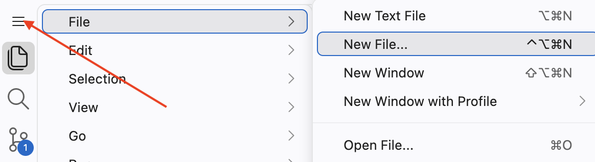{width=90%}

###

Select `Quarto Document` from the drop-down menu.

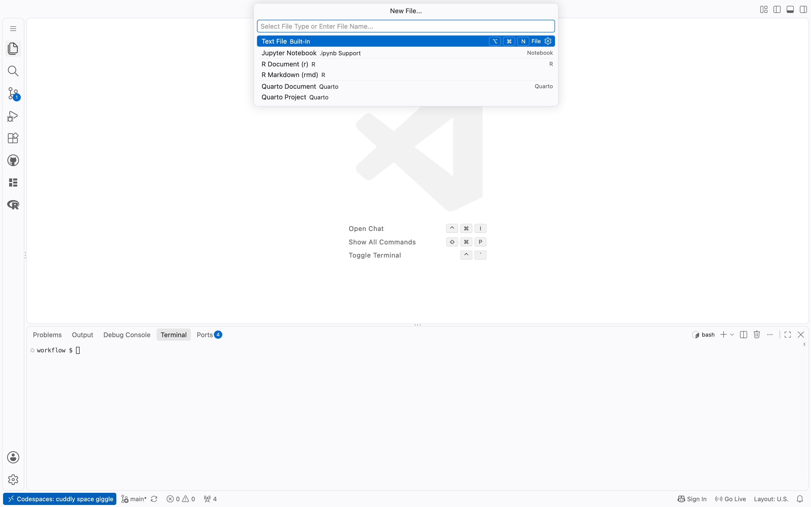{width=90%}

###

The top of the new document is called the YAML header. It should look like:

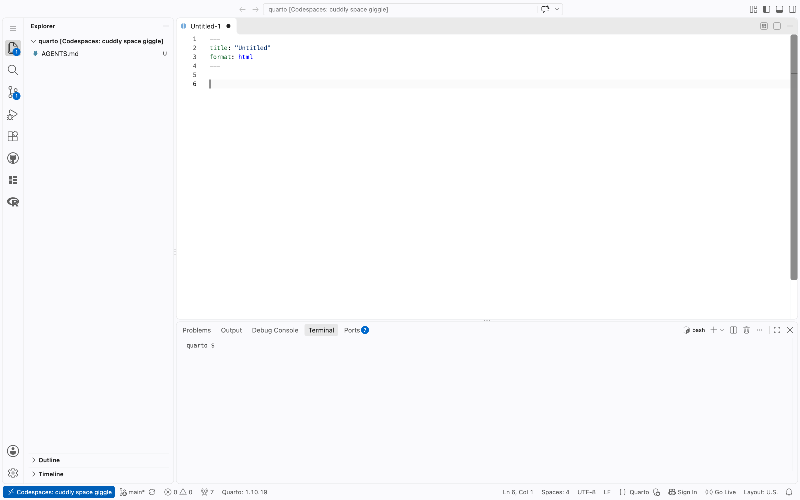{width=90%}

Change the title to “My First Quarto Document”.

###

In the bash Terminal, run `ls`. CP/CR.

```{r}
#| label: quarto-1-1
#| echo: false
learnr2::question(
  "In the bash Terminal, run ls. CP/CR.",
  type = "reflection",
  show_text = FALSE
)
```

###

```{.output}
quarto $ ls
AGENTS.md
quarto $
```

The only file is `AGENTS.md`, which `connect-repo` copied in when it created the repo --- it holds guidance for AI assistants working with you. Since we have not saved the new document yet, it does not appear in this listing.

The black dot next to the name indicates that the file has unsaved changes. The dot disappears when you save the file.

{width=90%}

###

If you already saved the file, your listing also shows `quarto-1.qmd`. An answer that differs from ours is never a problem.

###

Quarto is a command line tool, not an R package, so its commands run in a bash Terminal. The [Quarto documentation](https://quarto.org/) is the reference, and an AI is often the quickest way to get an answer.

### Exercise 2

Save the Quarto document with `File -> Save`. You can also use the shortcut `Cmd/Ctrl + S`.

Name the file `quarto-1.qmd`.

{width=90%}

Now that the file is saved, the black dot has disappeared. The `U` next to the name means that, according to Git, the file is **untracked**. It sits in the repo folder, but Git will not record it until you commit it.

###

Run `cat quarto-1.qmd` in the bash Terminal.

CP/CR.

```{r}
#| label: quarto-1-2
#| echo: false
learnr2::question(
  "Run cat quarto-1.qmd in the bash Terminal. CP/CR.",
  type = "reflection",
  show_text = FALSE
)
```

###

```{.output}
quarto $ cat quarto-1.qmd
---
title: "My First Quarto Document"
format: html
---
quarto $
```

###

A Quarto file uses `qmd` as its extension, where those initials stand for **Q**uarto **M**arkdown **D**ocument. We will often say *QMD*, in the same way that we use *PNG* for some image files. There is no necessary connection between the **title** of a Quarto document --- “My First Quarto Document” --- and the **name** of the file, `quarto-1.qmd`.

###

Here is an example of a Quarto file:


````{verbatim}
---
title: "My First Quarto Document"
author: "Your Name"
format: html
---

## Quarto

Quarto enables you to weave together content and executable code into a finished document. To learn more about Quarto, see <https://quarto.org>.

## Running Code

When you click the **Render** button, a document will be generated that includes both content and the output of embedded code. You can embed code like this:

```{r}
1 + 1
```

You can add options to executable code like this:

```{r}
#| echo: false
2 * 2
```

The `echo: false` option disables the printing of code (only output is displayed).
````

### 

A lot of the text is regular plain text, not code. However, there are code chunks (denoted by triple backticks on both ends, `` ```[code here]``` ``) that allow us to execute code when the document is "rendered." To "render" a Quarto document is to transform it into an HTML, PDF, DOCX, or other output file format while also running any embedded code. Here's an example of an R code chunk:

````{verbatim}
```{r}
1+1
```
````

Quarto documents use Markdown, an easy-to-write plain text format that can contain chunks of embedded code. These code chunks can be written in many languages, including R and Python. Code chunks allow you to use a programming language to create plots and other graphics.

### 

The [YAML header](https://bookdown.org/yihui/rmarkdown-cookbook/rmarkdown-anatomy.html) is everything between the dashed lines at the top of the file, including the dashed lines themselves. It holds "metadata" about the document, things like the title and the author. `format: html` means that the document will be rendered as an HTML file.

### Exercise 3

To "render" our Quarto document, use the shortcut `Cmd/Ctrl + Shift + K`. Your screen should look something like this:

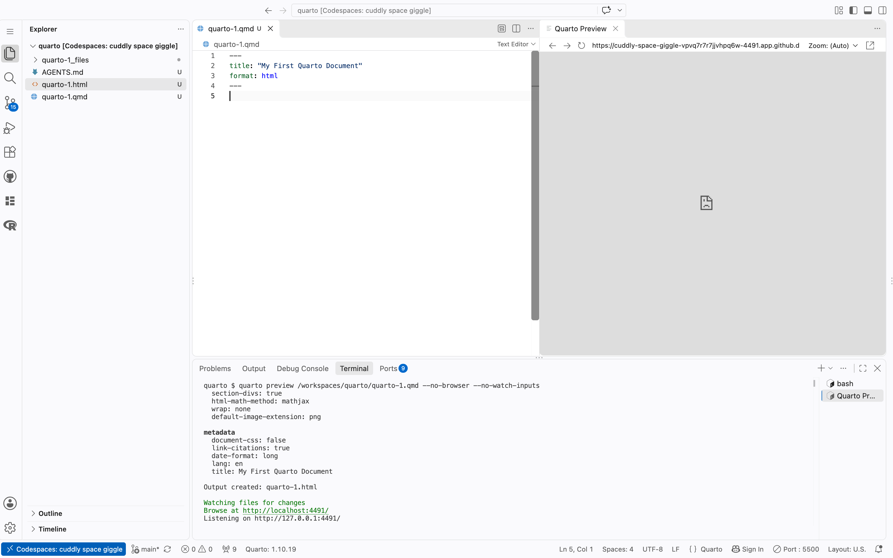{width=90%}

This command splits the Editor and opens a new tab titled "Quarto Preview" on the right. This displays the rendered document. It's often better to preview the document in a separate browser window. VS Code pops up a notice that your application is running on port NNNN, with an **Open in Browser** button. Ignore it for now.

###

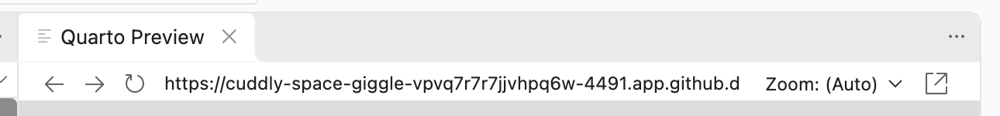{width=90%}

The Quarto Preview window shows what your Quarto document looks like now that it has been rendered as HTML. Its toolbar, shown above, has three controls. The circular arrow on the left is the "refresh" button, which re-renders the document, although this refresh generally happens automatically.

Next to it is the URL at which the rendered page is actually available (at least to you), via your Codespace.

At the far right, the box-with-an-arrow icon is the "Open in Browser" button, which opens the rendered document, using that same URL, in a browser window.

###

The list of terminals on the righthand side of the Panel shows two entries. The first, `bash`, is the terminal the Codespace opened when it switched to your new folder. The second, `Quarto Preview`, is a terminal that VS Code opened just now: it is where the `quarto preview` command is running, which is what generates the rendered document. (If the window did not switch after `connect-repo`, the list also holds the terminals you opened earlier.)

###

Using the `Cmd/Ctrl + Shift + K` shortcut causes VS Code to open a terminal named "Quarto Preview" and issue the `quarto preview` command, along with some options (`--no-browser --no-watch-inputs`), as you can see below.

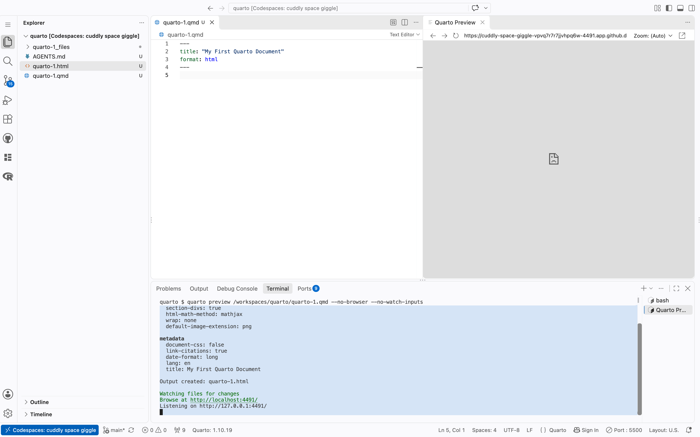{width=90%}

Use `Cmd/Ctrl + Shift + K` to preview your Quarto documents. Professionals save time with keyboard shortcuts rather than clicking buttons.

###

You can also open the HTML file in a browser window with `Cmd/Ctrl + click` on the "Browse at" link in that terminal. The "Listening on" address is the same page, so either link works.

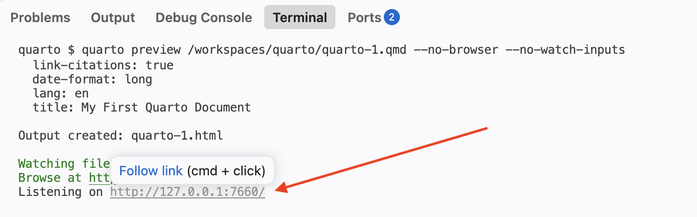{width=90%}

###

In the bash Terminal, run `ls`. CP/CR.

```{r}
#| label: quarto-1-3
#| echo: false
learnr2::question(
  "In the bash Terminal, run ls. CP/CR.",
  type = "reflection",
  show_text = FALSE
)
```

###

```{.output}
quarto $ ls
AGENTS.md  quarto-1.html  quarto-1.qmd  quarto-1_files
quarto $
```

In the Explorer, you should see a new file, `quarto-1.html`. This is the file created by rendering. 

### 

You should also see a new directory: `quarto-1_files`. Anytime you render a Quarto document, you create a directory like this, with the same name as the file, without the extension, plus `_files`. Quarto stores the support files for the rendered output there.

### Exercise 4

Look at the Source Control icon in the Activity Bar --- the one that looks like a branching line. Its badge shows how many files have changed, and the number is large: rendering just filled `quarto-1_files` with many small support files. Files that can be *regenerated* from your source do not belong in Git's history.

Create a new file named `.gitignore` --- note the leading dot --- containing this single line:

```default
quarto-1_files
```

Don't forget the blank line at the end. Save it, and watch the badge drop.

In the bash Terminal, run `cat .gitignore`. CP/CR.

```{r}
#| label: quarto-1-4
#| echo: false
learnr2::question(
  "In the bash Terminal, run cat .gitignore. CP/CR.",
  type = "reflection",
  show_text = FALSE
)
```

###

```{.output}
quarto $ cat .gitignore
quarto-1_files
quarto $
```

###

`.gitignore` tells Git which files to leave alone: one name per line, matched against the files and folders in your repo. Our single line names the `quarto-1_files` directory exactly. The rendered HTML itself stays tracked --- unlike the `_files` directory, it is the artifact your readers will eventually see.

### Exercise 5

The HTML document created from a QMD file shows, by default, both the code and the results that code generates. That is what makes a Quarto document reproducible.

Add a couple of blank lines to the bottom of `quarto-1.qmd`. Then, add an R code chunk by selecting the `More Actions ...` button --- the three dots in the top-right of the editor. 

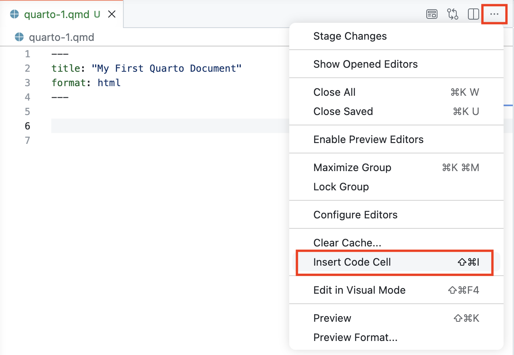{width=90%}

Then, choose `Insert Code Cell`, selecting `r` from the list of options. Within the code cell, add `6 + 3`.

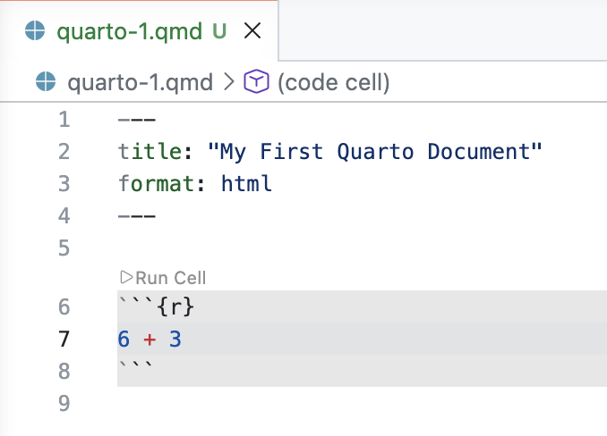{width=90%}

You can also insert a code cell with the shortcut key: `Cmd/Ctrl + Shift + I`. 

Save the file. Render it again.

Open an R Terminal: use the drop-down beside `+` on the right side of the Panel, then choose **R Terminal**. Its tab is labeled **R Interactive**. In the R Terminal, run:

```r
learnr2::show_file("quarto-1.qmd", pattern = "6")
```

CP/CR.


```{r}
#| label: quarto-1-5
#| echo: false
learnr2::question(
  "Add a couple of blank lines to the bottom of quarto-1.qmd. Then, add an R code chunk by selecting the More Actions ... button, the three dots in the top-right of the editor. Then, choose Insert Code Cell, selecting r from the list of options. Within the code cell, add 6 + 3. (You can also insert a code cell with the shortcut key Cmd/Ctrl + Shift + I.) Save the file. Render it again. Open an R Terminal: use the drop-down beside + on the right side of the Panel, then choose R Terminal. Its tab is labeled R Interactive. In the R Terminal, run learnr2::show_file(\"quarto-1.qmd\", pattern = \"6\"). CP/CR.",
  type = "reflection",
  show_text = FALSE
)
```

###

```{.output}
R 4.6.1> learnr2::show_file("quarto-1.qmd", pattern = "6")
6 + 3
```

###

`show_file()` with `pattern = "6"` returns only the lines that contain a `6`, here the one line you added to the code cell.

You did not strictly need to save the file before rendering it. The Codespace auto-saves after a short delay, which is why the black dot next to the file name disappears by itself, and `quarto preview` saves the file as well. Still, make a habit of saving your work before running it. Software that does not autosave will run your old code, and you will wonder why a fix did not work.

###

If you can no longer see the preview file, you can usually view it by checking the text that was printed in the **Quarto Preview** terminal when you rendered the QMD. That text will include something like this:

```{.output}
Watching files for changes
Browse at http://localhost:3807/
```

`Cmd/Ctrl + click` that link and you will be able to see the HTML. (Do not paste the address into a browser by hand: `localhost` here means your Codespace, a computer far away, and VS Code does the translation for you when you click.) In my case, the URL is `http://localhost:3807/`. Yours will be different.

### Exercise 6

Delete the first code cell. Add `This is my first Markdown text.` two lines below the YAML header. Save the file.

In the bash Terminal, run:

```bash
cat quarto-1.qmd
```

CP/CR.

```{r}
#| label: quarto-1-6
#| echo: false
learnr2::question(
  "Delete the first code cell. Add This is my first Markdown text. two lines below the YAML header. Save the file. In the bash Terminal, run cat quarto-1.qmd. CP/CR.",
  type = "reflection",
  show_text = FALSE
)
```

###

```{.output}
quarto $ cat quarto-1.qmd
---
title: "My First Quarto Document"
format: html
---

This is my first Markdown text.
quarto $
```

###

Make sure your file ends with an empty line, so that the `quarto $` prompt appears on its own line rather than glued to the end of your text. Ending a file with a newline is almost always a good idea.

### Exercise 7

In Quarto documents, you can use [Markdown syntax](https://quarto.org/docs/authoring/markdown-basics.html). You can use this to create **bold** or *italic* text (and even text that's both ***bold and italic***), and headers.

### 

Replace the one sentence already in `quarto-1.qmd` with `## My Header`. Skip a line and add this text. 

```markdown
You can do a lot of cool things in Quarto like **bold** and *italic* text.
```

Render the file again and check the result in the Quarto Preview pane or your browser.

### 

In the bash Terminal, run:

```bash
cat quarto-1.qmd
```

CP/CR.


```{r}
#| label: quarto-1-7
#| echo: false
learnr2::question(
  "Replace the one sentence already in quarto-1.qmd with ## My Header. Skip a line and add this text: You can do a lot of cool things in Quarto like **bold** and *italic* text. Render the file again and check the result in the Quarto Preview pane or your browser. In the bash Terminal, run cat quarto-1.qmd. CP/CR.",
  type = "reflection",
  show_text = FALSE
)
```

###

```{.output}
quarto $ cat quarto-1.qmd
---
title: "My First Quarto Document"
format: html
---

## My Header

You can do a lot of cool things in Quarto like **bold** and *italic* text.
quarto $
```

###

You can find a full list of Markdown formatting styles and commands [here](https://www.markdownguide.org/basic-syntax/).

From now on, instead of writing "Render the document," we will write `Cmd/Ctrl + Shift + K`.

That shortcut runs the "Preview" command, which renders the QMD once and then keeps watching it, re-rendering whenever it changes.

### Exercise 8

So far you have viewed your rendered document in the "Quarto Preview" pane inside VS Code. There is a second way to view it, and it is the one you will rely on in later tutorials: the **Live Server** extension, which opens the HTML file in its own browser tab and refreshes it automatically whenever the file changes.

In the Explorer (the file tree on the left side of VS Code), find `quarto-1.html`. Right-click it and select **"Open with Live Server"**.

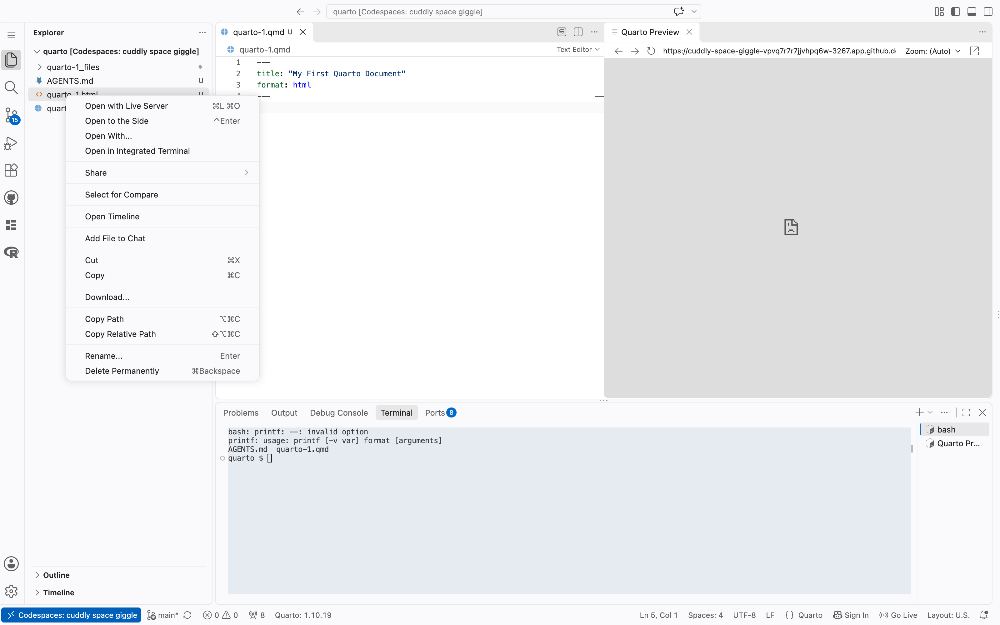{width=90%}

Two notices pop up --- "Server is Started at port : 5500" and "Your application running on port 5500 is available" --- and **Port : 5500** appears in the Status Bar at the bottom of the window.

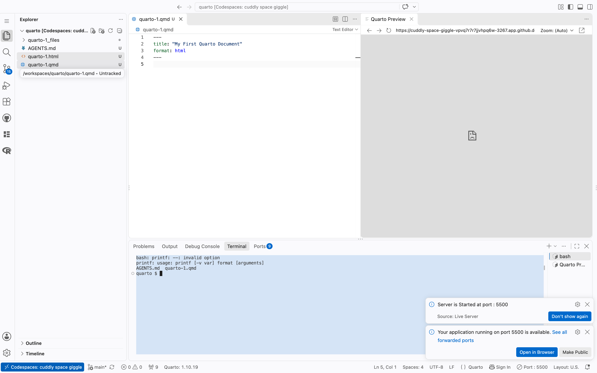{width=90%}

A new browser tab opens with `quarto-1.html`, served through your Codespace. The URL will look something like `https://[codespace-name]-5500.app.github.dev/quarto-1.html`.

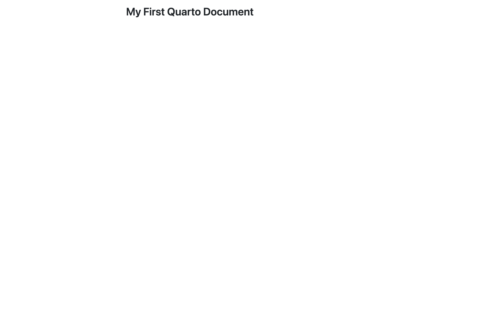{width=90%}

Copy/paste that URL below.

```{r}
#| label: quarto-1-8
#| echo: false
learnr2::question(
  "In the Explorer (the file tree on the left side of VS Code), find quarto-1.html. Right-click it and select Open with Live Server. Two notices pop up, Server is Started at port : 5500 and Your application running on port 5500 is available, and Port : 5500 appears in the Status Bar at the bottom of the window. A new browser tab opens with quarto-1.html, served through your Codespace. The URL will look something like https://[codespace-name]-5500.app.github.dev/quarto-1.html. Copy/paste that URL below.",
  type = "reflection",
  show_text = FALSE
)
```

###

```{.output}
https://congenial-chainsaw-wv757pv4pp67cpw-5500.app.github.dev/quarto-1.html
```

Keep this tab open. Every time `quarto-1.html` is updated in your Codespace --- whether you re-render with `Cmd/Ctrl + Shift + K` or run `quarto render` yourself --- the tab will refresh automatically.

###

Live Server is a VS Code extension that hosts HTML files so they can be viewed in a browser and reloads the page whenever a file changes. This is necessary in a Codespace because the files live on a remote computer and cannot be opened directly in a browser.

###

The "Quarto Preview" pane is quick and lives inside the editor. Live Server gives you a real browser tab that behaves exactly like the published web page your readers will eventually see, which is why later tutorials lean on it. Use whichever you prefer.

### Exercise 9

Your first Quarto document is done, so commit it. Through the Source Control view, as you did in the Code tutorial: review **Changes** --- you should see `.gitignore`, `AGENTS.md`, `quarto-1.qmd`, and `quarto-1.html`, but no `_files` directory, thanks to your `.gitignore` --- type `Add quarto-1` as the message, press **Commit**, then **Publish Branch**. (This is the first push from a brand-new repo, which is why the button says **Publish Branch**. After this, it will say **Sync Changes**.)

In the bash Terminal, run `git log -1`. CP/CR.

```{r}
#| label: quarto-1-9
#| echo: false
learnr2::question(
  "In the bash Terminal, run git log -1. CP/CR.",
  type = "reflection",
  show_text = FALSE
)
```

###

```{.output}
quarto $ git log -1
commit 2f8b4c6d9e1a3b5c7d9e0f2a4b6c8d0e2f4a6b8c (HEAD -> main, origin/main)
Author: Your Name <your-username@users.noreply.github.com>
Date:   Fri Aug 14 16:02:18 2026 +0000

    Add quarto-1
quarto $
```

###

`main` and `origin/main` on the same line means your Codespace and GitHub agree. The `-1` limits `git log` to the most recent commit.

## Quarto 2

Restart your R session. (In other words, close your current R Terminal and open a new one.)

Let's create another Quarto document to explore how to include R code within it.

### Exercise 1

Follow the same procedure as last time to create a new Quarto document. `File -> New File... -> Quarto Document`. Use "My Second Quarto Document" as the title and add your name as the author. Save the document as `quarto-2.qmd`. `Cmd/Ctrl + Shift + K`.

In the bash Terminal, run `ls`. CP/CR.

```{r}
#| label: quarto-2-1
#| echo: false
learnr2::question(
  "In the bash Terminal, run ls. CP/CR.",
  type = "reflection",
  show_text = FALSE
)
```

### 

The listing should include `quarto-2.qmd`, `quarto-2.html`, and the `quarto-2_files` directory, alongside `AGENTS.md` and the `quarto-1` files from earlier.

### Exercise 2

Add a code cell by using the shortcut key combination: `Cmd/Ctrl + Shift + I`. (In other words, on the Mac, the shortcut key is `Cmd + Shift + I` while on Windows it is `Ctrl + Shift + I`.)

The newly created code cell will be empty.

Save the file.

In the bash Terminal, run:

```bash
cat quarto-2.qmd
```

CP/CR.

```{r}
#| label: quarto-2-2
#| echo: false
learnr2::question(
  "Add a code cell by using the shortcut key combination Cmd/Ctrl + Shift + I. (On the Mac, the shortcut key is Cmd + Shift + I while on Windows it is Ctrl + Shift + I.) The newly created code cell will be empty. Save the file. In the bash Terminal, run cat quarto-2.qmd. CP/CR.",
  type = "reflection",
  show_text = FALSE
)
```

###

````{verbatim}
---
title: "My Second Quarto Document"
author: "Your Name"
format: html
---

```{r}
```
````

###

The curly braces `{}` at the top of the chunk hold an `r`, which tells Quarto to run the code with R.

Code chunks can hold any programming language, from common ones like Python, Java, and C to esoteric ones like INTERCAL and Whitespace. Name the language in the curly braces: `{python}`, `{ruby}`, and so on.

### Exercise 3

Put `2 * 2` within the code chunk. `Cmd/Ctrl + Shift + K`. Take a screenshot of the entire rendered document and paste it below. (This allows us to confirm that your file rendered correctly.) To take a screenshot, press `Cmd + Ctrl + Shift + 4` on a Mac, `Win + Shift + S` on Windows, or `Ctrl + Shift + Show windows` on a Chromebook, select the area, then click in the answer box and press `Cmd + V` (Mac) or `Ctrl + V` (Windows) to paste it.

```{r}
#| label: quarto-2-3
#| echo: false
learnr2::question(
  "Put 2 * 2 within the code chunk. Cmd/Ctrl + Shift + K. Take a screenshot of the entire rendered document and paste it below. (This allows us to confirm that your file rendered correctly.)",
  type = "reflection",
  allow_image = TRUE,
  allow_text = FALSE,
  show_text = FALSE
)
```

### 

Here is what we got:

```{.output}
My Second Quarto Document
2 * 2

[1] 4
```

The rendered page shows both the code and its result. Anyone can re-render the document and confirm that result, which is what "reproducible" means.

### Exercise 4

You can add options to code chunks. In Quarto, code chunk options are always preceded by `#|`, pronounced "hash-pipe", followed by an option/value pair, separated by a colon. A chunk can have several options. Each goes on its own line, and the order does not matter.

Add two options above the `2 * 2` calculation: `#| echo: false` and `#| label: calculation`.

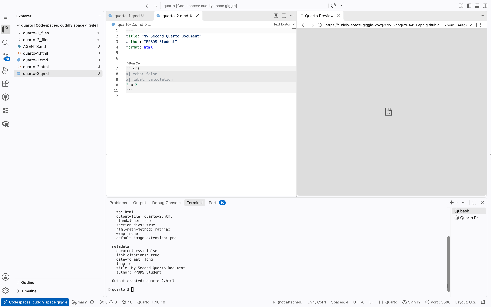{width=90%}

`Cmd/Ctrl + Shift + K`. Paste a screenshot of the HTML below.

```{r}
#| label: quarto-2-4
#| echo: false
learnr2::question(
  "Add two options above the 2 * 2 calculation: #| echo: false and #| label: calculation. Cmd/Ctrl + Shift + K. Paste a screenshot of the HTML below.",
  type = "reflection",
  allow_image = TRUE,
  allow_text = FALSE,
  show_text = FALSE
)
```

###

```{.output}
My Second Quarto Document
[1] 4
```

`echo: false` prevents the code, but not the results, from appearing in the finished file. Use this when writing reports aimed at people who don’t want to see the underlying R code, which is the vast majority of people you will ever write for. The `label` option, by contrast, has no effect on the output at all. Labels are for organizing your work. Keep them short but evocative, with dashes (`-`) rather than underscores or spaces.

### Exercise 5

Delete the current code chunk. Add a new one. In this new code chunk, put `library(tidyverse)`. `Cmd/Ctrl + Shift + K`. A message about "Attaching core tidyverse packages" should appear in the HTML file. Paste a screenshot of the rendered file below.


```{r}
#| label: quarto-2-5
#| echo: false
learnr2::question(
  "Delete the current code chunk. Add a new one. In this new code chunk, put library(tidyverse). Cmd/Ctrl + Shift + K. A message about \"Attaching core tidyverse packages\" should appear in the HTML file. Paste a screenshot of the rendered file below.",
  type = "reflection",
  allow_image = TRUE,
  allow_text = FALSE,
  show_text = FALSE
)
```

### 

```{.output}
My Second Quarto Document
library(tidyverse)

── Attaching core tidyverse packages ──────────────────────────────── tidyverse 2.0.0 ──
✔ dplyr     1.2.1     ✔ readr     2.2.0
✔ forcats   1.0.1     ✔ stringr   1.6.0
✔ ggplot2   4.0.3     ✔ tibble    3.3.1
✔ lubridate 1.9.5     ✔ tidyr     1.3.2
✔ purrr     1.2.2
── Conflicts ────────────────────────────────────────────────── tidyverse_conflicts() ──
✖ dplyr::filter() masks stats::filter()
✖ dplyr::lag()    masks stats::lag()
ℹ Use the conflicted package (<http://conflicted.r-lib.org/>) to force all conflicts to become errors
```

We will include the **tidyverse** package in almost every Quarto document that we create. In fact, the top of most Quarto documents includes a code chunk that loads all the packages that we use in the analysis.

### Exercise 6

Add `#| message: false` to the code chunk. `Cmd/Ctrl + Shift + K`. Paste a screenshot of the entire rendered file below.

```{r}
#| label: quarto-2-6
#| echo: false
learnr2::question(
  "Add #| message: false to the code chunk. Cmd/Ctrl + Shift + K. Paste a screenshot of the entire rendered file below.",
  type = "reflection",
  allow_image = TRUE,
  allow_text = FALSE,
  show_text = FALSE
)
```

### 

```{.output}
My Second Quarto Document
library(tidyverse)
```

`message: false` hides the attach message. We almost always do this, because readers care about the analysis, not about which packages loaded.

### Exercise 7

Instead of setting `echo: false` chunk by chunk, we can set it once for the whole document. Add

```yaml
execute:
  echo: false
```

to the bottom of the YAML header. Make sure `echo: false` is indented with two spaces. `Cmd/Ctrl + Shift + K`. The rendered file should now be empty except for the title: every chunk still runs, but no code appears.

###

YAML is very fussy about formatting. Let's confirm this by breaking it: edit the YAML header so that `echo: false` is no longer indented. `Cmd/Ctrl + Shift + K`.

Copy/paste the error that appears.

```{r}
#| label: quarto-2-7
#| echo: false
learnr2::question(
  "Add execute: echo: false to the bottom of the YAML header, with execute: on one line and echo: false on the next line, indented with two spaces. Cmd/Ctrl + Shift + K. The rendered file should now be empty except for the title. YAML is very fussy about formatting. Confirm this by breaking it: edit the YAML header so that echo: false is no longer indented. Cmd/Ctrl + Shift + K. Copy/paste the error that appears.",
  type = "reflection",
  show_text = FALSE
)
```

###

```{.output}
Error

Validation of YAML front matter failed.
In file quarto-2.qmd
(line 5, columns 1--8) Field "execute" has empty value but it must instead be an object
4: format: html
5: execute:
          ~
6: echo: false

Render failed due to invalid YAML.
```

###

Indent `echo: false` again. `Cmd/Ctrl + Shift + K` to confirm that everything works. Any code chunk option that applies to most or all chunks belongs in the YAML header under `execute:`. An option for just one or two chunks stays in those chunks, preceded by `#|`.

### Exercise 8

Add another code chunk option: `label: setup`. Don't forget to preface it with the hash-pipe: `#|`.

`Cmd/Ctrl + Shift + K`. Paste a screenshot of the HTML below.

```{r}
#| label: quarto-2-8
#| echo: false
learnr2::question(
  "Add another code chunk option: label: setup. Don't forget to preface it with the hash-pipe: #|. Cmd/Ctrl + Shift + K. Paste a screenshot of the HTML below.",
  type = "reflection",
  allow_image = TRUE,
  allow_text = FALSE,
  show_text = FALSE
)
```

### 

You may label chunks however you like, but `setup` is the conventional name for the chunk that loads libraries and does other housekeeping, and readers of your code will look for it there. Every chunk label in a document must be unique.

### Exercise 9

There are two different "worlds" here. One is the Quarto document, the QMD file. The other is the R Terminal. **These worlds only connect when we connect them.** Code in a Quarto document --- or an R script --- is not part of an R Terminal session until you run it there. An R Terminal session holds only the commands executed in that terminal.

### 

Right now, the **tidyverse** package has not been loaded into the current R session. To load it, you must run the code chunk. To do so, first place your cursor inside the code chunk. Then, you have multiple options, including:

* `Cmd/Ctrl + Shift + Enter` will run all the code in the code chunk.

* `Cmd/Ctrl + Enter` will run just the code at the line in which the cursor is located.

* Press the small triangle --- labeled "Run Cell" --- directly above the code chunk. This runs all the code in the chunk/cell. (Again, the terms cell and chunk are used interchangeably.)

Run the code chunk. Then, run `pull(mtcars, 1)` in the R Terminal. CP/CR.

```{r}
#| label: quarto-2-9
#| echo: false
learnr2::question(
  "Run the code chunk. Then, run pull(mtcars, 1) in the R Terminal. CP/CR.",
  type = "reflection",
  show_text = FALSE
)
```

###

```{.output}
R 4.6.1> pull(mtcars, 1)
 [1] 21.0 21.0 22.8 21.4 18.7 18.1 14.3 24.4 22.8 19.2 17.8 16.4 17.3 15.2 10.4
[16] 10.4 14.7 32.4 30.4 33.9 21.5 15.5 15.2 13.3 19.2 27.3 26.0 30.4 15.8 19.7
[31] 15.0 21.4
```

Your lines may break in different places, depending on the width of your terminal. `pull()` is a **dplyr** function. It extracts one column --- here the first, `mpg` --- from a data frame as a plain vector.

If you run this command without running `library(tidyverse)` in the R Terminal, you will get an error about not finding the "pull" function. The fact that `library(tidyverse)` exists in the QMD, and that you have "used" it there by rendering the document, has no bearing on the world of the R Terminal.

### Exercise 10

Let's create the following scatterplot in our Quarto document:

```{r}
#| label: quarto-2-10-plot
#| echo: false
scat_p <- ggplot(data = iris,
                 mapping = aes(x = Sepal.Width,
                               y = Sepal.Length,
                              color = Species)) +
  geom_point() +
  labs(title = "Measurements for Different Species of Iris",
       subtitle = "Virginica has the longest sepals",
        x = "Sepal Width",
        y = "Sepal Length",
       caption = "Fisher (1936)")
scat_p
```

### 

Create a new code chunk. 

Use AI to recreate the chart you see above using R. You can describe it in words, or even use the image of the chart itself. Then paste the code you get back into your new code chunk.

### 

Preview the file. You should see your plot --- but not the code that made it. The `execute: echo: false` you added to the YAML header in Exercise 7 applies to every chunk in the document, including this new one.

In the R Terminal, run:

```r
learnr2::show_file("quarto-2.qmd")
```

CP/CR.

```{r}
#| label: quarto-2-10
#| echo: false
learnr2::question(
  "Create a new code chunk. Use AI to recreate the scatterplot shown above (the iris data, with Sepal.Width on the x-axis, Sepal.Length on the y-axis, points colored by Species, and the title \"Measurements for Different Species of Iris\") using R. You can describe it in words, or even use the image of the chart itself. Then paste the code you get back into your new code chunk. Preview the file. You should see your plot but not the code that made it. In the R Terminal, run learnr2::show_file(\"quarto-2.qmd\"). CP/CR.",
  type = "reflection",
  show_text = FALSE
)
```

###

```{.output}
ggplot(data = iris,
       mapping = aes(x = Sepal.Width,
                     y = Sepal.Length,
                     color = Species)) +
  geom_point() +
  labs(title = "Measurements for Different Species of Iris",
       subtitle = "Virginica has the longest sepals",
       x = "Sepal Width",
       y = "Sepal Length",
       caption = "Fisher (1936)")
```

###

The pipe `|>` replaced the older `%>%`, but AI often still writes `%>%`. If yours did, tell it to use `|>` instead.

###

**Never include `install.packages()` in a Quarto document or R script that you share.** AI tools often suggest it. Code that installs packages changes someone else's computer, and the `library()` call already tells readers which packages they need.

### Exercise 11

Rendering `quarto-2.qmd` created a new support directory, `quarto-2_files`, and the Source Control badge has jumped again. Your `.gitignore` names `quarto-1_files` exactly, so this new directory is not covered.

Add `quarto-2_files` to `.gitignore` on its own line. Save the file, and watch the badge drop.

In the bash Terminal, run `cat .gitignore`. CP/CR.

```{r}
#| label: quarto-2-11
#| echo: false
learnr2::question(
  "In the bash Terminal, run cat .gitignore. CP/CR.",
  type = "reflection",
  show_text = FALSE
)
```

###

```{.output}
quarto $ cat .gitignore
quarto-1_files
quarto-2_files
quarto $
```

###

A `.gitignore` grows one line at a time as a project accumulates generated files. Git also accepts wildcard patterns --- a single line reading `*_files` would cover both directories at once --- but exact names are easier to read and to reason about.

### Exercise 12

Commit and push. Use the commit message `Add quarto-2`.

Then, in the bash Terminal, run `git status`. CP/CR.

```{r}
#| label: quarto-2-12
#| echo: false
learnr2::question(
  "Commit and push. Use the commit message Add quarto-2. Then, in the bash Terminal, run git status. CP/CR.",
  type = "reflection",
  show_text = FALSE
)
```

###

```{.output}
quarto $ git status
On branch main
Your branch is up to date with 'origin/main'.

nothing to commit, working tree clean
quarto $
```

###

`git status` confirms nothing was left behind. A clean working tree, up to date with `origin/main`, means all of your work is on GitHub.

## Publishing

A rendered HTML file in your Codespace can be seen by nobody but you. In this final section you will publish `quarto-2.qmd` --- your document with its AI-made scatterplot --- to the web, where anyone can see it.

### Exercise 1

So far you have rendered with `Cmd/Ctrl + Shift + K`. This time, render from the **bash Terminal**, the way later tutorials always will:

```bash
quarto render quarto-2.qmd
```

Then, in the Explorer, right-click `quarto-2.html` and choose **Open with Live Server**. Keep that tab open --- it refreshes every time you render.

CP/CR the render command and its output.

```{r}
#| label: publishing-1
#| echo: false
learnr2::question(
  "Render from the bash Terminal: run quarto render quarto-2.qmd. Then, in the Explorer, right-click quarto-2.html and choose Open with Live Server. Keep that tab open. CP/CR the render command and its output.",
  type = "reflection",
  show_text = FALSE
)
```

###

```{.output}
quarto $ quarto render quarto-2.qmd


processing file: quarto-2.qmd
1/5
2/5 [setup]
3/5
4/5 [unnamed-chunk-1]
5/5
output file: quarto-2.knit.md

pandoc
  to: html
  output-file: quarto-2.html
  standalone: true
  section-divs: true
  html-math-method: mathjax
  wrap: none
  default-image-extension: png

metadata
  document-css: false
  link-citations: true
  date-format: long
  lang: en
  title: My Second Quarto Document
  author: Your Name

Output created: quarto-2.html

quarto $
```

The render names each chunk as it runs it: `setup`, then your plotting chunk, which knitr calls `unnamed-chunk-1` because you never gave it a label. Then pandoc turns the result into HTML, and `Output created` tells you it worked.

###

Your document now has a YAML header, a `setup` chunk that loads libraries, and a work chunk that makes a graphic. That is the skeleton of every analysis document you will make from now on.

###

The shortcut runs `quarto preview`, which renders once and then keeps watching your file, re-rendering on every save. `quarto render` renders once and stops. Later tutorials assume the loop you just used: edit, `quarto render`, check the refreshed Live Server tab.

### Exercise 2

An HTML file in your repo on GitHub is still not a web page. [GitHub Pages](https://pages.github.com/) solves this: it serves files from your repository as a public website, with a real URL you can share.

Publishing should always start from committed work. In the bash Terminal, run `git status` --- if it shows anything to commit, commit and push before continuing.

Then run `quarto publish gh-pages quarto-2.qmd`. Respond with "Y" when it asks whether you want to publish. (This might take a minute.) CP/CR.

```{r}
#| label: publishing-2
#| echo: false
learnr2::question(
  "In the bash Terminal, run git status. If it shows anything to commit, commit and push before continuing. Then run quarto publish gh-pages quarto-2.qmd. Respond with \"Y\" when it asks whether you want to publish. (This might take a minute.) CP/CR.",
  type = "reflection",
  show_text = FALSE
)
```

###

```{.output}
quarto $ quarto publish gh-pages quarto-2.qmd
? Publish site to https://your-username.github.io/quarto/ using gh-pages? (Y/n) › Yes
Switched to a new branch 'gh-pages'
[gh-pages (root-commit) 0e5631c] Initializing gh-pages branch
remote:
remote: Create a pull request for 'gh-pages' on GitHub by visiting:
remote:      https://github.com/your-username/quarto/pull/new/gh-pages
remote:
To https://github.com/your-username/quarto.git
 * [new branch]      HEAD -> gh-pages
Switched to branch 'main'
Your branch is up to date with 'origin/main'.
From https://github.com/your-username/quarto
 * branch            gh-pages   -> FETCH_HEAD
Rendering for publish:


processing file: quarto-2.qmd
1/5
2/5 [setup]
3/5
4/5 [unnamed-chunk-1]
5/5
output file: quarto-2.knit.md

pandoc
  to: html
  output-file: quarto-2.html
  standalone: true
  section-divs: true
  html-math-method: mathjax
  wrap: none
  default-image-extension: png

metadata
  document-css: false
  link-citations: true
  date-format: long
  lang: en
  title: My Second Quarto Document
  author: Your Name

Preparing worktree (resetting branch 'gh-pages'; was at 0e5631c)
branch 'gh-pages' set up to track 'origin/gh-pages'.
HEAD is now at 0e5631c Initializing gh-pages branch
fatal: pathspec '.' did not match any files
[gh-pages 9c1d2a4] Built site for gh-pages
 16 files changed, 4319 insertions(+)
 create mode 100644 .nojekyll
 create mode 100644 index.html
 create mode 100644 quarto-2.html
 create mode 100644 quarto-2_files/figure-html/unnamed-chunk-1-1.png
 create mode 100644 quarto-2_files/libs/bootstrap/bootstrap.min.js
 ...
To https://github.com/your-username/quarto.git
   0e5631c..9c1d2a4  HEAD -> gh-pages

[✓] Deploying gh-pages branch to website (this may take a few minutes)
[✓] Published to https://your-username.github.io/quarto/

quarto $
```

The line `fatal: pathspec '.' did not match any files` looks alarming but is harmless --- the brand-new `gh-pages` branch simply had nothing in it yet --- and the run carries on to `[✓] Published to https://your-username.github.io/quarto/`. Your page lives at that address plus the file name, `https://your-username.github.io/quarto/quarto-2.html`. `quarto publish` also made a copy called `index.html`, so the bare address works too.

###

`quarto publish` put the rendered HTML on a separate Git "branch" called `gh-pages`, keeping it apart from your source on `main`. GitHub Pages then serves that branch as a website. GitHub Pages is one host among several --- [Netlify](https://www.netlify.com/) and [Quarto Pub](https://quartopub.com/) are popular alternatives.

### Exercise 3

The publish command printed (and may have opened in your browser) the address of your page. It can take a minute or two for the page to appear. Copy/paste the URL of your published page.

```{r}
#| label: publishing-3
#| echo: false
learnr2::question(
  "The publish command printed (and may have opened in your browser) the address of your page. It can take a minute or two for the page to appear. Copy/paste the URL of your published page.",
  type = "reflection",
  show_text = FALSE
)
```

###

```{.output}
https://your-username.github.io/quarto/quarto-2.html
```

###

Anyone you send that URL to can read the page. Nearly every later tutorial ends the same way: edit, render, publish.

## Summary

This tutorial covered how to create [Quarto documents](https://docs.posit.co/ide/user/ide/guide/documents/quarto-project.html#creating-new-documents) using [GitHub Codespaces](https://github.com/features/codespaces), finishing with a document published to the web via GitHub Pages. Some material was from [*R for Data Science (2e)*](https://r4ds.hadley.nz/) by Hadley Wickham, Mine Çetinkaya-Rundel, and Garrett Grolemund.


## Download answers

```{r}
#| label: download-answers-1
#| echo: false
learnr2::question(
  "How many minutes, approximately, did it take you to complete this
  tutorial? For example, an hour and a half would be 90 minutes.",
  type = "reflection_editable",
  validate = "integer"
)
```

###

```{r}
#| label: download-answers-2
#| echo: false
learnr2::download_answers_button(filename_prefix = "quarto")
```
