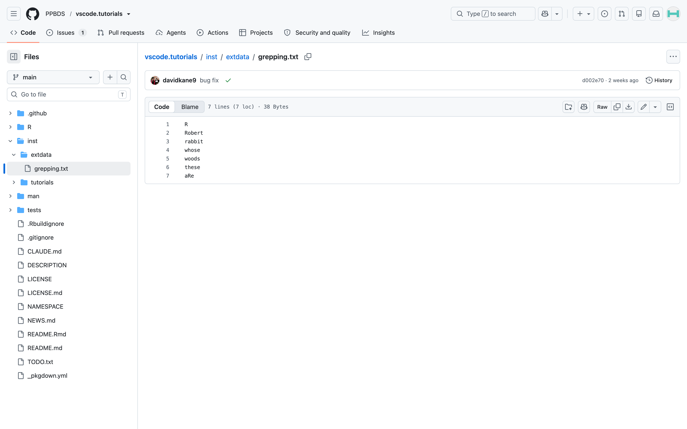




## Information

```{r}
#| label: information-1
#| echo: false
learnr2::student_info()
```

<!-- Explain more often that these are all programs that spit out stuff, which can often be chained together or just allowed to dump. -->

<!-- Mention Rscript and python -e. -->

<!-- Add a brief discussion of environment variables? -->

<!-- Could have test cases which confirm that these commands match what I think they should, I think. -->


## Introduction

This tutorial builds on Terminal 1 and Terminal 2. You know the core bash commands, paths, options, and how programs run. Here we cover three final topics. **Wildcards** match many file names at once using metacharacters like `*`. **grep** searches for patterns *inside* files. **Pipes** chain programs together. These are the grammar of the compound commands you will constantly read --- and approve or reject --- when AI agents work on your behalf.

Some material is from [*R for Data Science (2e)*](https://r4ds.hadley.nz/) by Hadley Wickham, Mine Çetinkaya-Rundel, and Garrett Grolemund.

###

You should be doing this tutorial in a repo named `terminal-3`. If you are not, create one and then connect to it.

## Wildcards

You will learn how to search for files by using **wildcards** to form **wildcard patterns**, which the shell expands into lists of matching file names.

### Exercise 1

In a bash Terminal, use `pwd` to confirm that you are in your default working directory, `/workspaces/terminal-3`. Use `mkdir` to create a directory named `wildcards`. CP/CR.

```{r}
#| label: wildcards-1
#| echo: false
learnr2::question(
  "In a bash Terminal, use pwd to confirm that you are in your default working directory, /workspaces/terminal-3. Use mkdir to create a directory named wildcards. CP/CR.",
  type = "reflection",
  show_text = FALSE
)
```

###

```{.output}
terminal-3 $ pwd
/workspaces/terminal-3
terminal-3 $ mkdir wildcards
terminal-3 $
```

The `mkdir` command does not produce any output. To confirm that it had the desired effect, you could run `ls`.

### Exercise 2

Change your working directory to `wildcards` using `cd`. Confirm the change with `pwd`. CP/CR.

```{r}
#| label: wildcards-2
#| echo: false
learnr2::question(
  "Change your working directory to wildcards using cd. Confirm the change with pwd. CP/CR.",
  type = "reflection",
  show_text = FALSE
)
```

###

```{.output}
terminal-3 $ cd wildcards/
wildcards $ pwd
/workspaces/terminal-3/wildcards
wildcards $
```

The prompt changed after we switched directories. Keep track of your current location. Right now, you are inside `wildcards`.

### Exercise 3

Using `echo`, make three text files named `hat.txt`, `cat.txt`, and `ate.txt` by running:

```bash
echo "" > hat.txt; echo "" > cat.txt; echo "" > ate.txt
```

The semicolons let you put three commands on one line. The shell runs them one after another.

Confirm that you have done so by running `ls`. (If you misname a file, remove it with `rm` and try again.)

CP/CR.

```{r}
#| label: wildcards-3
#| echo: false
learnr2::question(
  "Confirm that you have done so by running ls. (If you misname a file, remove it with rm and try again.) CP/CR.",
  type = "reflection",
  show_text = FALSE
)
```

###

```{.output}
wildcards $ echo "" > hat.txt; echo "" > cat.txt; echo "" > ate.txt
wildcards $ ls
ate.txt cat.txt hat.txt
wildcards $
```

`echo ""` prints an empty line. The `>` sends that line into a file instead of to the screen, creating the file if it does not exist.

### Exercise 4

Terminal commands allow the use of **wildcards**. A wildcard `*` represents zero or more of any character, and it is used to work with similarly named files as a group.

###

Let's generate a list of all our files whose names contain the letter `a`. First, try to run `ls a`. You will get an error message --- "No such file or directory" --- because there is no file named `a` in the working directory. CP/CR.

```{r}
#| label: wildcards-4
#| echo: false
learnr2::question(
  "Let's generate a list of all our files whose names contain the letter a. First, try to run ls a. You will get an error message -- \"No such file or directory\" -- because there is no file named a in the working directory. CP/CR.",
  type = "reflection",
  show_text = FALSE
)
```

###

```{.output}
wildcards $ ls a
ls: cannot access 'a': No such file or directory
wildcards $
```

Although we have been using `ls` to return all the contents of a directory, `ls` can also take a name as an argument, as above.

### Exercise 5

Run `ls a*`. The only return will be `ate.txt`. Because you put `*` after `a`, `ls` returns only files that begin with `a`. The "star" wildcard --- `*` --- matches anything. CP/CR.

```{r}
#| label: wildcards-5
#| echo: false
learnr2::question(
  "Run ls a*. The only return will be ate.txt. Because you put * after a, ls returns only files that begin with a. The \"star\" wildcard -- * -- matches anything. CP/CR.",
  type = "reflection",
  show_text = FALSE
)
```

###

```{.output}
wildcards $ ls a*
ate.txt
wildcards $
```

Although `*` will match strings of any length, its positioning matters. `a*` is not the same thing as `*a`. The first matches any string (i.e., any filename) that starts with `a`. The second matches any filename that ends with `a`.

### Exercise 6

Now run `ls *a*`. This should return all three files. CP/CR.

```{r}
#| label: wildcards-6
#| echo: false
learnr2::question(
  "Now run ls *a*. This should return all three files. CP/CR.",
  type = "reflection",
  show_text = FALSE
)
```

###

```{.output}
wildcards $ ls *a*
ate.txt cat.txt hat.txt
wildcards $
```

Note that these **wildcard patterns** are case-sensitive. The shell expands a wildcard pattern into the list of matching file names before the command even runs. `ls` never sees the `*`, only the names.

### Exercise 7

Make a list of all the files with names, before the suffix, that end in `t` by running `ls *t.*`. CP/CR.

```{r}
#| label: wildcards-7
#| echo: false
learnr2::question(
  "Make a list of all the files with names, before the suffix, that end in t by running ls *t.*. CP/CR.",
  type = "reflection",
  show_text = FALSE
)
```

###

```{.output}
wildcards $ ls *t.*
cat.txt hat.txt
wildcards $
```

Read this wildcard pattern --- `*t.*` --- as matching any string that includes a `t` followed directly by a period, regardless of any characters before or after. `ate.txt` is not matched because the `t` and the `.` are separated by `e`.

### Exercise 8

Save the output of our list of all the file names that contain `a` to a new file named `afiles.txt`. Keep pressing the **up** arrow key to navigate through your previous commands until you get to the command you used above: `ls *a*`. Then add `> afiles.txt` afterward and run the command. That is, you are running `ls *a* > afiles.txt`.

Then, run `ls` to confirm that it worked.

CP/CR.

```{r}
#| label: wildcards-8
#| echo: false
learnr2::question(
  "Then, run ls to confirm that it worked. CP/CR.",
  type = "reflection",
  show_text = FALSE
)
```

###

```{.output}
wildcards $ ls *a* > afiles.txt
wildcards $ ls
afiles.txt      ate.txt         cat.txt         hat.txt
wildcards $
```

The `up` and `down` arrow keys move through your command history. The `>` symbol redirects the output of the left-hand command into the named file.

### Exercise 9

Wildcards can be used with more than `ls`. Let's move `hat.txt` and `cat.txt` together into one directory.

First, make a new directory called `seuss` within the `wildcards` directory, where you are currently located.

Run `ls` to confirm. CP/CR.

```{r}
#| label: wildcards-9
#| echo: false
learnr2::question(
  "First, make a new directory called seuss within the wildcards directory, where you are currently located. Run ls to confirm. CP/CR.",
  type = "reflection",
  show_text = FALSE
)
```

###

Your answer should look like:

```{.output}
wildcards $ mkdir seuss
wildcards $ ls
afiles.txt      ate.txt         cat.txt         hat.txt         seuss
wildcards $
```

`wildcards` now holds five items, one of which is the `seuss` directory.

### Exercise 10

Run `ls -l`. CP/CR.

```{r}
#| label: wildcards-10
#| echo: false
learnr2::question(
  "Run ls -l. CP/CR.",
  type = "reflection",
  show_text = FALSE
)
```

###

```{.output}
wildcards $ ls -l
total 16
-rw-rw-rw- 1 rstudio rstudio   24 Oct 12 12:00 afiles.txt
-rw-rw-rw- 1 rstudio rstudio    1 Oct 12 12:00 ate.txt
-rw-rw-rw- 1 rstudio rstudio    1 Oct 12 12:00 cat.txt
-rw-rw-rw- 1 rstudio rstudio    1 Oct 12 12:00 hat.txt
drwxrwxrwx 2 rstudio rstudio 4096 Oct 12 12:00 seuss
wildcards $
```

The `-l` option provides a **l**ong-format listing of the contents of the directory, including information about the type of content (file versus directory) and the date and time each was last modified. The leading `d` in the line for `seuss` indicates that it is a directory.

### Exercise 11

Run `ls *t.*`. CP/CR.

```{r}
#| label: wildcards-11
#| echo: false
learnr2::question(
  "Run ls *t.*. CP/CR.",
  type = "reflection",
  show_text = FALSE
)
```

###

```{.output}
wildcards $ ls *t.*
cat.txt hat.txt
wildcards $
```

Before moving or otherwise acting on a group of files, we often want to ensure that we have the correct group. Running `ls` with the appropriate wildcard pattern is an easy way to test.

### Exercise 12

Use the previous command (since we have confirmed that it generates the list of files we want to move), but replace `ls` with `mv` and then add `seuss`, which indicates where we want to move the files. In other words, run `mv *t.* seuss`. CP/CR.

```{r}
#| label: wildcards-12
#| echo: false
learnr2::question(
  "Use the previous command (since we have confirmed that it generates the list of files we want to move), but replace ls with mv and then add seuss, which indicates where we want to move the files. In other words, run mv *t.* seuss. CP/CR.",
  type = "reflection",
  show_text = FALSE
)
```

###

```{.output}
wildcards $ mv *t.* seuss
wildcards $
```

The `mv` command, like `mkdir`, does not produce any output. You need to check by hand to ensure it has done what you wanted.

### Exercise 13

Run `ls -R`. CP/CR.

```{r}
#| label: wildcards-13
#| echo: false
learnr2::question(
  "Run ls -R. CP/CR.",
  type = "reflection",
  show_text = FALSE
)
```

###

Your answer should look like:

```{.output}
wildcards $ ls -R
afiles.txt      ate.txt         seuss

./seuss:
cat.txt hat.txt
wildcards $
```

The `-R` option to the `ls` command stands for **r**ecursive. We see not simply the contents of the current directory (two files and the `seuss` directory) but also the contents of the `seuss` directory itself.

### Exercise 14

Use `cd ..` to move out of the `wildcards` directory, one level up. Run `pwd`. CP/CR.

```{r}
#| label: wildcards-14
#| echo: false
learnr2::question(
  "Use cd .. to move out of the wildcards directory, one level up. Run pwd. CP/CR.",
  type = "reflection",
  show_text = FALSE
)
```

###

```{.output}
wildcards $ cd ..
terminal-3 $ pwd
/workspaces/terminal-3
terminal-3 $
```

You cannot delete a directory while you are inside it. We are about to remove `wildcards`, since this tutorial cleans up every temporary file and directory it creates.

### Exercise 15

Run `rm wildcards`. That command will fail because `wildcards` is a directory. Instead, you need to use `rm -r`, where the `-r` indicates **r**ecursive. Run `rm -r wildcards`. CP/CR.

```{r}
#| label: wildcards-15
#| echo: false
learnr2::question(
  "Run rm wildcards. That command will fail because wildcards is a directory. Instead, you need to use rm -r, where the -r indicates recursive. Run rm -r wildcards. CP/CR.",
  type = "reflection",
  show_text = FALSE
)
```

###

```{.output}
terminal-3 $ rm wildcards
rm: cannot remove 'wildcards': Is a directory
terminal-3 $ rm -r wildcards
terminal-3 $
```

If you tab-completed the name, your command probably reads `rm -r wildcards/` instead. The shell adds a slash when tab-completing a directory, to show you that the object is a directory rather than a file. Both `wildcards` and `wildcards/` refer to the same entity, so either command works.

## grep

In the previous section, **wildcards** matched patterns against file *names*. In this section, `grep` matches patterns against the text *inside* files.

### Exercise 1

Make a directory called `grepping` using `mkdir`. Run `ls`. CP/CR.

```{r}
#| label: grep-1
#| echo: false
learnr2::question(
  "Make a directory called grepping using mkdir. Run ls. CP/CR.",
  type = "reflection",
  show_text = FALSE
)
```

###

```{.output}
terminal-3 $ mkdir grepping
terminal-3 $ ls
AGENTS.md  grepping
terminal-3 $
```

`AGENTS.md` is the file `connect-repo` placed in your repo for AI assistants.

We call this folder `grepping` rather than `grep` because you should not name a file or directory after a command. The shell allows it, but it causes confusion later.

### Exercise 2

`cd` into the `grepping` directory. Run this command:

```bash
echo hat.txt > files.txt && echo cat.txt >> files.txt && echo ate.txt >> files.txt && echo "" >> files.txt
```

`>` redirects the output into a file, deleting anything already in the file. `>>` appends to an existing file. So we are creating `files.txt` line by line. `&&` runs the commands in order, like `;`, but stops if one of them fails. That matters here, because the `>` must come before the `>>`s.

Run `cat files.txt`. CP/CR.

```{r}
#| label: grep-2
#| echo: false
learnr2::question(
  "> redirects the output into a file, deleting anything already in the file. >> appends to an existing file. So we are creating files.txt line by line. && runs the commands in order, like ;, but stops if one of them fails. That matters here, because the > must come before the >>s. Run cat files.txt. CP/CR.",
  type = "reflection",
  show_text = FALSE
)
```

###

When I run this, I see:

```{.output}
terminal-3 $ cd grepping
grepping $ echo hat.txt > files.txt && echo cat.txt >> files.txt && echo ate.txt >> files.txt && echo "" >> files.txt
grepping $ cat files.txt
hat.txt
cat.txt
ate.txt

grepping $
```

The extra `""` at the end of the command ensures that there is a blank line at the end of the file, which is always a good idea when working with text files.

### Exercise 3

Let's search the text file for lines containing the letter "a". Run `grep a files.txt`. CP/CR.

```{r}
#| label: grep-3
#| echo: false
learnr2::question(
  "Let's search the text file for lines containing the letter \"a\". Run grep a files.txt. CP/CR.",
  type = "reflection",
  show_text = FALSE
)
```

###

```{.output}
grepping $ grep a files.txt
hat.txt
cat.txt
ate.txt
grepping $
```

Use the *tab* key to complete file names like `files.txt`.

The blank line is not returned because it does not include an `a`.

`grep` is used to search for a string of characters within a text file. When it finds a match, it prints the line. You can put the regular expression, in this case `a`, in quotes, but that is not required.

### Exercise 4

Let's search through `files.txt` for lines that begin with the letter "a". Run `grep ^a files.txt`. CP/CR.

```{r}
#| label: grep-4
#| echo: false
learnr2::question(
  "Let's search through files.txt for lines that begin with the letter \"a\". Run grep ^a files.txt. CP/CR.",
  type = "reflection",
  show_text = FALSE
)
```

###

```{.output}
grepping $ grep ^a files.txt
ate.txt
grepping $
```

`^` is put at the beginning of a regular expression to indicate that the expression must occur at the beginning of a line. A dollar sign --- `$` --- at the end of a regular expression indicates that the expression must occur at the end of the line.

### Exercise 5

Now, we'll download another text file. You can view the file on the following webpage:

```default
https://github.com/PPBDS/vscode.tutorials/blob/main/inst/extdata/grepping.txt
```
Then click the **Raw** button at the top right of the file box to open the raw text file.

{width=90%}

Copy the URL in your address bar. It should begin with `https://raw.githubusercontent.com/`.

Back in your Codespace, run `cd ..` to return to `terminal-3`. Then run the following command, replacing `URL` with the URL for the raw file:

```bash
curl -o grepping/grepping.txt URL
```

Then run `ls grepping` to verify that the file has been downloaded to the correct location.

CP/CR.

```{r}
#| label: grep-5
#| echo: false
learnr2::question(
  "Open https://github.com/PPBDS/vscode.tutorials/blob/main/inst/extdata/grepping.txt, click the Raw button, and copy the URL in your address bar (it begins with https://raw.githubusercontent.com/). Back in your Codespace, run cd .. to return to terminal-3. Then run curl -o grepping/grepping.txt URL, replacing URL with the raw file's URL. Then run ls grepping to verify that the file has been downloaded to the correct location. CP/CR.",
  type = "reflection",
  show_text = FALSE
)
```

###

My answer looks like:

```{.output}
terminal-3 $ curl -o grepping/grepping.txt https://raw.githubusercontent.com/PPBDS/vscode.tutorials/refs/heads/main/inst/extdata/grepping.txt
  % Total    % Received % Xferd  Average Speed   Time    Time     Time  Current
                                 Dload  Upload   Total   Spent    Left  Speed
100    38  100    38    0     0    455      0 --:--:-- --:--:-- --:--:--   457
terminal-3 $ ls grepping
files.txt  grepping.txt
terminal-3 $
```

###

The `-o` (lowercase "o") option lets you specify the **o**utput name. By renaming, we can place the downloaded file in any file path. In this case, we rename the downloaded file to `grepping.txt` and place it in the `grepping` directory.

### Exercise 6

Move back into the `grepping` directory with `cd grepping`. Then run `wc grepping.txt`. The `wc` command stands for **w**ord **c**ount. CP/CR.

```{r}
#| label: grep-6
#| echo: false
learnr2::question(
  "Move back into the grepping directory with cd grepping. Then run wc grepping.txt. The wc command stands for word count. CP/CR.",
  type = "reflection",
  show_text = FALSE
)
```

###

```{.output}
terminal-3 $ cd grepping
grepping $ wc grepping.txt
       7       7      38 grepping.txt
grepping $
```

The first number returned by `wc` is the number of lines in the file. The second is the total number of words. The third is the number of characters. In this case, the number of lines is the same as the number of words.

### Exercise 7

Use `grep` to search `grepping.txt` for lines that contain `R`. That is, run:

`grep R grepping.txt`

CP/CR.

```{r}
#| label: grep-7
#| echo: false
learnr2::question(
  "Use grep to search grepping.txt for lines that contain R. That is, run grep R grepping.txt. CP/CR.",
  type = "reflection",
  show_text = FALSE
)
```

###

```{.output}
grepping $ grep R grepping.txt
R
Robert
aRe
grepping $
```

`aRe` is included because the pattern `R` matches any line that includes an `R`, regardless of where that `R` is on the line.

### Exercise 8

Use `grep` and `^` to search `grepping.txt` for lines that **begin** with `R`. That is, run:

`grep ^R grepping.txt`

CP/CR.

```{r}
#| label: grep-8
#| echo: false
learnr2::question(
  "Use grep and ^ to search grepping.txt for lines that begin with R. That is, run grep ^R grepping.txt. CP/CR.",
  type = "reflection",
  show_text = FALSE
)
```

###

```{.output}
grepping $ grep ^R grepping.txt
R
Robert
grepping $
```

`^` and `$` are called metacharacters. Put quotes around a regular expression that includes metacharacters, since the shell may otherwise interpret them itself.

### Exercise 9

Use `grep` and `$` to search `grepping.txt` for lines that end with `e`. That is, run:

`grep e$ grepping.txt`

CP/CR.

```{r}
#| label: grep-9
#| echo: false
learnr2::question(
  "Use grep and $ to search grepping.txt for lines that end with e. That is, run grep e$ grepping.txt. CP/CR.",
  type = "reflection",
  show_text = FALSE
)
```

###

```{.output}
grepping $ grep e$ grepping.txt
whose
these
aRe
grepping $
```

`grep -E` turns on *extended* regular expressions, which add more metacharacters.

### Exercise 10

So far, `grep` has searched one file that you named. Its real power --- and the way AI agents almost always use it --- is searching *every* file at once. Run these commands, one at a time:

```bash
cd ..
grep -rn Robert .
cd grepping
```

CP/CR.

```{r}
#| label: grep-10
#| echo: false
learnr2::question(
  "So far, grep has searched one file that you named. Its real power, and the way AI agents almost always use it, is searching every file at once. Run these commands, one at a time: cd .., then grep -rn Robert ., then cd grepping. CP/CR.",
  type = "reflection",
  show_text = FALSE
)
```

###

```{.output}
grepping $ cd ..
terminal-3 $ grep -rn Robert .
./grepping/grepping.txt:2:Robert
terminal-3 $ cd grepping
grepping $
```

###

The `-r` option makes `grep` **r**ecursive: starting from `.`, it descends into every directory and searches every file, printing each match as `file:line:text` (the `-n` adds the line number). Together with Terminal 2's `find`, this completes the pair every agent leans on in an unfamiliar project: `find` locates files by *name*, `grep -r` locates them by *content*. When an AI seems to magically know which file defines something, `grep -rn` is usually the trick.

## Pipes

Every command you have met is a program that reads text and spits out text. The **pipe** symbol --- `|` --- connects them: it feeds the output of one program straight into the next. Pipes are everywhere in the commands AI agents run, so you need to read them fluently. We are still in the `grepping` directory.

### Exercise 1

Run `cat files.txt | wc -l`. CP/CR.

```{r}
#| label: pipes-1
#| echo: false
learnr2::question(
  "Run cat files.txt | wc -l. CP/CR.",
  type = "reflection",
  show_text = FALSE
)
```

###

```{.output}
grepping $ cat files.txt | wc -l
4
grepping $
```

###

`cat` printed the file, but instead of landing on your screen, the output flowed through the pipe into `wc -l`, which counted its four lines (three file names and the blank line at the end). `wc -l files.txt` gives the same count --- many commands can read either from a file or from a pipe.

### Exercise 2

Run `grep t.txt$ files.txt | wc -l`. CP/CR.

```{r}
#| label: pipes-2
#| echo: false
learnr2::question(
  "Run grep t.txt$ files.txt | wc -l. CP/CR.",
  type = "reflection",
  show_text = FALSE
)
```

###

```{.output}
grepping $ grep t.txt$ files.txt | wc -l
2
grepping $
```

###

A filter feeding a counter: `grep` kept only the lines ending in `t.txt` (`hat.txt` and `cat.txt` --- not `ate.txt`, which ends in `e.txt`), and `wc -l` counted the survivors. Read pipelines left to right, one program at a time.

### Exercise 3

Pipelines can be as long as you like. Run `cat files.txt | grep ^a | wc -l`. CP/CR.

```{r}
#| label: pipes-3
#| echo: false
learnr2::question(
  "Pipelines can be as long as you like. Run cat files.txt | grep ^a | wc -l. CP/CR.",
  type = "reflection",
  show_text = FALSE
)
```

###

```{.output}
grepping $ cat files.txt | grep ^a | wc -l
1
grepping $
```

###

Print the file, keep lines starting with `a` (just `ate.txt`), count them. In the OpenRouter tutorial, you will run `aider --list-models openrouter/ | grep ':free'`, a program that lists hundreds of AI models, piped through `grep` to keep only the free ones.

A related symbol is `&&`, which chains commands *sequentially*. `mkdir data && cd data` means "make the directory **and then**, if that worked, move into it." Pipes pass text between programs. `&&` just runs one program after another.

### Exercise 4

One more pipeline --- this one about safety. Run `rm --help | grep -w force`. CP/CR.

```{r}
#| label: pipes-4
#| echo: false
learnr2::question(
  "One more pipeline -- this one about safety. Run rm --help | grep -w force. CP/CR.",
  type = "reflection",
  show_text = FALSE
)
```

###

```{.output}
grepping $ rm --help | grep -w force
  -f, --force           ignore nonexistent files and arguments, never prompt
grepping $
```

###

`--help` printed `rm`'s documentation, and `grep` pulled out the one line you cared about. So `rm -rf` means delete **r**ecursively, **f**orcing past every safeguard, never prompting. When an AI agent asks to run a command, read it before approving. Check three things. What is `rm` (or `mv`, or `>`) targeting? Does any path point outside your repo? Does the command download and run code, as in `curl ... | sh`? Approving an agent's command means exactly what typing it yourself means.

### Exercise 5

Use `cd ..` to change the working directory to the directory that is one level above your current location. This should be the default working directory from which we started. Run `pwd`. CP/CR.

```{r}
#| label: pipes-5
#| echo: false
learnr2::question(
  "Use cd .. to change the working directory to the directory that is one level above your current location. This should be the default working directory from which we started. Run pwd. CP/CR.",
  type = "reflection",
  show_text = FALSE
)
```

###

```{.output}
grepping $ cd ..
terminal-3 $ pwd
/workspaces/terminal-3
terminal-3 $
```

This tutorial uses `/workspaces/terminal-3` as the default working directory.

### Exercise 6

Use `rm -r` to remove `grepping`. CP/CR.

```{r}
#| label: pipes-6
#| echo: false
learnr2::question(
  "Use rm -r to remove grepping. CP/CR.",
  type = "reflection",
  show_text = FALSE
)
```

###

```{.output}
terminal-3 $ rm -r grepping
terminal-3 $
```

Clean up temporary files and directories when you are done with them.


## Summary

This tutorial covered **wildcards**, **grep**, and **pipes**, and through them two pattern languages: **wildcard patterns**, which the shell expands into file names, and your first **regular expressions**, which `grep` matches against text --- both built from metacharacters like `*`, `^`, and `$`. You will rarely type these yourself in the age of AI, but you will constantly *read* them in the commands your AI agents run, and knowing what they mean is how you audit that work before approving it. Some material is from [*R for Data Science (2e)*](https://r4ds.hadley.nz/) by Hadley Wickham, Mine Çetinkaya-Rundel, and Garrett Grolemund.

Learn more about the command line and related topics by reading [*The Unix Workbench*](https://seankross.com/the-unix-workbench/) by Sean Kross.

## Download answers

```{r}
#| label: download-answers-1
#| echo: false
learnr2::question(
  "How many minutes, approximately, did it take you to complete this
  tutorial? For example, an hour and a half would be 90 minutes.",
  type = "reflection_editable",
  validate = "integer"
)
```

###

```{r}
#| label: download-answers-2
#| echo: false
learnr2::download_answers_button(filename_prefix = "terminal-3")
```
