

## Information

```{r}
#| label: information-1
#| echo: false
learnr2::student_info()
```

## Introduction

This is the first tutorial you should complete after **Orientation**. It builds directly on that tutorial and repeats its most important ideas. Repetition is how these habits stick.

You will:

* Move around VS Code and work in its Terminal.
* Create your own GitHub repository.
* Create and run R scripts by hand and with AI.
* Make two plots using the `diamonds` data.
* Commit your files with Git and push them to GitHub.

###

Every tutorial begins in the same place: a Codespace on the `main` branch of [`PPBDS/codespace-starter`](https://github.com/PPBDS/codespace-starter). You then start the tutorial from the R Tutorials extension in the Activity Bar in VS Code.

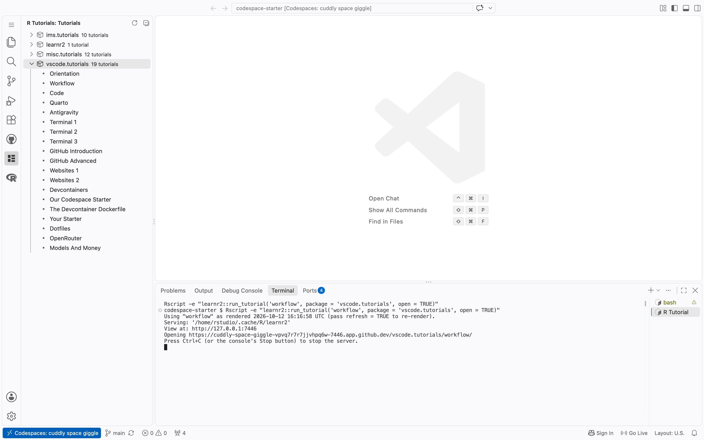{width=90%}

###

The tutorial itself runs in an R process displayed in a terminal whose tab is named something like **R Tutorial**. Leave that terminal alone. Closing it stops the tutorial.

###

VS Code is split into a few parts:

* The **Activity Bar** is the row of small icons on the far left.
* The **Side Bar** is the box next to those icons. Click the Explorer icon to see your files. (In `codespace-starter` the Explorer looks almost empty --- only files you made yourself, like `presidents.txt` from Orientation, show up --- because the folder's own plumbing is hidden on purpose.) Click the Source Control icon to work with Git.
* The **Editor** is the big space in the middle. This is where you read and change files.
* The **Panel** is usually at the bottom. Its most important view is the **Terminal**, where you type commands.
* The **Status Bar** is the thin bar across the very bottom.

Here is the whole VS Code window. The Explorer Side Bar is on the left. The Editor is in the middle. The Panel, with the Terminal view selected, is across the bottom.

###

{width=90%}

You can make a part bigger or smaller by dragging its edge. If you close something, you can open it again by clicking its icon.

###

Most questions ask for you to **CP/CR** --- **C**opy/**P**aste the **C**ommand and **R**esponse --- as you have seen in earlier tutorials.

Your answer may look a little different from ours. Usernames and version numbers vary. The **prompt** --- the text the Terminal prints while it waits for you to type --- is the name of the current folder, a space, and a `$`, like `codespace-starter $`. `codespace-starter` sets that prompt, so every bash Terminal you open in this Codespace has it.

## The Terminal

The Terminal is a place where you type commands and the computer answers. You ran several of this section's commands --- `pwd`, `ls`, `ls -a` --- in Orientation. Running them again puts them in your fingers, not your notes.

###

First, make sure you can see the Terminal. It lives in the Panel across the bottom of the window. If it is not there, open it from the menu bar: click **View**, then choose **Terminal**.

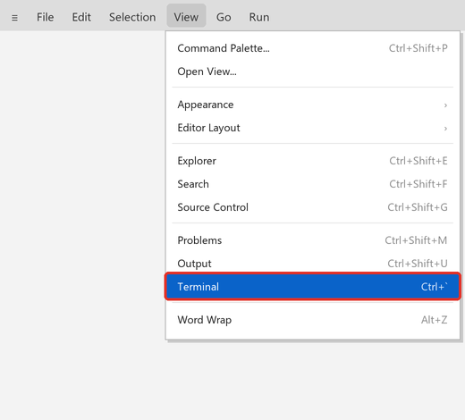{width=90%}

You can also open it with the keyboard shortcut shown in the menu, `` Ctrl + ` `` (the key just above `Tab`).

###

You want a **bash** Terminal. The Codespace already opened one for you: the terminal showing the READY banner, which you met in Orientation. Use it. In the picture below, the **TERMINAL** view is selected, the **bash** tab sits at the right side of the Panel, and the `+` and down-arrow buttons for opening more terminals are just beside it. If you ever need another bash Terminal, click the `+`.

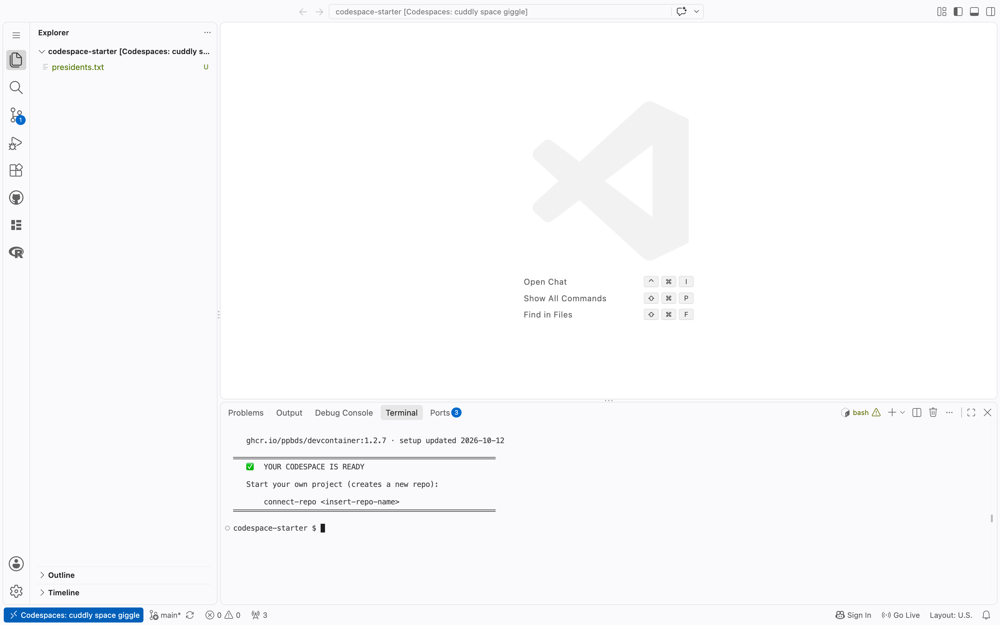{width=90%}

Once this tutorial is running, the Panel shows two terminal tabs: **bash**, where you will work, and **R Tutorial**, which is busy running this tutorial. Leave the **R Tutorial** tab alone.

### Exercise 1

In the bash Terminal, type `pwd` and press `Enter`. You should see something like the picture below. Then CP/CR.

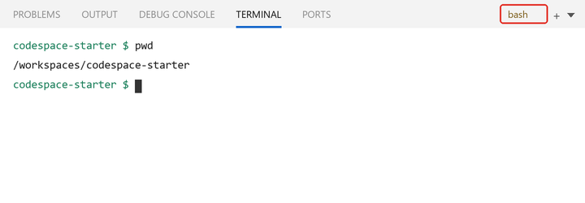{width=90%}

```{r}
#| label: the-terminal-1
#| echo: false
learnr2::question(
  "In the bash Terminal, type pwd and press Enter. You should see something like the picture below. Then CP/CR.",
  type = "reflection",
  show_text = FALSE
)
```

###

```{.output}
codespace-starter $ pwd
/workspaces/codespace-starter
codespace-starter $
```

`pwd` means **print working directory**. It tells you which folder you are in. Right now, you should be in the `codespace-starter` folder.


### Exercise 2

Options change what a command does. Many commands also have a `--help` option that explains how they work without doing anything.

Run:

```bash
ls --help
```

CP/CR. The response is long, so paste just the first several lines.

```{r}
#| label: the-terminal-2
#| echo: false
learnr2::question(
  "CP/CR. The response is long, so paste just the first several lines.",
  type = "reflection",
  show_text = FALSE
)
```

###

The beginning should look like:

```{.output}
codespace-starter $ ls --help
Usage: ls [OPTION]... [FILE]...
List information about the FILEs (the current directory by default).
Sort entries alphabetically if none of -cftuvSUX nor --sort is specified.
```

`--help` prints a description and never changes your files. Almost every command you meet has a `--help` option.

### Exercise 3

Let's make a file by hand. Open the Application Menu from the three horizontal bars at the top left of the VS Code window. Choose `File -> New File...`.

<!-- DK: This image shows Text Document highlighted in blue instead of R Document. -->

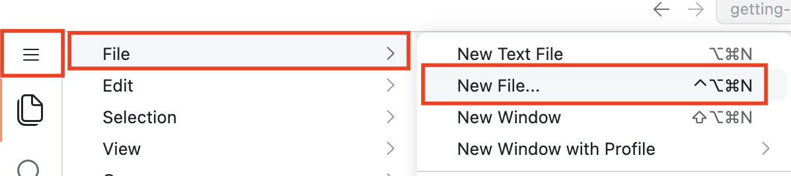{width=90%}

When VS Code asks what kind of file to make, choose **R Document**.

{width=90%}

Type this single line into the new file:

```r
1 + 2
```

Add a blank line after it.

Save the file as `warmup.R` at the top level of `codespace-starter`. Press `Cmd/Ctrl + S`. In the Save dialog, make sure the path ends in `codespace-starter/warmup.R`, then press **OK**. A black dot on an Editor tab means the file has unsaved changes. Saving makes the dot disappear. (The Codespace also saves files by itself after a short pause, so the dot may vanish before you press anything.) `warmup.R` now appears in the Explorer.

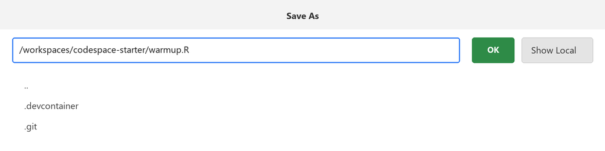{width=90%}

VS Code sometimes suggests a lowercase `.r` suffix. R accepts either, but the next step needs the file named exactly `warmup.R`, with a capital `R`.

In the bash Terminal, run `Rscript warmup.R`. CP/CR.

```{r}
#| label: the-terminal-3
#| echo: false
learnr2::question(
  "In the bash Terminal, run Rscript warmup.R. CP/CR.",
  type = "reflection",
  show_text = FALSE
)
```

###

```{.output}
codespace-starter $ Rscript warmup.R
[1] 3
codespace-starter $
```

An R script is a text file containing R commands. `Rscript warmup.R` asks R to run every command in the file. The code stays in the script after it runs, so you can look at it, change it, and run it again.

### Exercise 4

Run `ls`. (Again, this is the lowercase letter `L` followed by the lowercase letter `S`.)

CP/CR.

```{r}
#| label: the-terminal-4
#| echo: false
learnr2::question(
  "Run ls. (Again, this is the lowercase letter L followed by the lowercase letter S.) CP/CR.",
  type = "reflection",
  show_text = FALSE
)
```

###

```{.output}
codespace-starter $ ls
warmup.R
codespace-starter $
```

`warmup.R` lives inside the `PPBDS/codespace-starter` working copy, which you do **not** own. You cannot save your work to that repository on GitHub. Closing the browser does not erase the file, but deleting the Codespace will. You need a repository that belongs to you.

## Git and GitHub

**Git** is a tool that keeps a history of your files. A **repository**, or **repo**, is a folder that Git is watching. **GitHub** is a website that keeps a copy of your repo online, so your work is safe and shareable.

The `codespace-starter` folder you have been working in is one repo, but it belongs to the course, not to you. In this section you will create your own repo, named `workflow`, and connect to it.

We give you a shortcut for this called `connect-repo`. It signs you in to GitHub, creates (or finds) a repo with the name you give it, and opens that repo's folder.

### Exercise 1

<!-- DK: Split this up into several questions? Add an image for every step, including messages from GitHub? -->

In the bash Terminal, run:

```bash
connect-repo workflow
```

This is the command the READY banner has been suggesting since the Codespace started.

###

The first thing `connect-repo` does is sign you in to GitHub. You should see:

```{.output}
codespace-starter $ connect-repo workflow
→ Sign in to GitHub: authorize in the browser/code prompt, then come back here.
? Authenticate Git with your GitHub credentials? (Y/n) 
```

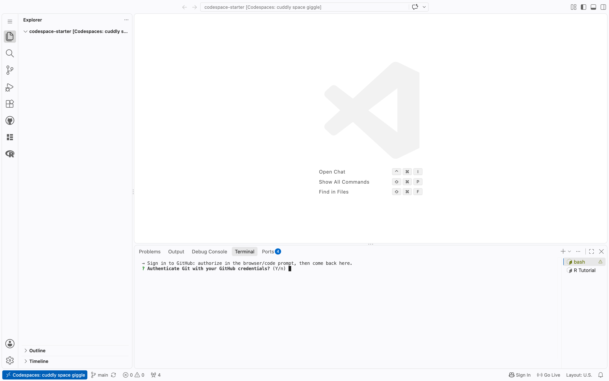{width=90%}

Press `Enter` to answer `Y`. A one-time code appears:

```{.output}
? Authenticate Git with your GitHub credentials? Yes

! First copy your one-time code: 7A6F-7093
Press Enter to open https://github.com/login/device in your browser... 
```

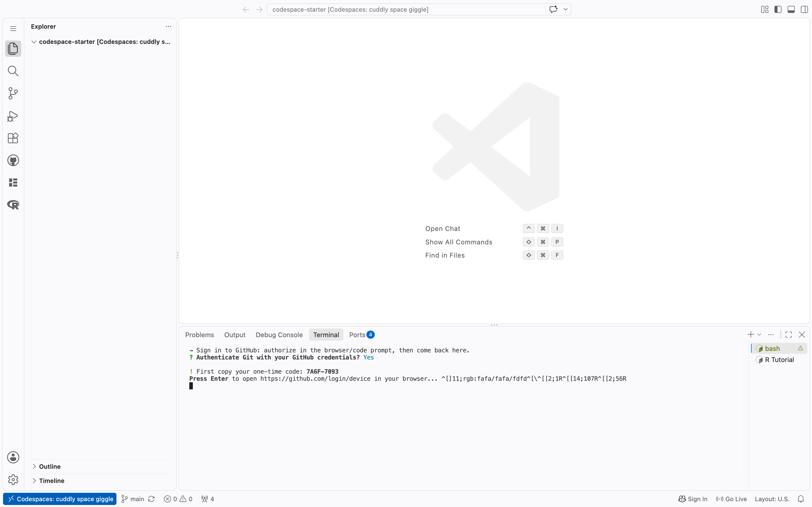{width=90%}

Your code will be different from this one, and different each time. Copy the entire code, dash and all. You will paste the whole thing in at once when GitHub asks for it. (Some junk characters may appear after the "Press Enter" line. Ignore them.)

###

Press `Enter`. A new browser tab opens on GitHub's device page.

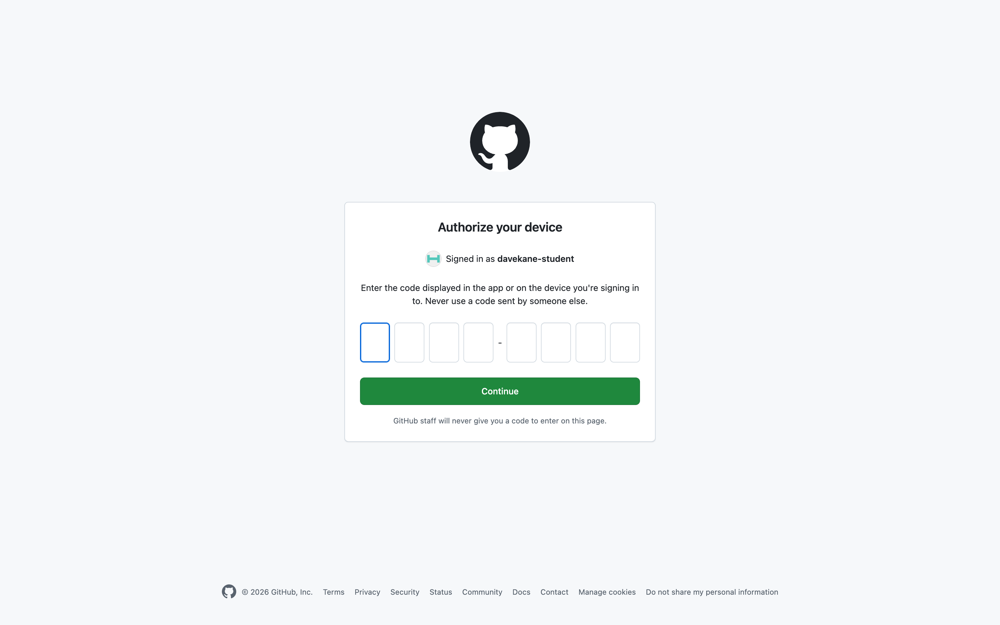{width=90%}

Paste your code into the boxes and press **Continue**. If GitHub asks you to authorize, do so. Then return to the VS Code tab.

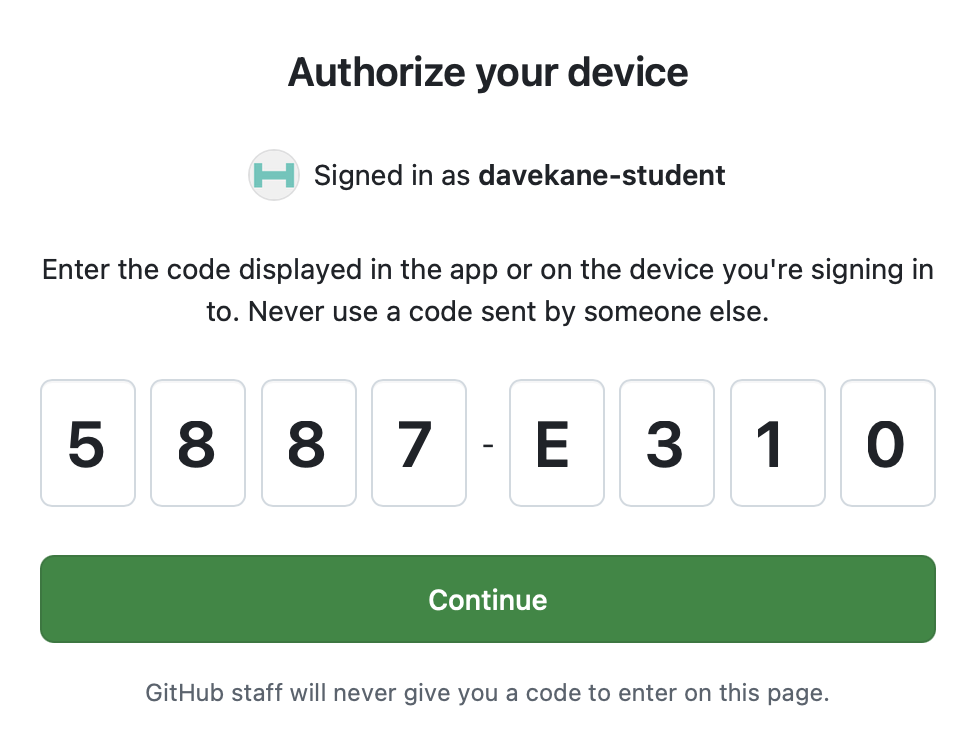{width=90%}

###

Back in the Terminal, `connect-repo` finishes its work:

```bash
✓ Created repository davekane-student/workflow on github.com
  https://github.com/davekane-student/workflow
→ Added AGENTS.md (how AI assistants work with you in this course). Re-run with --no-agents to skip.

   ✅  Connected: /workspaces/workflow  →  https://github.com/davekane-student/workflow

workflow $ 
```

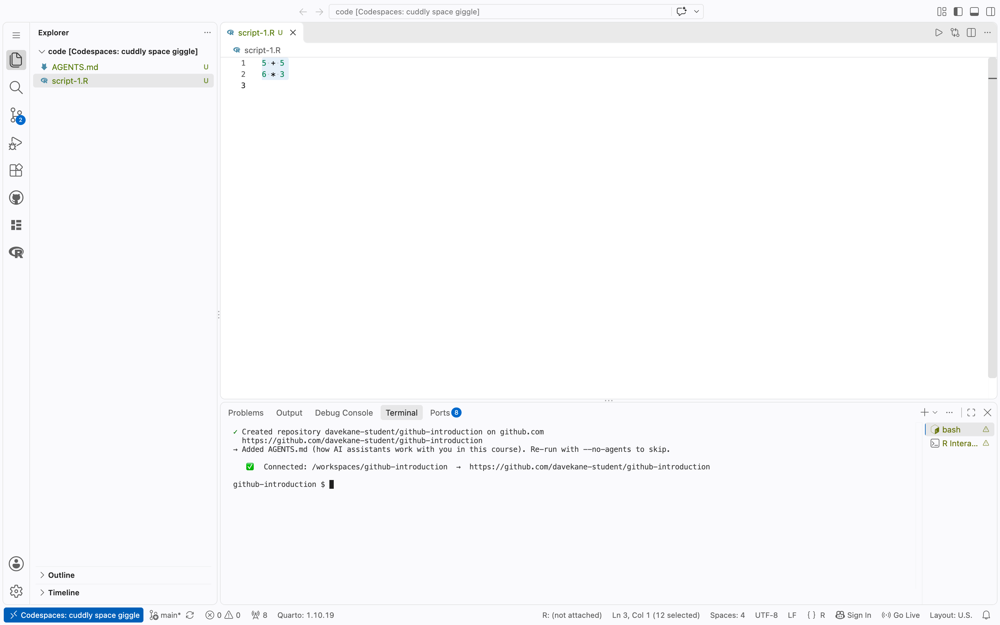{width=90%}

(The picture was taken for a repo with a different name. Yours says `workflow`.) The prompt on the last line has changed from `codespace-starter $` to `workflow $`. `connect-repo` created the repo on GitHub, made a folder for it at `/workspaces/workflow`, and then restarted the shell in this terminal inside that folder.

###

What happens next takes one of two forms. Both are normal.

**Most of the time, the window switches to the new folder by itself.** A "Restricted Mode" bar appears at the top, and VS Code asks, "Do you trust the authors of the files in this folder?" Click **Trust Folder & Continue**.

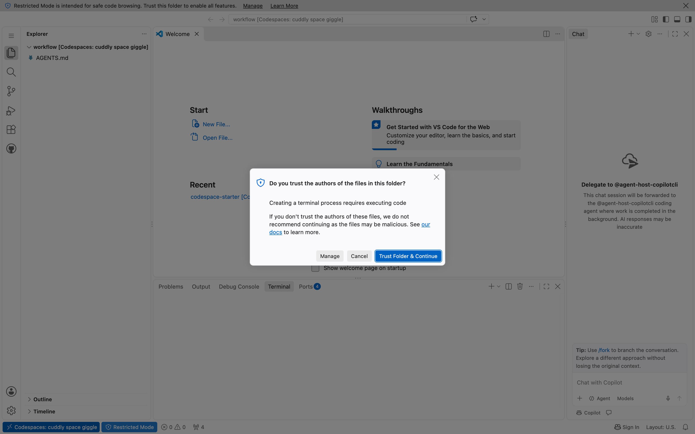{width=90%}

VS Code then rebuilds itself around `/workspaces/workflow`. The old terminals, including **R Tutorial**, vanish from the Panel. A Welcome tab flashes and closes. The Chat side bar reopens. A fresh, single **bash** terminal appears, already at `workflow $`. The Explorer now shows `AGENTS.md`. The process serving this tutorial survives the switch, so this browser tab keeps working even though the **R Tutorial** terminal is gone.

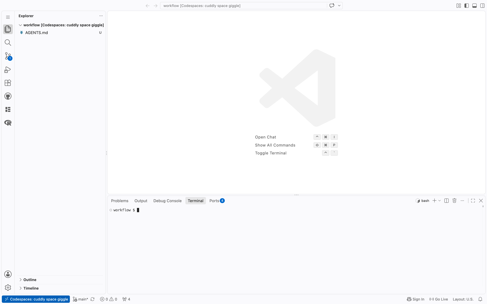{width=90%}

**Sometimes nothing switches.** The prompt says `workflow $`, but the Explorer still says `CODESPACE-STARTER`. Open the folder yourself: from the Application Menu choose `File -> Open Folder...`, type `/workspaces/workflow` in the box, and press **OK**. Click **Trust Folder & Continue** when asked. The same rebuild follows.

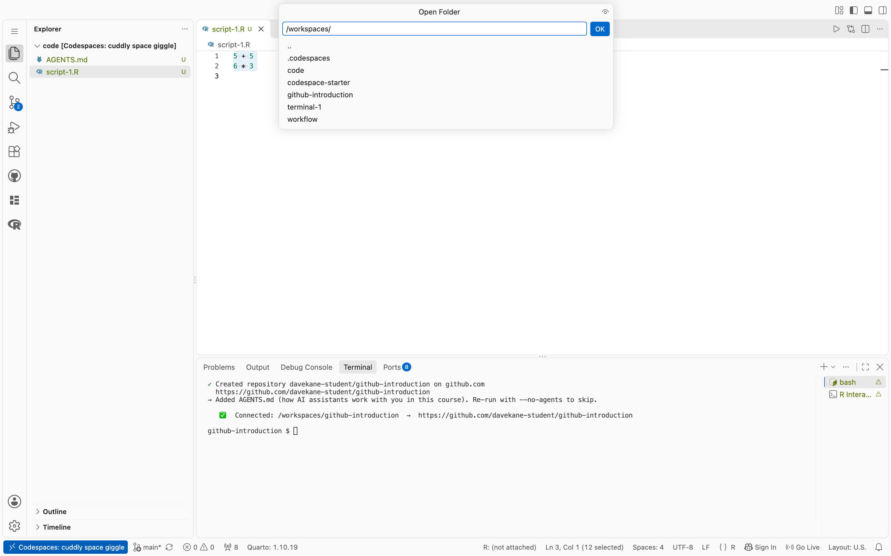{width=90%}

###

Run `ls`. CP/CR.

```{r}
#| label: git-and-github-1
#| echo: false
learnr2::question(
  "In the bash Terminal, run connect-repo workflow. When asked whether to authenticate Git with your GitHub credentials, press Enter to answer Y. Copy the one-time code that appears, dash and all, then press Enter to open https://github.com/login/device in your browser. Paste the code into the boxes, press Continue, authorize if GitHub asks, and return to the VS Code tab. connect-repo creates the repo on GitHub, makes a folder for it at /workspaces/workflow, and restarts the shell in that folder, so the prompt changes from codespace-starter $ to workflow $. Most of the time the window then switches to the new folder by itself; click Trust Folder & Continue when VS Code asks whether you trust the authors of the files in this folder. If nothing switches and the Explorer still says CODESPACE-STARTER, open the folder yourself: from the Application Menu choose File -> Open Folder..., type /workspaces/workflow in the box, press OK, and click Trust Folder & Continue when asked. Then run ls. CP/CR.",
  type = "reflection",
  show_text = FALSE
)
```

###

```{.output}
workflow $ ls
AGENTS.md
workflow $ 
```

The result of `connect-repo` is a GitHub repository named `workflow` and a folder at `/workspaces/workflow`.

###

The two folders now sit beside each other:

```{.output}
/workspaces/codespace-starter
/workspaces/workflow
```

The first supplied the Codespace and the tutorial. The second is yours and will hold your work. 

### Exercise 2

If you need a new bash Terminal, click the `+` at the right of the Panel. It starts in `workflow`, not in `codespace-starter`: `connect-repo` arranged for every new terminal to begin in your repo. Run `pwd`. CP/CR.

```{r}
#| label: git-and-github-2
#| echo: false
learnr2::question(
  "If you need a new bash Terminal, click the + at the right of the Panel. Run pwd. CP/CR.",
  type = "reflection",
  show_text = FALSE
)
```

###

```{.output}
workflow $ pwd
/workspaces/workflow
workflow $
```

###

If your result still ends in `codespace-starter`, that terminal was never moved. Run `cd /workspaces/workflow`, or open a new bash Terminal with the `+`, which starts in the right place. If the Explorer still shows `CODESPACE-STARTER`, that is a separate problem: use `File -> Open Folder...` to open `/workspaces/workflow`, as described above, then click **Trust Folder & Continue**. The reload may stop this tutorial. Restart it the same way you started it: click **R Tutorials** in the Activity Bar, find this tutorial under **vscode.tutorials**, and click the arrow to launch it. All of your saved answers will still be there.

### Exercise 3

Run `ls -a`. CP/CR.

```{r}
#| label: git-and-github-3
#| echo: false
learnr2::question(
  "Run ls -a. CP/CR.",
  type = "reflection",
  show_text = FALSE
)
```

###

```{.output}
workflow $ ls -a
.  ..  AGENTS.md  .git
workflow $ 
```

The hidden `.git` directory is what defines a Git repository. Git fills it with your work as you proceed. You never work directly in, or even examine, the `.git` folder.

`AGENTS.md` is a plain-text file that `connect-repo` copies into every new repo. GitHub Copilot and the command-line agents (`agy`, `claude`, and the rest) read it from the repo root and follow its rules: take short, narrated steps, ask once for permission, and do not solve whole worksheets for you. Read it with `cat AGENTS.md` in the bash Terminal. If you would rather not have it, `connect-repo --no-agents <name>` skips it next time. Otherwise leave it alone. It goes into your first commit along with everything else.

### Exercise 4

Check your repository on GitHub.

Open a new browser tab and go to [github.com](https://github.com). Sign in with the same account if you are asked. Click your profile picture in the top-right corner, choose **Your repositories**.

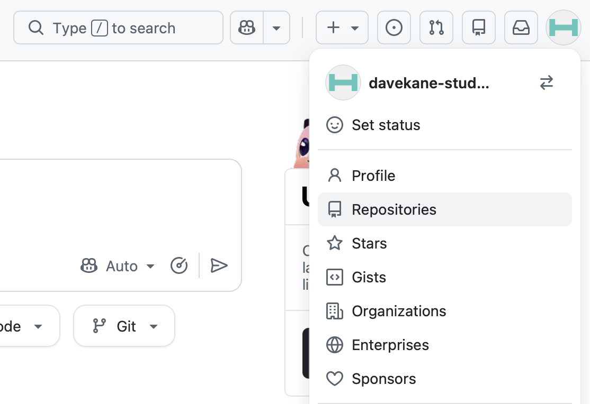{width=90%}

###

Find the repo named **workflow**. Click it.

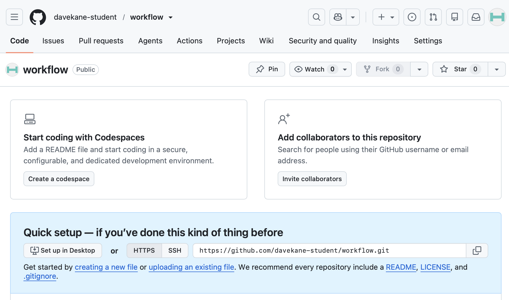{width=90%}

This is your repository's page. Your username appears in the address bar, like `github.com/your-username/workflow`, so the repository belongs to **you**. It is empty because you have not committed anything.

###

Go back to the bash Terminal in your Codespace and run `git status`. CP/CR.


```{r}
#| label: git-and-github-4
#| echo: false
learnr2::question(
  "Go back to the bash Terminal in your Codespace and run git status. CP/CR.",
  type = "reflection",
  show_text = FALSE
)
```

###

```{.output}
workflow $ git status
On branch main

No commits yet

Untracked files:
  (use "git add <file>..." to include in what will be committed)
        AGENTS.md

nothing added to commit but untracked files present (use "git add" to track)
workflow $ 
```

`On branch main` and `No commits yet` mean this repo has a branch called `main` but no history yet. `Untracked files` lists files that sit in the folder but that Git has not been told to watch --- right now, just `AGENTS.md`. Your first commit will change both.

## Script 1: GitHub Copilot

You met **GitHub Copilot** --- the AI assistant built right into VS Code --- in the Orientation tutorial, where it wrote small files for you. We use Copilot here because it is always available and works out of the box.

If the Chat window --- normally the Secondary Side Bar on the right of the VS Code main screen --- is not open, open it now by clicking the "Toggle Secondary Side Bar" icon in the top-right corner of the window. 

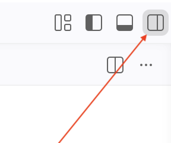{width=90%}


Before starting any AI agent, check that its Terminal or workspace is `/workspaces/workflow`. An agent reads and writes files relative to the folder it starts in. An agent accidentally started in `codespace-starter` can create files that never show up in your `workflow` Explorer and never reach your repository.


### Exercise 1

Give Copilot this prompt, adjusting the wording if needed:

> Create an R script named script-1.R. It should add the integers from 1 through 10 and print the result. Run the script with Rscript and tell me the result. Do not install any packages.

Review and approve the creation of `script-1.R` and the `Rscript` command one at a time. Then, in the bash Terminal, run:

```bash
cat script-1.R
```

`cat` prints a file's contents in the Terminal. It is the quickest way to show us --- and any AI you are working with --- exactly what is in a file.

CP/CR.

```{r}
#| label: script-1-github-copilot-1
#| echo: false
learnr2::question(
  "cat prints a file's contents in the Terminal. It is the quickest way to show us -- and any AI you are working with -- exactly what is in a file. CP/CR.",
  type = "reflection",
  show_text = FALSE
)
```

###

Your answer will vary, but the sum should be `55` and `script-1.R` should appear in Explorer. One reasonable answer is:

```{.output}
numbers <- 1:10
total <- sum(numbers)
print(total)
```

### Exercise 2

The Copilot interface changes all the time, so these images may be out of date. The Explorer probably shows something like this:

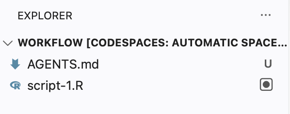{width=90%}

###

The black dot surrounded by the square next to `script-1.R` indicates a file that has been created/edited by an AI but not yet saved. To save it, you will need to take some action, like selecting "Keep":

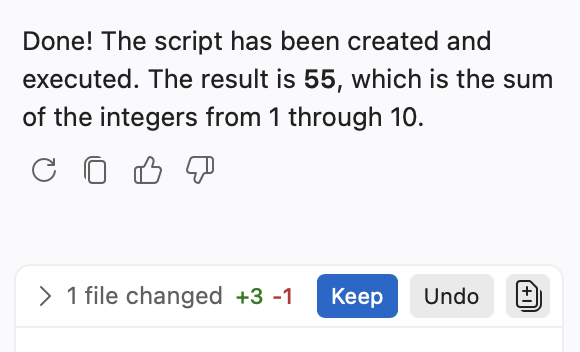{width=90%}

###

Doing so makes the black-dot-square disappear. It should be replaced with a `U` to indicate that the file is **untracked** by Git. 

In the bash Terminal, run `ls`. CP/CR.


```{r}
#| label: script-1-github-copilot-2
#| echo: false
learnr2::question(
  "In the bash Terminal, run ls. CP/CR.",
  type = "reflection",
  show_text = FALSE
)
```

###

```{.output}
workflow $ ls
AGENTS.md  script-1.R
workflow $ 
```

The file is saved, but Git will not track it until you commit it.

### Exercise 3

Finish the script with a plot. Ask Copilot:

> Update script-1.R so that it keeps the addition example and then makes a beautiful plot using the diamonds data set from ggplot2. Use library(tidyverse) and no other library calls or data sets. Save the plot as diamonds-1.png. Run the script and fix any errors. Do not install packages.

You should see something like:

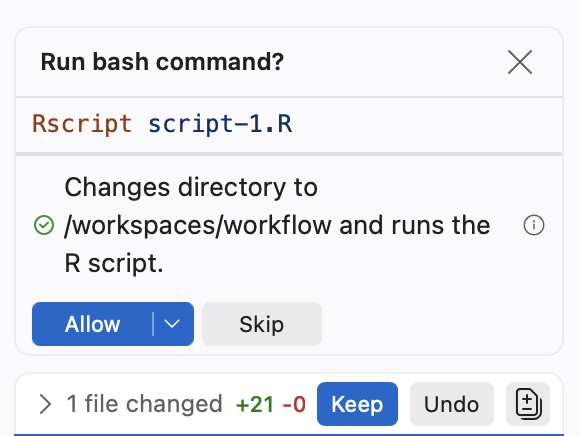{width=90%}


Keep the changes and allow the agent to run the script. Then run the following in the bash Terminal and CP/CR:

```bash
cat script-1.R
```

```{r}
#| label: script-1-github-copilot-3
#| echo: false
learnr2::question(
  "Finish the script with a plot. Ask Copilot: Update script-1.R so that it keeps the addition example and then makes a beautiful plot using the diamonds data set from ggplot2. Use library(tidyverse) and no other library calls or data sets. Save the plot as diamonds-1.png. Run the script and fix any errors. Do not install packages. Keep the changes and allow the agent to run the script. Then, in the bash Terminal, run cat script-1.R. CP/CR.",
  type = "reflection",
  show_text = FALSE
)
```

###

Here is one possible answer:

```r
library(tidyverse)

numbers <- 1:10
total <- sum(numbers)
print(total)

diamonds_plot <- diamonds |>
  count(cut) |>
  ggplot(aes(x = cut, y = n, fill = cut)) +
  geom_col(show.legend = FALSE) +
  labs(
    title = "Diamonds at Every Level of Cut",
    subtitle = "Counts in the ggplot2 diamonds data set",
    x = NULL,
    y = "Number of diamonds"
  ) +
  theme_minimal(base_size = 14)

ggsave("diamonds-1.png", diamonds_plot, width = 8, height = 5)
```

This solution loads only **tidyverse**, uses only `diamonds`, assigns the plot to an object, and saves a PNG. Click `diamonds-1.png` in Explorer to inspect your own result.

### Exercise 4

**Git** records a snapshot of your files, called a **commit**. A **push** sends your commits up to GitHub. Do both through the Source Control view.

Click the Source Control icon (the branching icon) in the Activity Bar on the left. Your new files appear under **Changes**. (`AGENTS.md` is there too. It belongs in this first commit.) Each one has a `U`, which means **untracked**: Git can see the file, but it is not yet part of any commit.

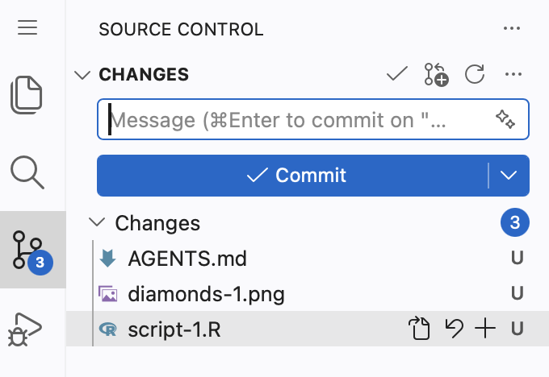{width=90%}

Now commit and push:

1. Review the files under **Changes**. Do not commit secrets, tokens, or files you do not understand.
2. Type `Add script-1 and diamonds plot` as the commit message.
3. Press **Commit**. The Codespace is set up to include all the displayed changes.
4. Press **Publish Branch** to push the commit to GitHub.

###

When the push finishes, open your `workflow` repository on GitHub and refresh the page. It looks like this.

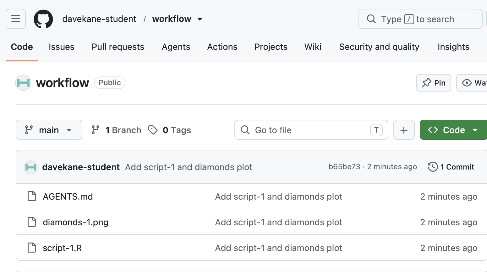{width=90%}

###

From the bash Terminal, run `git log`. CP/CR.    

```{r}
#| label: script-1-github-copilot-4
#| echo: false
learnr2::question(
  "From the bash Terminal, run git log. CP/CR.",
  type = "reflection",
  show_text = FALSE
)
```

###

You should see at least:

```{.output}
workflow $ git log
commit b65be73dbdf149c48b4cbc177e9d0a996caa6797 (HEAD -> main, origin/main)
Author: davekane-student <dave.kane+student@gmail.com>
Date:   Thu Aug 13 05:44:10 2026 +0000

    Add script-1 and diamonds plot
workflow $ 
```

The Codespace is where you work. The GitHub repo is where you keep and share it. If your computer stopped working right now, your commit would still be safe on GitHub.

###

Copilot is only one option. The Codespace may also provide command-line agents from Google, OpenAI, Anthropic, and other providers. These tools have different interfaces, models, limits, and account requirements, but the core workflow is the same:

1. Describe the outcome you want.
2. Let the AI inspect the relevant files.
3. Review proposed changes and commands.
4. Run or render the result.
5. Inspect the result and ask for revisions.

## Script 2: AI agnostic

From this point forward, we are **AI agnostic**. "Ask AI" means use whichever AI you prefer — Copilot, Antigravity, or any other agent the Codespace provides.

### Exercise 1

Use any AI to complete this task:

> Create script-2.R. Choose ten positive numbers, store them in a vector, and print their sum and mean. Run the script with Rscript and fix any errors. Do not install packages.

In the bash Terminal, run `cat script-2.R`. CP/CR.

```{r}
#| label: script-2-ai-agnostic-1
#| echo: false
learnr2::question(
  "In the bash Terminal, run cat script-2.R. CP/CR.",
  type = "reflection",
  show_text = FALSE
)
```

###

One possible answer is:

```{.output}
numbers <- c(5, 12, 8, 23, 15, 7, 19, 11, 31, 9)

sum_result <- sum(numbers)
mean_result <- mean(numbers)

print(paste("Vector:", paste(numbers, collapse = ", ")))
print(paste("Sum:", sum_result))
print(paste("Mean:", mean_result))
```

The particular numbers do not matter. What matters is a saved script that runs successfully with `Rscript`.

### Exercise 2

Finish the second script with another plot. Ask your AI:

> Update script-2.R so that it deletes the number example and then makes a beautiful plot using the diamonds data set from ggplot2. Use library(tidyverse) and no other library calls or data sets. Make a different kind of plot from the one in script-1.R, save it as diamonds-2.png, run the script, and fix any errors. Do not install packages.

Your screen can become confusing:

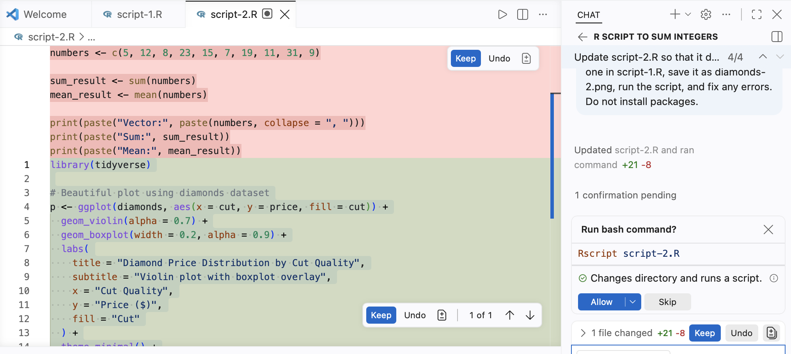{width=90%}

* The black-dot-square next to `script-2.R` in the Explorer view indicates a file that has been created/edited by an AI but not yet saved. 

* The black-dot-square also appears next to `script-2.R` in the name of the tab in the Editor.

* To save `script-2.R`, select "Keep". VS Code offers three different "Keep" buttons, all of which do the same thing.

* The red shaded portion of `script-2.R` in the Editor indicates code that the AI wants to remove. The green shaded portion indicates code that the AI wants to add. 

* Click any one of the "Keep" buttons to save the file. Both black-dot-squares should disappear. The one in the Explorer should be replaced with a `U` to indicate that the file is **untracked** by Git.

* The AI is asking your permission to run the script using `Rscript script-2.R` in the bash Terminal. You can approve or reject that command. If you approve, the AI will run the script and show you the result. If you reject it, you can run the script yourself in the bash Terminal. Experienced users tell the AI to stop asking permission for every small step.

###

In the bash Terminal, run `cat script-2.R`. CP/CR.

```{r}
#| label: script-2-ai-agnostic-2
#| echo: false
learnr2::question(
  "In the bash Terminal, run cat script-2.R. CP/CR.",
  type = "reflection",
  show_text = FALSE
)
```

###

Here is one possible plot:

```r
library(tidyverse)

diamonds_plot <- diamonds |>
  slice_sample(n = 5000) |>
  ggplot(aes(x = carat, y = price, color = cut)) +
  geom_point(alpha = 0.35, size = 1.2) +
  scale_y_continuous(labels = scales::label_dollar()) +
  labs(
    title = "Price Rises Rapidly with Diamond Weight",
    subtitle = "A random sample of 5,000 diamonds, colored by cut",
    x = "Weight (carats)",
    y = "Price",
    color = "Cut"
  ) +
  theme_minimal(base_size = 14) +
  theme(legend.position = "bottom")

ggsave("diamonds-2.png", diamonds_plot, width = 8, height = 5)
```

`slice_sample(n = 5000)` plots a random 5,000 of the 53,940 diamonds, which keeps the scatterplot from turning into a solid blob.

### Exercise 3

Through the Source Control view, commit your new files with the message `Add script-2 and second diamonds plot`.

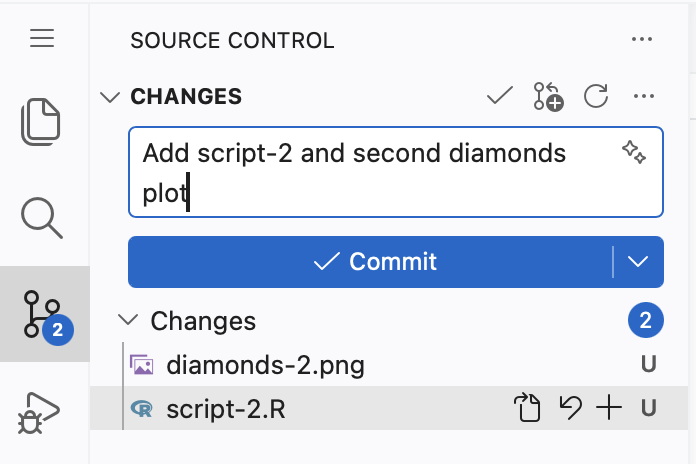{width=90%}

Then press **Sync Changes 1** to push.

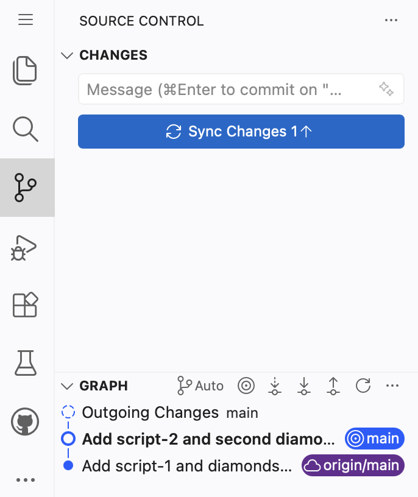{width=90%}

The `1` in "Sync Changes 1" means you have one commit to push. The first push of a repo is labeled "Publish Branch". Every later push is "Sync Changes".

###

In the bash Terminal, run `git log -1`. CP/CR.

```{r}
#| label: script-2-ai-agnostic-3
#| echo: false
learnr2::question(
  "In the bash Terminal, run git log -1. CP/CR.",
  type = "reflection",
  show_text = FALSE
)
```

###

Your answer should look something like:

```{.output}
workflow $ git log -1
commit 757d4dfd030339a67d164b0c846c5152c559a544 (HEAD -> main, origin/main)
Author: davekane-student <dave.kane+student@gmail.com>
Date:   Thu Aug 13 06:21:02 2026 +0000

    Add script-2 and second diamonds plot
workflow $ 
```

`git log -1` shows only the last commit. When its top line shows both `main` and `origin/main`, your Codespace and GitHub agree on the latest commit, so your push worked.

## Summary

You used the major parts of VS Code, practiced bash commands, created and connected a repository, ran R scripts, directed AI agents, inspected their work, made plots, and used Git and GitHub.

From now on, begin course work with the same routine:

1. Open a Codespace on `main` from `PPBDS/codespace-starter`.
2. Start the tutorial from the R Tutorials panel in the Activity Bar.
3. When the tutorial tells you to, run `connect-repo` to create and connect to a new repo, named after the tutorial you are doing.
4. Start whichever AI you want to use. GitHub Copilot is always available, but you may prefer another agent. Review everything it proposes before you approve it.

Future tutorials will often say only "create and connect to a repo," "ask AI," "run," or "commit and push." Those phrases mean what you did here. Whichever AI you use, always review its results.

### Exercise 1

Copy and paste the URL for your `workflow` repository. This is the last question in the tutorial.

```{r}
#| label: summary-1
#| echo: false
learnr2::question(
  "Copy and paste the URL for your workflow repository. This is the last question in the tutorial.",
  type = "reflection",
  show_text = FALSE
)
```

###

```{.output}
https://github.com/davekane-student/workflow
```

The `github.com/...` URL is the repository. A `github.dev` or `githubpreview.dev` URL points to a temporary working interface, not the repository page you should submit.

## Download answers

```{r}
#| label: download-answers-1
#| echo: false
learnr2::question(
  "How many minutes, approximately, did it take you to complete this
  tutorial? For example, an hour and a half would be 90 minutes.",
  type = "reflection_editable",
  validate = "integer"
)
```

###

```{r}
#| label: download-answers-2
#| echo: false
learnr2::download_answers_button(filename_prefix = "workflow")
```
